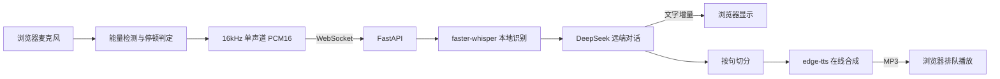

# Python 语音助手：本地识别 + DeepSeek + edge-tts

当前工作目录统一为 `F:\wkspace\local_voice_chat`。音色改进见 [音色升级方案](音色升级方案.md)。

## 工具调用

助手现在可以查询天气：问“北京明天下雨吗”，模型会调用 `get_weather`，查到后用口语回答。闲聊和常识问题不调用工具。

天气数据来自 Open-Meteo，无需 Key；查询的地点会发给该服务。不说地点时默认查合肥。要换城市，启动前设置 `VOICE_DEFAULT_CITY`；设为空字符串时，助手会先问你在哪：

```powershell
$env:VOICE_DEFAULT_CITY = '苏州'
./start.ps1
```

查询较慢时会播放“我查一下”。每个音色在服务启动后第一次查询时不播，后台缓存好后才开始播放。设计说明见 [阶段 2 解析](docs/阶段2-工具循环解析.md)。

## 操作确认

危险操作执行前会先问你。问题播完后，说“确定执行”才会执行，也可以点页面上的按钮。单独的“确认”也算同意，但识别率很低，不建议用。说“取消”、20 秒没回答、打断或说别的内容，都不会执行。按键说话模式下只能点按钮。

所有写操作都记录在本机的 `data/agent.db`。设计说明见 [阶段 3 解析](docs/阶段3-权限与确认解析.md)。

## 持续监听

勾选页面上的“持续监听”后，不需要唤醒词：麦克风音频持续发给本机后端，由 Silero VAD（`turn_detector.py`，模型随 faster-whisper 自带）判断说话的开始和结束，每句话说完后约0.6秒交给 Whisper 识别并回答。周围人说话和电视声也会被回答并发送给 DeepSeek，不用时请取消勾选。

页面状态：待命中、聆听中、识别中、思考中、播报中、已暂停。声音被丢弃时会显示原因（没听清、喇叭声、太短）。音量条下方的“语音概率”是 Silero 的实时输出，说话时应明显超过0.40；没超过就不会开始聆听，可据此排查麦克风。音量高而语音概率接近0，说明麦克风收到的主要是噪声。

点“麦克风诊断”并持续说话，页面会逐一测试每个麦克风和三种浏览器处理模式（约3.5秒一项），列出语音占比、概率、音量和听到的文字，并自动选用听到人声最多的组合。录音只在本机分析，不保存。

播报时打断的流程：

1. 听到声音，播报音量压低。
2. 人声持续0.5秒，暂停播放，同时用 Whisper 确认。
3. 确认是至少2个字的人话：丢弃这段回复，这句话说完后作为新问题回答。“停”“别说了”这类话只停止，不发给 DeepSeek。
4. 只是噪声或喇叭声：从暂停处继续播放。

喇叭声通过与刚播放的那几段文字比对来过滤，外放时仍可能误判，建议戴耳机。音频只在本机处理，只有识别出的文字会发给 DeepSeek。监听只占 CPU，不占 GPU。

## 克隆语音提速与显存限制（2026-11-05）

同一段8小段、约17秒的回复，在 GTX 1060 6GB 上经真实 HTTP 服务实测：

| 指标 | 优化前 | 优化后 |
|---|---|---|
| 首段音频 | 6.2 秒 | 2.4 秒 |
| 段间静音合计 | 24.6 秒 | 0 秒 |
| 生成耗时 / 音频时长 | 2.3 | 约 0.9（短段）、约 0.7（长文本） |
| 192字文本的显存峰值 | 6006 MB | 约 4300 MB |
| 音色相似度（CAM++ 余弦） | 0.88 | 0.88 |

改动在 `cosy_accel.py` 和 `cosy_server.py`，不修改 `vendor/CosyVoice`：

- LLM 单步解码改为 CUDA Graph 回放，每 token 从 40 毫秒降到 16 毫秒，与原实现逐步对比一致；超长提示自动回退原路径。
- flow 模型只使用参考音频最后 5 秒，LLM 仍使用完整参考和文字。
- 单次推理最多80字，更长文本在服务内按标点切分，显存不再随文本长度增长。
- PyTorch 显存上限 3.7GB，避免占满 6GB。

可用环境变量调整：`COSY_FLOW_PROMPT_SECONDS`（默认5，0为使用完整参考；音色不像时可调大，但会变慢）、`COSY_VRAM_LIMIT_GB`（默认3.7）、`COSY_CUDA_GRAPH=0`（关闭 CUDA Graph）。

合成时 GPU 占用仍会接近满载，这是正常现象；浏览器或游戏同时占用 GPU 时余量会变小，短段之间仍可能有短暂停顿。

## 自定义音色卡顿优化（2026-11-05）

默认使用“短首句优先”（balanced）：DeepSeek 文字逐字显示，首段及后续所有语音段均不超过20字，优先在标点处切分。“好的。”等短开场会和后面的实质内容合并，不会单独抢先播报。文字继续生成时，TTS 后台线程已在合成首段；浏览器播放时，后台继续合成后续短段。分段队列不会阻塞文字流。浏览器保留250毫秒起播缓冲，连续音频使用同一播放时间线；打断后丢弃旧音频。

修正了上一版“只限制首句、后文整段合成”的问题：它可能先播两个字，再等待几十秒。当前限制每一次合成的长度，但小段也有推理开销，总合成时长不保证缩短；（当时 GPU 慢于播放速度，段间停顿已由上一节的提速解决。）截图对应的“好的 + 背影分析”长回复已加入回归测试，46项后端测试通过。

GTX 1060 6GB 此前实测同一段约30字文本：整段合成约10.41秒，产生5.72秒音频；流式热启动首段约5.39秒，但全部生成约15.66秒，音频块到达速度慢于播放速度。原来的整段合成减少了播放停顿，却增加首次等待，现改用短首句优先。以上为提速前的数据。追求更快聊天可在页面切换 edge-tts。

克隆服务启动时，会对当前已选的自定义参考音色做一次真实推理预热，完成后才开始监听端口。初始化开销转移到启动阶段；看到 `Voice warmup finished. Ready for chat.` 表示完成，`/health` 的 `warmup` 字段也会显示结果。它不会播放预热音频，不会调用 DeepSeek，也不会消除每次正常推理的耗时。更换参考录音后，第一次仍可能有额外开销。

更新后重启克隆服务 `./start_cosyvoice.ps1`（先在其终端 Ctrl+C 停止旧服务）；等待预热完成。在原聊天终端 Ctrl+C 停止后运行 `./start.ps1 -ClonePlayback balanced`，浏览器 Ctrl+F5 刷新，状态应显示“短首句优先”。此参数会覆盖原终端可能保留的 smooth 设置。

可选模式：`./start.ps1 -ClonePlayback smooth` 等整段合成后连续播放；`./start.ps1 -ClonePlayback stream` 使用原生流式合成，适合速度快于播放的设备。实测数据见 `outputs/stream_benchmark.json`，复测脚本为 `work/benchmark_stream.py`。

并发采用“异步网络 + 合成后台线程 + 浏览器播放”的流水线，同一个 GPU 的模型推理仍串行，避免 GTX 1060 上多路推理争抢显存。终端 `voice_latency` 日志只记录阶段和秒数：`asr_done`、`first_text`、`tts_start`、`llm_done`、`first_audio`、`all_audio_sent`，不输出 Key 或聊天正文；时间从服务收到该轮请求开始累计，可据此区分识别、模型回复和声音合成的等待。

本次预热后的真实对照：11字首句合成约5.90秒，输出2.24秒音频；48字完整回答合成约16.83秒，输出10.44秒音频。因此优先提交短首句可以更早开始播放，但这两项只测声音合成，不包括识别、DeepSeek 响应和浏览器起播。原始数据 `outputs/first_audio_benchmark.json`，复测 `work/benchmark_first_audio.py`。45项后端与3项前端测试通过；另外验证了首句合成在 DeepSeek 回复结束前启动，以及各模式文字内容完整、顺序一致。

已接入参考录音驱动的自定义声音：上传、选择和试听入口位于页面“音色设置”。独立模型服务的准备与启动见 [声音克隆使用说明](声音克隆使用说明.md)。

## 当前默认音色：edge-tts 晓晓女声

已接入在线合成，默认 `zh-CN-XiaoxiaoNeural`、语速 `-5%`、音高 `+0Hz`。回复文字会发送给微软在线语音服务，无需另填 TTS Key。在线失败会提示并保留文字，不会自动切回慧慧。

当前项目环境已安装依赖。停止原服务后，在同一 PowerShell 中运行 `./start.ps1`，再用 Ctrl+F5 刷新页面。页面应显示 `edge · zh-CN-XiaoxiaoNeural`。如曾设置旧音色，可在启动前明确覆盖：

```powershell
$env:VOICE_TTS_PROVIDER = 'edge'
$env:VOICE_TTS_VOICE = 'zh-CN-XiaoxiaoNeural'
$env:VOICE_TTS_RATE = '-5%'
$env:VOICE_TTS_PITCH = '+0Hz'
./start.ps1
```

试听样本已保存到 `outputs/zh-CN-XiaoxiaoNeural.mp3` 和 `outputs/zh-CN-YunxiNeural.mp3`。切换男声时把 `VOICE_TTS_VOICE` 改为 `zh-CN-YunxiNeural` 后重启。重新生成样本可运行 `.venv/Scripts/python.exe try_voice.py`，不需要 DeepSeek Key。

如需本地慧慧，设置 `VOICE_TTS_PROVIDER=windows` 和 `VOICE_TTS_VOICE=Microsoft Huihui Desktop` 后重启。

适合从后端开发切入语音应用的最小项目。浏览器负责录音与播放，Python 负责识别、对话编排和语音合成。对话使用 DeepSeek 远端 API，不依赖 Ollama；识别文字和最近六轮历史发送给 DeepSeek，录音不上传。API 调用需要联网，并按服务商规则计费。

## 处理链路



**本版是句末识别、半双工交互**：点击开始，说完停顿约 0.9 秒自动提交，再生成和播报回复。回复文字逐步到达，语音按句生成。支持点击打断或重新录音，但不包含持续监听、唤醒词、真正的流式 ASR 或模型级回声消除。

## 在当前 Windows 电脑启动

在本项目目录打开 PowerShell：

```powershell
# 当前交付目录已创建独立 Python 3.12 环境。
# 如果复制到其他电脑，先执行下面两行：
uv venv --python 3.12 .venv
uv pip install --python .venv/Scripts/python.exe -r requirements.txt

# 首次下载识别模型，约 150MB；后续不需重复下载
.venv/Scripts/python.exe prepare_asr.py

# 在 DeepSeek 平台申请 API Key，在当前终端设置后启动
$env:DEEPSEEK_API_KEY = Read-Host 'DeepSeek API Key'
$env:DEEPSEEK_MODEL = 'deepseek-flash'
./start.ps1
```

打开 [本地界面](http://127.0.0.1:8765)，先输入一句话验证 DeepSeek 对话，再允许麦克风权限测试录音。浏览器建议使用 Chrome 或 Edge。页面必须通过 localhost / 127.0.0.1 打开；直接双击 HTML 无法工作。

若脚本执行受本机策略限制，也可以直接执行：

```powershell
.venv/Scripts/python.exe -m uvicorn app:app --host 127.0.0.1 --port 8765 --ws-max-size 2097152
```

`speak.ps1` 同样受系统 PowerShell 策略约束；若被组织策略阻止，文字对话仍可使用，需要换用获准运行的 TTS 接入方式。

## 组件与配置

| 环节 | 本版实现 | 可替换方案 |
|---|---|---|
| 录音 | 浏览器 AudioWorklet，按实际采样率转换到 16kHz | ESP32 麦克风或 Python sounddevice |
| 说话结束判定 | 音量阈值 + 900ms 静音 | Silero VAD，改善噪声环境 |
| 识别 | faster-whisper base，CPU int8，中文 | 更大 Whisper 模型提高准确率；流式 ASR 用 sherpa-onnx 等 |
| 对话 | DeepSeek HTTPS / SSE 远端接口 | 其他兼容接口 |
| 合成 | edge-tts 晓晓在线语音，逐句 MP3 | 可显式选用 Windows 慧慧 |
| 播放 | Web Audio 队列 | 硬件端扬声器 |

通过环境变量修改配置，设置后重新启动后端：

```powershell
$env:DEEPSEEK_MODEL = 'deepseek-flash'
$env:DEEPSEEK_BASE_URL = 'https://api.deepseek.com'
$env:VOICE_ASR_MODEL = 'D:\models\your-faster-whisper-model'
$env:VOICE_TTS_PROVIDER = 'edge'
$env:VOICE_TTS_VOICE = 'zh-CN-XiaoxiaoNeural'
```

识别模型路径必须是 CTranslate2 / faster-whisper 格式的完整本地模型目录。服务器启用 `local_files_only=True`，不会在接收录音时自动下载。首次下载失败时，检查 Hugging Face 网络连通性，也可以在能下载的机器运行准备脚本后复制 `models/whisper-base`。

默认 edge-tts 在内存中收集每句 MP3，再发给浏览器播放；需要联网。仅在显式选用 Windows 引擎时才使用已安装的慧慧，并写入短暂的文本与 WAV 临时文件，完成或正常取消后删除。录音与会话历史在内存中处理，连接断开后历史清空。

## 值得理解的后端设计

1. 每次提交或打断递增 `request_id`。前端只接收当前编号，防止旧轮次迟到的文字与声音继续播放。
2. 打断会取消 HTTP 流、待合成队列和运行中的 TTS 子进程，并停止浏览器播放。CPU ASR 在工作线程执行，已开始的推理不能立即中止，但结果会丢弃，线程锁限制并行推理。
3. 文字生成与语音合成通过有界队列连接。按句合成，比等待整段答案完成再播报响应更早；并非音频逐帧生成。
4. 单次音频限制 30 秒，文字输入限制 2000 字；历史保留最近六轮完成的对话，控制资源开销。合成失败仍可显示文字。
5. 后端只绑定本机地址，WebSocket 校验页面 Origin。本项目是单用户学习原型，没有账户、会话持久化和生产部署所需的限流。

## 测试与排查

### Windows 出现 WinError 10054 与 Shutting down

当 Python 的 `asyncio.proactor_events._call_connection_lost` 在清理已被对端重置的连接时调用 socket shutdown，可能抛出10054。项目现在只将这一特定回调与错误码组合降为调试日志，其他网络错误和应用异常仍走原错误处理器；不会更换影响 Windows 子进程支持的事件循环。

`Shutting down` 是另一条服务生命周期日志，不能仅凭上面的断连异常认定它导致退出。看到该日志后应确认服务是否已停止。启动脚本已补充启动地址、保持终端打开的提示，以及退出码和停止状态。服务停止后重新运行 `./start.ps1`；正常使用时保持终端运行。若没有主动停止却再次退出，应保留从启动到退出的完整日志，继续定位退出来源。

### 新 Key 仍返回 401

先在原服务终端按 Ctrl+C 停止，再在项目目录执行：

```powershell
./start.ps1 -UpdateKey
```

脚本会隐藏输入，强制读取本次输入的新 Key；先调用 `/models` 验证认证及模型可用性，通过后才启动页面服务，不会用聊天生成来验证认证。输出仅包含接口主机、Key 的 SHA256 短指纹、HTTP 状态；不会输出 Key。页面显示相同指纹，可用于确认浏览器连接的是本次配置的服务。若不一致，应检查是否仍有旧服务占用 8765 端口。

也可以单独运行 `.venv/Scripts/python.exe check_api.py`，隐藏输入 Key 后验证，不启动服务。

若 `/models` 仍返回 401，说明该接口没有接受本次输入的 Key，问题已独立于录音、识别和聊天模型名。核对输出主机是否为 `api.deepseek.com`；第三方平台发放的 Key 应搭配该平台提供的接口地址。不要把 Key 粘贴到聊天或截图中。

配置中会清理首尾空白、成对引号和误粘贴的 `Bearer ` 前缀。401 表示认证失败，402 才表示余额不足，见 [DeepSeek 官方错误码说明](https://api-docs.deepseek.com/quick_start/error_codes/)。

```powershell
uv pip install --python .venv/Scripts/python.exe pytest
.venv/Scripts/python.exe -m pytest -q
```

验证范围包括分句、跨站连接拒绝、旧识别结果丢弃、DeepSeek SSE 模拟响应与历史、认证诊断、Windows WAV、edge 音频提取、合成失败保留文字与取消合成。已实际从 edge-tts 生成晓晓和云希两份 MP3；真实浏览器播放效果与麦克风全流程仍需用户试听。

用户已经完成识别模型准备及 DeepSeek 认证，并反馈文字对话可用。本次升级未读取用户服务进程中的密钥，也未重启该进程；需要停止旧进程后重新启动，才能加载新引擎。

- 页面提示 Key 未配置：在启动后端的同一终端设置 `DEEPSEEK_API_KEY`，然后重新启动。Key 仅保留在后端，不发送给浏览器；页面不会验证 Key 是否有效。
- DeepSeek 返回非 200 状态：检查 Key、余额、模型名称与服务商错误说明。默认模型名按当前官方文档采用 `deepseek-flash`，可通过环境变量修改。
- 没有声音：先勾选语音播报，检查系统输出设备和页面提示；使用耳机减少回声。
- 说话被截断：将 `static/app.js` 的静音阈值 `900` 调大。低音量漏检时可降低 `rms > 0.015` 的阈值；噪声大应更换真正的 VAD。
- 识别不准：base 模型是体积与速度优先的起点。行业术语、口音和嘈杂环境需要更强模型与真实语料验证。
- 要纯转写：保留录音和 `transcribe()`，识别完成后直接显示，不进入 DeepSeek 和 TTS。

## 下一阶段：接近小智的体验

先替换为流式 ASR 与 Silero VAD，再加入持续监听、语音打断和回声处理。硬件端接入时保留 Python 会话与模型层，增加设备握手、Opus 编解码及设备协议。这里的 PCM WebSocket 是演示协议，不能直接与小智固件对接。

理解后可以往已有养老、医院或安防业务里增加语音查询和知识问答。涉及查询之外的业务操作，应单独做身份校验、参数确认及操作审计。

参考：[faster-whisper 官方项目](https://github.com/SYSTRAN/faster-whisper)、[DeepSeek API](https://api-docs.deepseek.com/)、[小智 WebSocket 协议](https://github.com/78/xiaozhi-esp32/blob/main/docs/websocket.md)。
