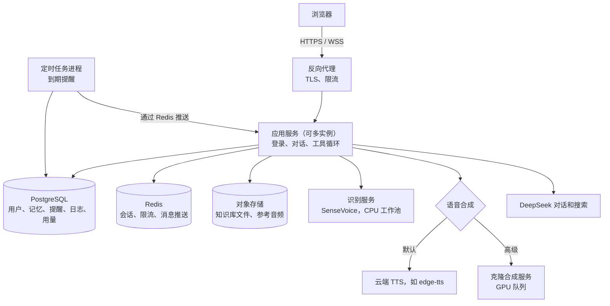
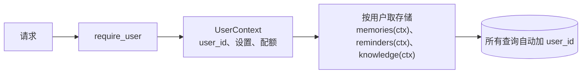
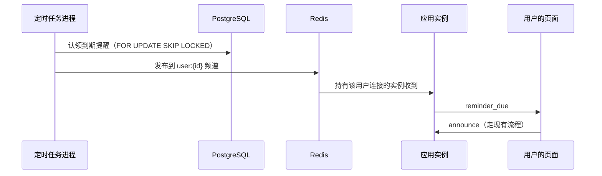
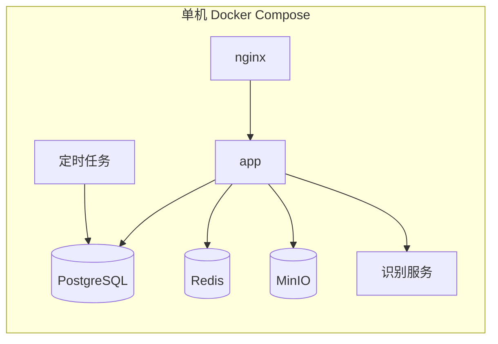

# 多用户 SaaS 改造方案

目标：把现在“一台电脑、一个人”的语音助手，改造成多人通过浏览器登录使用的服务。每个用户有自己的记忆、提醒、知识库和音色，彼此完全隔离。

这份方案只是规划，还没有动代码。第 8 节有几个决定会大幅改变工作量，需要你先定。

## 1. 现状：单用户假设清单

| 假设 | 位置 | 多用户下的问题 |
|---|---|---|
| 声音设置是全局变量 | `app.py:512`，`select_voice` 改写 `TTS_PROVIDER`、`VOICE`、`CLONE_ID` | 一个人换音色，所有人都跟着变 |
| 记忆、提醒共用一个 SQLite 文件 | `tools.py:19-20`，`data/agent.db` | 所有人的记忆混在一起 |
| 知识库只有一个文件夹 | `tools.py:30`，`knowledge/` | 互相能查到对方的文档 |
| 操作日志、耗时日志只有一份 | `app.py:43-45` | 分不清是谁的操作 |
| 默认城市、API Key 来自环境变量 | `app.py:40-41` | 不能每人不同 |
| 接口只认本机 | `app.py:378-385`，`require_local_page`、`require_local_host` | 外网无法访问，而且没有“谁在访问”的概念 |
| 服务只监听 `127.0.0.1` | `start.ps1` | 外网无法访问 |
| 克隆合成一次只服务一路 | `cosy_server.py:25`，`inference_gate = Semaphore(1)` | 第二个人要排队，GTX 1060 实测合成速度只略快于播放 |
| 识别模型是进程内单例，加了锁 | `app.py:98-99`、`asr_lock` | 多人同时说话时要排队识别 |
| 对话历史只在 WebSocket 连接里 | `app.py` 的 `Conversation()` | 刷新页面就丢，换设备也看不到 |
| 浏览器访问麦克风 | `static/app.js` | 浏览器只在 HTTPS 或 localhost 下允许使用麦克风，部署到外网必须上 HTTPS |

好的一面是，核心逻辑大多已经和存储解耦：

- `run_turn`、`ToolRegistry` 都通过参数注入依赖。
- 存储类都只接受一个路径参数。
- 权限分级、确认流程、外部内容防护这些安全机制，不依赖“单用户”这个前提。

所以改造的重点是**把单例换成“按用户取”**，大部分业务逻辑不用重写。

## 2. 目标架构

你笔记里的 FastAPI-LangGraph-Agent 模板用的是同类组合：JWT、PostgreSQL 加 pgvector、Valkey/Redis、Prometheus 加 Grafana，可以参考它的工程做法。

## 3. 关键设计

### 3.1 账号和登录

| 项目 | 做法 |
|---|---|
| 登录方式 | 第一版用邮箱加密码，以后再加第三方登录 |
| 密码存储 | argon2 或 bcrypt 哈希，绝不存明文 |
| 会话 | 服务端会话加 HttpOnly、Secure、SameSite Cookie。浏览器场景比把 JWT 放在 localStorage 更安全 |
| WebSocket 认证 | 握手时校验 Cookie 里的会话，并检查 Origin 白名单。每条消息都带着连接对应的用户 |
| 跨站防护 | 写操作接口校验 CSRF token |
| 替换本机检查 | `require_local_page` 和 `require_local_host` 换成 `require_user`，取出当前用户，未登录返回 401 |
| 角色 | 普通用户和管理员两种，管理员能看用量、停用账号 |

### 3.2 数据隔离

**原则**：每张业务表都有 `user_id`，每次查询都必须带上它，而且由代码统一保证，不靠每个调用点记得加。

| 数据 | 现在 | 改造后 |
|---|---|---|
| 记忆、提醒、操作日志 | 共用一个 SQLite | PostgreSQL，表里都加 `user_id` |
| 知识库索引 | 一个 SQLite 加 FTS5 | 第一版每用户一个索引文件；规模大了再迁到 PostgreSQL 全文检索 |
| 知识库文件 | 一个本地文件夹 | 对象存储，路径用 `users/{user_id}/knowledge/` |
| 参考音频 | `voices/` | 对象存储，路径用 `users/{user_id}/voices/` |
| 声音和城市设置 | 全局变量加 `settings.json` | `user_settings` 表 |
| 对话历史 | 只在内存 | 存数据库，保留最近 N 轮，用户可以清除 |

**为什么第一版知识库不急着迁到 PostgreSQL**：现在的切词、标题路径、评测脚本都基于 SQLite FTS5，而且效果已经在你的笔记上验证过。每个用户一个索引文件，改动最小，隔离也最彻底。

**加一层保险**：PostgreSQL 可以开启行级安全（Row-Level Security）。即使某处代码漏写了 `user_id` 条件，数据库也不会返回别人的数据。

### 3.3 每用户的状态

现在散落在全局变量里的东西，都要变成“每个用户一份”：

| 现在 | 改造后 |
|---|---|
| `TTS_PROVIDER`、`VOICE`、`CLONE_ID` | `UserContext.settings` |
| `DEFAULT_CITY` | 用户设置，注册时可以留空 |
| `fillers`（提示语缓存） | 缓存键里加上用户的音色，音色相同的用户可以共享 |
| `finished_actions`、`history` | 按连接，并且持久化 |
| 演示录音 `data/heard` | 只在管理员调试模式下开启 |

### 3.4 语音算力：最大的瓶颈

这是语音 SaaS 和普通聊天 SaaS 最大的区别。识别和合成都很吃算力，而且必须实时。

| 环节 | 现在 | 多用户下 |
|---|---|---|
| 识别 | SenseVoice，进程内单例加锁，每句约 0.17 秒 | 独立的识别服务，按 CPU 核数开工作进程，排队并限流 |
| 合成（默认） | edge-tts 或克隆 | 默认用云端 TTS，不占本机资源 |
| 合成（克隆） | CosyVoice，GTX 1060，一次一路 | 作为高级功能，单独的 GPU 服务加任务队列，每个用户限并发 |

**默认音色不能继续用 edge-tts**：edge-tts 调用的是微软 Edge 浏览器“朗读”功能的非公开接口，不是微软提供的商用 API，用在面向公众的收费或商业服务上，授权和稳定性都没有保障；而且它的服务器在境外，回复文字会出境。面向公众时应改用有正式授权、提供服务协议的国内语音合成服务，具体选哪家在第 8 节决定。

**克隆音色撑不起多人同时用**：GTX 1060 上实测合成耗时是音频时长的 0.7 到 0.9 倍，只比实时快一点。也就是说一张卡同一时间只能流畅服务大约一个人，第二个人就要排队，等待会很明显。所以：

- 默认音色用云端 TTS，这和小智 AI 的做法一致。
- 克隆音色要么限制使用人数，要么迁到更强的 GPU 或云端 GPU 上。
- 这台电脑不适合作为对外服务的主机：显卡同时驱动显示器，而且之前有过多次蓝屏和意外重启。

**克隆音色的额外要求**：用户上传的是自己的声音样本，必须确认上传者有权使用这个声音，见 3.8 节。

### 3.5 后台任务和主动播报

现在的提醒扫描跑在每个 WebSocket 连接里，靠 SQLite 的条件更新保证只有一个页面认领。多实例部署时要改：

- 认领逻辑基本不变，只是从 SQLite 的条件更新换成 PostgreSQL 的 `SKIP LOCKED`。
- “用户在说话时推迟”“错过的补报”“多个页面只播一次”这些规则都保留，现有的测试用例可以直接改用。
- 定时任务进程只运行一个，用数据库锁或 Redis 锁选出唯一的执行者。

### 3.6 费用、配额和计量

| 问题 | 选项 |
|---|---|
| 谁付模型费用 | 平台统一付费，或者用户填自己的 DeepSeek Key（BYOK） |
| 计量 | 新增 `usage_events` 表：每次对话的 token、每次搜索、每秒合成音频、知识库存储空间 |
| 配额 | 按用户设每日上限，超出时明确提示，不再静默失败 |
| 限流 | 按用户限制每分钟请求数和同时连接数，防止滥用 |

现在 `latency.jsonl` 和操作日志的思路可以直接扩展成计量表。

如果用户自带 Key，Key 必须加密存储，界面上不回显，日志里不出现。现有的 `api_config.fingerprint` 只显示指纹，可以沿用。

### 3.7 安全

| 风险 | 措施 |
|---|---|
| 明文传输 | 全站 HTTPS 和 WSS。浏览器也只在安全连接下允许用麦克风 |
| 跨用户访问 | 统一的 `UserContext`、行级安全、专门的隔离测试 |
| 上传滥用 | 每用户存储配额；文件类型和大小限制（现有逻辑沿用）；文件名清洗（现有逻辑沿用） |
| 提示词注入 | 现有的外部内容防护全部保留；知识库按用户隔离，一个人的文档影响不到别人 |
| 日志泄露 | 日志只记阶段耗时和长度，不记对话内容（现在已经是这样） |
| 密钥管理 | 平台 Key 放在密钥管理服务或环境变量里，不进代码和镜像 |
| 数据备份 | 数据库和对象存储每日备份，并定期演练恢复 |

### 3.8 合规（对公众开放，必须先解决）

**2026-11-07 已决定对公众开放**，所以下面的要求是上线前提，不是可选项。以下内容整理自公开规定和报道，**不是法律意见**，具体以属地网信部门的口径和律师意见为准。

#### 生成式 AI 服务：登记

我们调用的是 DeepSeek 这类已备案大模型的 API，没有自己训练或微调模型。按国家网信办的公告，这类“直接调用已备案模型能力的应用”由**属地网信办负责登记**，不需要做大模型备案。截至 2026 年 8 月 31 日，已有 731 款应用或功能完成登记。

| 事项 | 要点 | 状态 |
|---|---|---|
| 服务登记 | 向属地网信办办理 | 必须做，具体材料要问当地网信办 |
| 算法备案 | 面向公众、有舆论属性的生成合成服务是否还要做，各方说法不一致 | **待确认** |
| 模型公示 | 在显著位置或详情页公示所用模型的名称和备案号 | 必须做，页面要加 |
| 上游模型 | 只用已备案的模型，并记录备案号 | DeepSeek 的备案号要核实 |

如果以后要微调模型，就可能变成大模型备案的路径，要求高得多。所以 S1 到 S4 都只调用 API，不微调。

#### 生成内容标识

《人工智能生成合成内容标识办法》从 2025 年 9 月 1 日起施行，配套的强制性国家标准同时实施。

| 标识 | 含义 | 我们要做的 |
|---|---|---|
| 显式标识 | 用户能直接看到或听到 | 回复文字标明“AI 生成”；合成语音在播报时或界面上提示是 AI 合成 |
| 隐式标识 | 写进文件数据，不易察觉 | 合成音频的文件元数据里加标识（WAV/MP3 都要处理） |
| 不得删除 | 不得恶意删除、篡改、伪造标识 | 导出和下载功能也要保留标识 |

语音的具体技术细节要查国家标准原文，搜索结果里没有找到语音专项细则。

#### 声音克隆和个人信息

| 事项 | 要点 |
|---|---|
| 声纹是敏感个人信息 | 按《个人信息保护法》，声纹属于生物识别信息，处理时需要单独同意，并告知必要性和影响 |
| 克隆需要本人同意 | 深度合成相关规定对编辑生物识别信息要求单独同意；《民法典》第 1023 条规定声音参照肖像权保护 |
| 产品要求 | 上传声音时，确认是本人或已获书面授权；单独的同意页面；可以随时删除样本和已生成的音色 |

条款编号和完整表述来自评论文章，没有核对原文，要以规定原文为准。

#### 其他通常需要的（未在本次检索中核实）

- **网站 ICP 备案**：服务器在中国大陆、绑定域名对外服务，通常需要。
- **用户实名**：深度合成类服务可能要求基于手机号等方式做真实身份认证。
- **隐私政策和用户协议**：写明对话、记忆、知识库、声音样本、搜索词分别发给了哪些第三方（DeepSeek、语音合成服务等）。
- **投诉举报渠道**和**内容安全**：对用户输入和模型输出做必要的审核。

#### 服务器放在海外的影响（2026-11-07 选择了海外云服务器）

**服务器在哪，不决定国内规定是否适用。**《生成式人工智能服务管理暂行办法》第二条以“向中华人民共和国境内公众提供”为标准；第二十条规定，境外向境内提供的服务如果不合规，网信部门可以通知有关机构采取技术措施处置，实际效果可能是被屏蔽。

| 事项 | 用户主要在中国境内 | 用户主要在海外 |
|---|---|---|
| ICP 备案 | 服务器在海外，不需要 | 不需要 |
| 服务登记、内容标识 | **仍然需要** | 国内这部分规定一般不适用，但要遵守用户所在地的法规，例如欧盟的 GDPR |
| 数据出境 | 境内用户的数据存到海外，涉及个人信息出境规则 | 主要看用户所在地的规定 |
| 访问稳定性 | 跨境网络可能不稳，有被屏蔽的风险 | 正常 |
| 语音延迟 | 跨境往返时间更长，持续监听和打断会更明显地受影响 | 选离用户近的区域即可 |
| 上游服务 | DeepSeek、edge-tts 都能从海外调用 | 同左；但用户数据会发往中国境内的 DeepSeek，隐私政策要写明 |

**数据出境的门槛**：按《促进和规范数据跨境流动规定》，一年内累计向境外提供不满 10 万人的个人信息可以免签标准合同，但这个门槛**不包括敏感个人信息**；敏感个人信息不满 1 万人也需要订立标准合同或通过认证。声音样本属于敏感个人信息，所以只要开放克隆音色，就可能要签。“海外服务器直接从境内用户收集”是否算“向境外提供”，没有查到明确解读，需要律师确认。

**结论**：如果用户主要在中国境内，海外服务器只省掉了 ICP 备案，却增加了延迟、稳定性和数据出境的问题，登记和标识一样要做。如果用户主要在海外，海外服务器是合理的选择，合规重点换成当地法规。

**2026-11-07 已确定用户主要在中国境内**，所以建议改用国内云服务器：

| | 海外服务器 | 国内服务器（建议） |
|---|---|---|
| ICP 备案 | 不需要 | 需要，通常要几周，和开发并行办理 |
| 服务登记、内容标识 | 需要 | 需要 |
| 数据出境 | 境内用户数据存在海外，规则不明确，克隆音色可能要签标准合同 | 数据留在境内，不涉及 |
| 访问稳定性 | 跨境网络波动，有被屏蔽的风险 | 稳定 |
| 语音延迟 | 往返时间更长 | 更短 |
| 调用 DeepSeek | 跨境调用 | 境内调用 |

ICP 备案耗时，但它是一次性的，可以和 S1 的开发同时办。

**2026-11-07 已改为国内云服务器。**

#### 对计划的影响

- **S0 必须包含合规咨询**：至少弄清登记材料、是否需要算法备案、语音标识的技术要求。
- **克隆音色推迟到最后**：它是合规负担最重的功能，S5 之前都只用平台提供的标准音色。
- **标识和公示提前到 S2**：只要对外开放，就要有。

### 3.9 部署

- **第一阶段**：一台云服务器，用 Docker Compose 部署，克隆音色先关闭。
- **扩展**：应用服务无状态化，然后多实例部署；WebSocket 用粘性会话或靠 Redis 推送；识别服务单独扩容；克隆合成放到 GPU 机器上。
- **可观测性**：Prometheus 加 Grafana，按用户统计请求量、延迟、错误率、费用。现有的阶段耗时记录正好可以作为指标来源。

## 4. 分阶段实施

每个阶段都能独立上线和回退。

### 阶段 S0：决定和准备

- 已决定：**对公众开放**（2026-11-07）。
- 确定第 8 节剩下的几个问题。
- 用户主要在中国境内，使用国内云服务器（均已确定）。选定云厂商后办理 ICP 备案（和 S1 并行），准备域名和 HTTPS 证书。
- **合规咨询**：向属地网信办了解服务登记材料，确认是否需要算法备案，查阅生成内容标识的国家标准。
- 核实所用模型的备案号。

**验收**：形成书面决定，写进这份方案；拿到登记要求的明确答复。

### 阶段 S1：账号和用户上下文（仍是单机）

- 用户表、注册、登录、退出、会话 Cookie、CSRF 防护。
- `UserContext`，替换掉所有 `require_local_*`。
- 存储类都改成按用户取，数据库迁到 PostgreSQL。
- 声音、城市等设置从全局变量改成用户设置。
- 写一个迁移脚本，把现在的数据导入为第一个用户。

**结果（2026-11-08）**：代码和自动验证完成。实际采用每用户一个数据目录，仍用 SQLite，PostgreSQL 推迟到部署阶段，原因见 [S1 解析](docs/S1-账号与数据隔离解析.md)。

**验收**：

- 两个账号同时使用，记忆、提醒、知识库、音色、操作日志都互不可见。
- 专门的隔离测试：用户 A 用各种方式（改编号、改路径、改 WebSocket 消息）都访问不到用户 B 的数据。
- 现有测试全部通过，或者改造成“带用户”的版本后通过。

### 阶段 S2：部署到外网（小范围试用）

- Docker 镜像和 Compose 配置，nginx 负责 TLS 终止。
- 默认音色改用云端 TTS，克隆音色暂时关闭。
- 识别服务独立出来，设置并发上限。
- 限流和基础监控。
- 生成内容标识：文字显式标识；合成音频的显式提示和元数据隐式标识。
- 页面公示所用模型名称和备案号。
- 隐私政策、用户协议、投诉渠道；按要求接入实名认证。

**验收**：

- 通过 HTTPS 访问，麦克风正常。
- 5 个用户同时语音对话，首字延迟和单用户时相比，增加不超过约定的值（要在 S0 定下具体数字）。
- 服务重启后提醒不丢。

### 阶段 S3：配额和计量

- `usage_events` 计量表，按用户的每日配额。
- 管理后台：用户列表、用量、停用账号。
- 可选：用户自带 DeepSeek Key。

**验收**：超出配额时有明确提示；用量统计和 DeepSeek 账单能对上。

### 阶段 S4：后台任务和多实例

- 定时任务独立成一个进程，提醒通过 Redis 推送给对应用户。
- 应用服务多实例部署。
- 对象存储替换本地文件。

**验收**：任意停掉一个应用实例，用户自动重连后功能正常；提醒只播一次。

### 阶段 S5：克隆音色和商业化（可选）

- 克隆合成独立成 GPU 服务，加任务队列和每用户并发限制。
- 声音授权流程、合成内容标识。
- 支付和套餐。
- 隐私政策、用户协议、数据导出和注销。

**验收**：取决于 S0 的合规结论。

## 5. 测试策略

| 类型 | 重点 |
|---|---|
| 隔离测试 | 每个接口、每种 WebSocket 消息都用“A 访问 B 的数据”去试，必须全部失败 |
| 认证测试 | 过期会话、伪造 Cookie、跨站请求、缺 CSRF token |
| 负载测试 | 模拟多个用户同时持续语音对话，观察识别排队和首字延迟 |
| 配额测试 | 刚好到上限、超过上限、并发抢配额 |
| 回归测试 | 现有的 428 项测试改造成“带用户”的版本 |

现有测试的写法，比如注入假模型、用 `conftest.py` 隔离存储，都可以直接扩展到多用户。

## 6. 工作量和风险

| 阶段 | 相对工作量 | 主要风险 |
|---|---|---|
| S1 账号和隔离 | 大，改动面最广 | 漏掉某个全局状态，造成数据串号 |
| S2 部署 | 中 | 网络延迟让语音体验变差；HTTPS 和 WebSocket 配置 |
| S3 计量 | 中 | 计量不准，费用失控 |
| S4 多实例 | 中到大 | WebSocket 和推送在多实例下的一致性 |
| S5 克隆和商业化 | 大 | 合规和 GPU 成本 |

**最大的风险在合规，而不在技术**。声音克隆和面向公众的生成式 AI 服务，都可能有前置要求，最好在 S1 之前弄清楚。

## 7. 现有能力的复用

| 现有能力 | 多用户下 |
|---|---|
| 工具循环、权限分级、语音确认 | 直接复用 |
| 外部内容防护、历史中去掉网页原文 | 直接复用 |
| 提醒的认领、过期、补报规则 | 逻辑复用，换数据库实现 |
| 知识库切词、标题路径、评测脚本 | 直接复用，按用户分索引 |
| SenseVoice 加 Silero 把关 | 复用，挪到独立服务里 |
| 阶段耗时记录、操作日志 | 扩展成计量和审计 |
| 测试的注入和隔离写法 | 扩展成多用户测试 |

## 8. 需要你决定的

1. ~~**给谁用**~~：已决定**对公众开放**（2026-11-07）。合规成为上线前提，见 3.8 节。
2. ~~**部署在哪**~~：已改为**国内云服务器**（2026-11-07）。需要办理 ICP 备案，和 S1 并行；数据留在境内。
3. ~~**用户主要在哪里**~~：已确定**主要在中国境内**（2026-11-07），适用国内生成式 AI、标识、个人信息保护等规定。
4. **默认音色**：edge-tts 不适合商用（见 3.4 节），需要从国内正式的语音合成服务里选一家；用云端 TTS 换取多人并发，还是保留克隆音色并接受排队或 GPU 成本？
5. **谁付模型费用**：平台统一付费，还是用户自带 Key？
6. **规模预期**：第一年大概多少用户，同时在线多少人？这决定是否需要做 S4 的多实例。

既然对公众开放，S1 到 S4 都要做，S2 之前必须完成合规咨询和服务登记的准备。

## 参考资料

- [国家网信办：人工智能生成合成内容标识办法（2025 年 3 月发布）](https://www.cac.gov.cn/2025-03/14/c%5F1743654684782215.htm)
- [新京报：网信办公告生成式人工智能服务备案和登记情况](https://m.bjnews.com.cn/detail/1789387872129240.html)
- [锦天城律师事务所：生成式 AI 合规相关文章](https://www.allbrightlaw.com/CN/10475/9D795E4543AA51EA.aspx)
- [新华网：声纹等敏感个人信息保护的报道](https://www.news.cn/legal/20250224/e813bb40cf524927914c7000476273be/c.html)
- [China Law Translate：深度合成管理规定英文译本](https://www.chinalawtranslate.com/deep-synthesis/)
- [国家网信办：生成式人工智能服务管理暂行办法](https://www.cac.gov.cn/2023-07/13/c_1690898327029107.htm)
- [国家网信办：促进和规范数据跨境流动规定](https://www.cac.gov.cn/2024-03/22/c_1712776611775634.htm)
