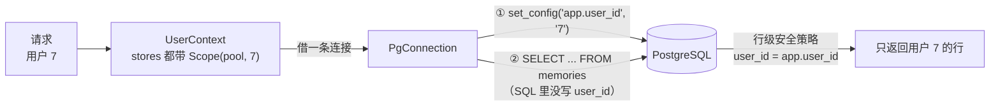
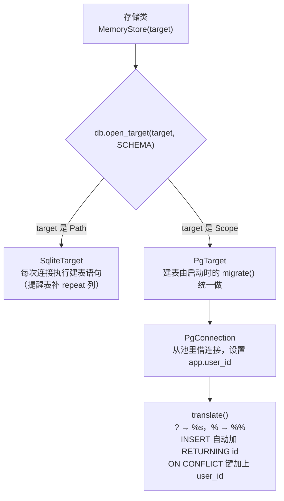
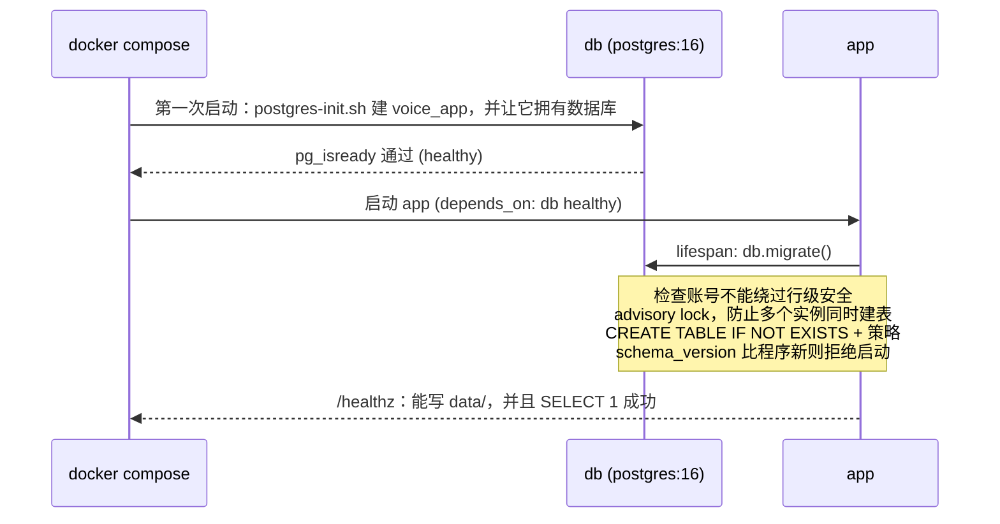
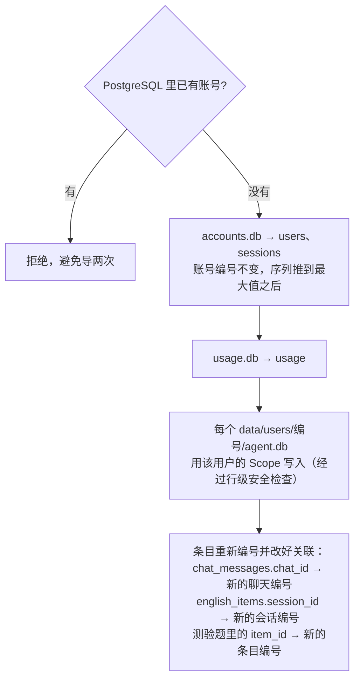

# PostgreSQL 迁移解析

S1 的时候，每个用户的数据放在自己的目录里，用 SQLite 文件存，把 PostgreSQL 留到部署时再做。这一步就是迁移：设置环境变量 `VOICE_DATABASE_URL` 后，账号、花费，以及每个用户的记忆、提醒、操作日志、后台任务、英语练习和聊天记录都存进同一个 PostgreSQL；不设置时还是 SQLite，开发和测试不受影响。知识库索引仍按原方案，每人一个 SQLite 文件（FTS5 切词和评测都基于它）。

| 文件 | 内容 |
|---|---|
| `db.py` | 新增：数据库适配层。SQLite 和 PostgreSQL 两种目标、SQL 方言转换、连接池、建表和行级安全、启动检查 |
| `memory_store.py`、`accounts.py`、`usage.py` | 存储类改成从 `db.open_target` 拿连接；几处 SQLite 独有写法改成两边通用 |
| `user_context.py`、`app.py`、`manage.py` | 用 `db.target(...)` 选择存储位置；启动时建表；`/healthz` 也检查数据库 |
| `pg_migrate.py` | 新增：把 SQLite 数据导入 PostgreSQL |
| `manage.py` | 新命令 `migrate-to-postgres`；`import-legacy` 在 PostgreSQL 模式下直接导入数据库 |
| `deploy/postgres-init.sh`、`docker-compose.yml`、`.env.example` | 新增 `db` 服务，建应用专用的数据库账号 |
| `conftest.py`、`test_postgres.py` | 设置 `VOICE_TEST_DATABASE_URL` 后，全部测试改跑 PostgreSQL；新增隔离和迁移测试 |

## 1. 隔离方式：表里加 user_id，用行级安全兜底

SQLite 版每个用户一个文件，查询漏写条件也只能查到自己的文件。PostgreSQL 里所有用户共用同一套表，我们要求做到同样安全：**即使某条 SQL 漏写了 `WHERE user_id = ...`，也查不到别人的数据**。



做法分三层：

1. **每张个人表都有 `user_id` 列**，默认值取自连接上的 `app.user_id`。所以 `INSERT INTO memories (content, created_at) ...` 不用改 SQL，行会自动归到当前用户名下。
2. **行级安全策略**（`USING` 和 `WITH CHECK`）：读、改、删只能碰 `user_id` 等于当前用户的行；写入时也不能把 `user_id` 填成别人。
3. **`FORCE ROW LEVEL SECURITY`**：表的所有者（也就是应用账号）同样受策略限制。

还有一点：超级用户和带 `BYPASSRLS` 的账号会无视行级安全。所以部署时另建一个普通账号 `voice_app` 给应用用（`deploy/postgres-init.sh`）。启动时 `db.migrate()` 会检查当前账号，发现能绕过就拒绝启动：

```python
superuser, bypass = connection.execute("SELECT rolsuper, rolbypassrls FROM pg_roles WHERE rolname = current_user").fetchone()
if superuser or bypass:
    raise RuntimeError("数据库账号是超级用户或带 BYPASSRLS，会绕过行级安全；...")
```

**不指定用户就什么都看不到**：账号、花费这类共享表用不带用户的连接，这时 `app.user_id` 是空的，策略里的比较结果为假，所以查个人表返回 0 行，写也写不进去（测试 `test_a_connection_naming_no_user_sees_and_writes_nothing`）。

**为什么不给每个用户建一个 schema**：那样 SQL 一行都不用改，但用户多了以后，每次升级表结构都要逐个 schema 跑一遍；而且原方案定的就是“加 `user_id` + 行级安全”，这是多租户的常规做法。

## 2. 适配层 `db.py`：存储类的 SQL 只写一份



每个存储类只改了构造函数和 `connect()`，其余代码一行没动：

```python
def __init__(self, path):
    self.path = path if isinstance(path, db.Scope) else Path(path)
    self.db = db.open_target(self.path, MEMORY_SCHEMA)

def connect(self):
    return self.db.connect()
```

`PgConnection` 模仿 sqlite3 连接的用法，所以原来到处都在用的 `with contextlib.closing(self.connect()) as connection, connection:` 原样可用：`with connection:` 正常结束就提交、出错就回滚，`close()` 把连接还回池里。

**SQL 方言差异**的处理方式：

| SQLite 写法 | 怎么处理 |
|---|---|
| `?` 占位符 | `translate()` 换成 `%s`，SQL 里本来的 `%` 变成 `%%` |
| `cursor.lastrowid` | 往有 `id` 的表 INSERT 时自动加 `RETURNING id`，`PgCursor.lastrowid` 读回来 |
| `INSERT OR REPLACE`（翻译缓存） | 改成两边都支持的 `ON CONFLICT (key) DO UPDATE` |
| `ON CONFLICT (kind, key)` | 个人表的唯一键带 `user_id`，`translate()` 自动改成 `ON CONFLICT (user_id, kind, key)`；不同用户可以各有一个 apple |
| 两个参数的 `MIN(due_at, excluded.due_at)` | 改成两边通用的 `CASE WHEN ... END` |
| `SUM(kind = 'search')` 对布尔值求和 | PostgreSQL 不支持，改成 `SUM(CASE WHEN ... THEN 1 ELSE 0 END)` |
| `PRAGMA table_info` 补列 | 只在 SQLite 的 `upgrade` 回调里做；PostgreSQL 建表时就带这一列 |
| `REAL` | PostgreSQL 里是单精度，花费金额改用 `DOUBLE PRECISION` |

**`app.user_id` 为什么设成会话级、并且马上提交**：如果只在当前事务里设置，提交之后同一连接上的语句就拿不到它；如果设成会话级但不提交，一旦回滚，会退回到上一个借过这条连接的用户的值。所以每次借出连接都先设置一遍（共享表设成空字符串），然后立刻提交。测试 `test_the_previous_users_scope_does_not_leak_into_the_next_checkout` 专门验证连接被反复借出后不会串号。

## 3. 选择存储位置：`db.target()`

```python
def target(path, user_id=None):
    return Scope(pool(), user_id) if configured() else Path(path)
```

- `app.py`：`AccountStore(db.target(ROOT / "data" / "accounts.db"))`
- `usage.py`：`UsageLedger(db.target(.../"usage.db"))`
- `user_context.build`：`database = db.target(root / "agent.db", user["id"])`，记忆、提醒、任务、英语、聊天共用这个目标
- 翻译缓存 `LookupCache(db.target(context.root / "agent.db", context.user_id))`

没有设置 `VOICE_DATABASE_URL` 时，这些都返回原来的路径，行为和以前完全一样。

## 4. 启动和健康检查



- 连接串里不放密码：`VOICE_DATABASE_URL=postgresql://voice_app@db:5432/voice`，密码通过 `PGPASSWORD` 环境变量传给驱动，避免特殊字符要做 URL 转义。
- 数据库端口不对外开放，只有应用容器能访问。
- `schema_version` 现在是 1。以后改表结构时版本号加一，并在 `migrate()` 里补上对应的升级语句。

## 5. 数据导入 `pg_migrate.py`



- **账号编号保持不变**：知识库、音色、录音的文件夹按账号编号命名，编号一变就对不上了。
- **条目重新编号**：SQLite 里每个用户的记忆都从 1 开始编号，PostgreSQL 里所有用户共用一个序列，所以只能重新编号。复制时记下旧编号到新编号的对应关系，把引用它们的地方一起改掉。
- 每个用户的数据都用该用户的连接写入，所以写入时也要通过行级安全检查。
- SQLite 文件原样保留，导入只读不写。

## 6. 验证

| 检查 | 结果 |
|---|---|
| 原有全部测试，SQLite | 669 通过，1 跳过 |
| 原有全部测试，PostgreSQL（`VOICE_TEST_DATABASE_URL`，用 voice_app 账号） | 669 通过，1 跳过 |
| `test_postgres.py`：用户隔离、按编号改别人的记忆、伪造 user_id、不指定用户、连接复用不串号、单词和缓存按用户分开、提醒只被一个页面认领、花费汇总、导入后关联正确、重复导入被拒绝 | 11 通过 |
| 用超级用户启动 | `migrate()` 拒绝 |
| 真实应用（含 lifespan）冒烟：两个账号注册、各写一条记忆、互相看不到；登录、花费接口正常 | 通过 |
| 把本机真实 SQLite 数据的副本导入测试库，逐表比对行数 | 10 张表全部一致 |
| `pg_dump` 备份后用 `pg_restore` 恢复 | 数据完整；表仍归 voice_app 所有，行级安全仍强制开启，10 条策略都在 |

本地跑 PostgreSQL 测试的方法（测试库用完即删，`fsync=off` 只是为了快，生产环境不要这样配）：

```bash
docker run -d --name voice-pg-test -p 55432:5432 -e POSTGRES_DB=voice -e POSTGRES_PASSWORD=<管理员密码> -e VOICE_DB_PASSWORD=<应用密码> -v "$PWD/deploy/postgres-init.sh:/docker-entrypoint-initdb.d/10-voice.sh:ro" postgres:16-alpine -c fsync=off
PGPASSWORD=<应用密码> VOICE_TEST_DATABASE_URL=postgresql://voice_app@localhost:55432/voice .venv/Scripts/python.exe -m pytest -q -p no:cacheprovider
```

## 没做的和要注意的

- **还没有用 `docker compose up` 在服务器上完整跑过**：镜像构建和三个容器一起启动没有实测，是用单独的 PostgreSQL 容器加本机应用验证的。
- 提醒扫描还在每个 WebSocket 连接里跑，靠条件更新保证只有一个页面认领，这在 PostgreSQL 里同样成立。要多实例部署时，再按方案改成 `SKIP LOCKED` 的后台任务。
- 知识库索引仍是每用户一个 SQLite 文件，跟着 `data/` 目录一起备份。
- 千万不要用 `docker compose down -v`，会删掉数据库卷。
