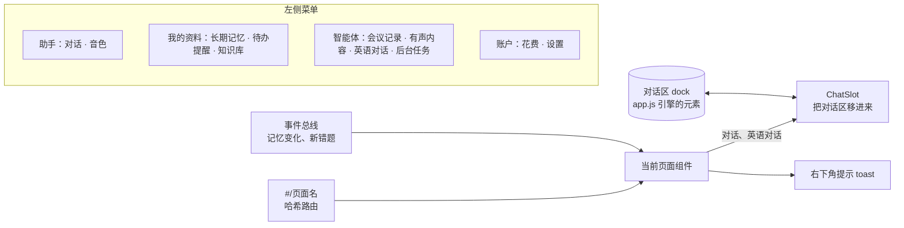
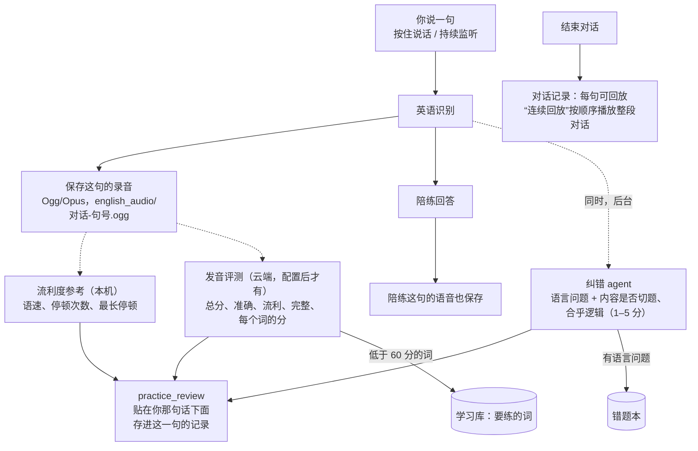
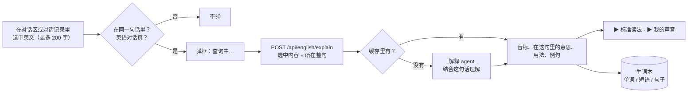

# React 改版与英语录音评判解析

两件事：

1. 前端改用 React：每个功能一个菜单页面，统一样式。
2. 英语对话录下你说的每句话，逐句评判语言、内容、流利度和发音，结束后可以回看和回放。

## 一、React 改版

### 怎么接入 React（不用构建）

按你的选择，不装构建工具：

- 从 npm 官方仓库取 React 18.3.1 的单文件版本（`react.production.min.js` 约 11 KB，`react-dom.production.min.js` 约 130 KB）放进 `static/vendor/`。下载时核对了 npm 发布的校验值，许可证一起放在旁边。
- React 18 是最后一个提供单文件版本的大版本，所以用 18。
- 没有 JSX，组件用 `h()`（即 `React.createElement`）写：

```javascript
h(Card, {title: '上传文件'}, h('label', {className: 'dropzone'}, ...))
```

- 部署时不需要 Node，FastAPI 照旧直接提供静态文件。

### 页面结构



| 文件 | 内容 |
|---|---|
| `static/ui/core.js` | `h`、小型状态库、`api()`、事件总线、提示、路由、格式化、通用组件（Page、Card、Button、Badge、Stat、Table、Empty）、ChatSlot、后台任务列表 |
| `static/ui/pages.js` | 对话、长期记忆、待办提醒、知识库、后台任务、花费、设置 |
| `static/ui/voices.js` | 音色 |
| `static/ui/meetings.js`、`audio.js`、`english.js` | 会议记录、有声内容、英语对话 |
| `static/ui/shell.js` | 左侧菜单（手机上是抽屉）、当前页面、提示 |
| `static/index.html` | 样式（颜色、圆角、阴影统一用 CSS 变量）、对话区 dock 的 HTML、脚本 |

旧的 `memories.js`、`usage.js`、`tasks.js`、`meetings.js`、`audio.js`、`practice.js`、`voices.js` 已删除，内容都搬进了上面的页面。

### 为什么语音引擎没有改写成 React

`app.js` 管 WebSocket、麦克风、持续监听、Opus 上行、按句播放、打断、确认，有 40 多个测试，已经很稳定。它直接操作固定 id 的元素。

所以对话区做成一块固定的 HTML（dock），藏在页面里。`ChatSlot` 组件挂载时把它移进当前页面，卸载时移回去：

```javascript
useEffect(() => {
  const dock = document.getElementById('chatDock');
  holder.current.append(dock); dock.hidden = false;
  return () => { dock.hidden = true; document.getElementById('dockHome').append(dock); };
}, []);
```

这样“对话”和“英语对话”两个页面用的是同一个对话区：切换页面时对话不断、麦克风不断，正在播的语音也不停。原来 `app.js` 里的账号、默认城市、服务状态挪到了“设置”页面。

### 页面上的变化

- **左侧菜单**分四组；手机宽度下变成左上角“☰”打开的抽屉。
- **提示**统一显示在右下角：删除记忆、取消提醒后带“撤销”按钮（8 秒）；后台任务完成或失败也在这里提示一次。
- **长期记忆、待办提醒、知识库**各一页。知识库改成拖放区，文件显示段数；没提取到文字的标黄。
- **会议记录、有声内容**：上面是新建表单，下面是只属于这一类的任务列表。最新的一条默认展开，结果直接在列表里看。
- **后台任务**：所有任务，带状态标签和进度动画。
- **花费**：四个数字卡片（今天、本月、缓存命中、本月 token），下面是按天、按 agent 的表；管理员多一张按账号的表。
- **音色**：卡片式选择，选中的高亮。
- **设置**：账号、默认城市、服务状态（包括发音评测是否配置）。

## 二、英语对话：录音、评判、回放

### 全局流程



### 录音怎么保存

- **按住说话**：服务器本来就拿到了这句的 PCM，识别完直接保存。
- **持续监听**：服务器识别后先把文字发给页面，页面再把文字作为一轮发回来，录音在这中间会丢。所以服务器记下最后听到的一句（文字 + 录音），页面发回同样的文字时取用一次（`take_heard`）。文字对不上就不用，不会张冠李戴。
- **打字**的句子没有录音，只评语言和内容。
- **陪练的话**：播报时发给页面的每段语音都留一份，这一轮说完后拼成一个文件保存。
- 录音存成 Ogg/Opus（复用带宽那步的编码），一句话十几 KB。保存失败只记日志，不影响对话。
- 每一句的记录多了 `audio`（文件名）、`seconds`（时长）和 `review`（评判结果），和对话一起实时保存。

### 评判什么

| 方面 | 怎么判断 | 花费 |
|---|---|---|
| 语言（语法、用词、表达） | 纠错 agent，和以前一样，有问题进错题本 | 和以前同一次调用 |
| **内容**：是否回应了陪练、意思是否清楚、是否合乎逻辑 | 同一个纠错 agent 顺带给 1–5 分和一句评语 | 不多花，同一次调用 |
| **流利度参考** | 本机用 Silero 逐帧判断哪里在说话：说话时长、语速（词/分钟）、超过 0.5 秒的停顿次数和最长停顿 | 不花钱 |
| **发音** | 云端口语评测服务：总分、准确度、流利度、完整度、每个词的分；低于 60 分的词记进学习库，标“发音需要练习” | 按服务商计费 |

关于发音：自由对话没有标准答案句子，本机也没有能判断“发音标准不标准”的模型，只能交给专门的评测服务，把识别出的文字当作参考文本一起发过去。

`pronunciation.py` 已经做好接口：

- 选哪家服务由环境变量 `VOICE_PRON_PROVIDER` 决定；
- 没配置时 `assess()` 返回空，页面写明“发音评测：未配置（只评内容和流利度）”，其他评判照常；
- 服务出错时显示原因，不影响对话。

**具体接哪家（腾讯云智聆口语评测或讯飞语音评测）还需要你定**，定了之后按那家的官方文档实现，Key 由你自己填。

### 页面上怎么显示

- **对话中**：你说的每句话下面依次出现彩色标签（发音、要练的词、流利度、内容）和批注，再下面是“▶ 回放”“↺ 重说这句”。陪练的话下面也有“▶ 回放”。
- **对话记录**里点开一次对话：
  - 顶部“连续回放”按顺序播放整段对话（陪练和你交替），正在播放的那句加框，可以随时“停止回放”；
  - 每句有“回放”，你的句子下面显示批注和评判标签，还有“从这句重说”；
  - 最后是总结。
- 同一时间只有一个声音在放，点另一个会先停掉前一个。

## 实测（浏览器面板）

**React 改版**：11 个页面逐个打开，都能显示，没有脚本错误。“对话”和“英语对话”之间切换，对话区跟着移动，内容不丢。

**英语录音评判**：用 edge-tts 的英式男声生成一句“I go to the cinema yesterday, and the movie was really funny.”，按“按住说话”的方式送进页面。

- 识别为“i go to the cinema yesterday and the movie was really funny”；
- 这句下面出现：流利度（语速 227 词/分，停顿 0 次）、内容（4/5）、语法批注（I go → I went）、回放和重说按钮；
- 结束后打开对话记录：三句都有录音（陪练 6.8 秒、你 4.7 秒、陪练 4.9 秒，浏览器都能解码）；“连续回放”从第一句开始，正在播放的句子加框。

聊天和纠错用的是假模型（临时服务器没有 Key）。真麦克风的录音效果，按之前的约定等新麦克风到了再测。

## 测试

- 后端 593 个通过（新增 7 个）：
  - 流利度参考的说话时长、语速、停顿计算；
  - 内容评分只接受 1–5；
  - 没配置发音服务时不评分，配置了不支持的服务也不评分；
  - 服务的分数取整，出错时给出原因，要练的词去重；
  - **按住说话**：录音保存、可回放、评判发到页面并存进记录、要练的词入库；
  - 打字的句子没有录音；
  - **持续监听**：录音能接到页面发回的那一轮上。
- 前端 53 个通过，按新结构重写：
  - 菜单分组顺序、格式化函数；
  - 记忆变化的撤销提示和撤销请求；
  - 服务状态、花费表格、后台任务提示和轮询；
  - 会议待办、有声内容的长度和大小；
  - 音色的试听进度和取消、服务忙时不试听；
  - 英语对话区的批注、重说、续说、结束；
  - 评判标签和回放按钮。

在 node 里没有 DOM，测不了 React 组件本身的渲染。所以页面拆成“逻辑函数 + 组件”：测试覆盖逻辑函数和对话区模块，渲染和交互在浏览器里实测。

## 局限

- 发音评测要等你选定服务商并填 Key。
- 没有构建步骤，组件用 `h()` 写，比 JSX 啰嗦一些；文件按页面分开，每个都不大。
- 录音只在用“开始说话”或“持续监听”说的句子上有；打字的句子没有。
- 重说某句后，被撤掉那几句的录音文件会在同位置的新句子录音时被覆盖，不单独清理。

---

# 补充一：听正确读法（标准音色 / 我的声音）

每条批注下面有两个按钮，读的是改好的句子（有“更地道”的说法就读那句，否则读改法）：

| 按钮 | 用什么合成 | 花费 | 速度 |
|---|---|---|---|
| ▶ 标准读法 | edge-tts 英语音色 en-US-JennyNeural（和陪练同一个声音） | 不花钱；句子文字会发给微软在线服务 | 实测首次约 1.6 秒 |
| ▶ 我的声音 | 本机 CosyVoice，用你上传的克隆音色说英语 | 不花钱，用本机显卡 | GTX 1060 上要几秒到十几秒 |

- 接口：`POST /api/practice/say`，参数是句子（必须是英文，最多 300 字）和音色（standard 或 mine）。
- 同一句话、同一个音色只合成一次，存在 `english_audio/say/`，再点直接播放（实测 4 毫秒）。
- “我的声音”用当前选用的克隆音色；当前用的不是克隆音色时，用你上传的第一个克隆音色。还没上传过会提示先去“音色”页上传。克隆服务忙、没启动，都会给出明确提示。
- 对话中和对话记录里的批注都有这两个按钮，和你自己那句的“回放”放在一起，方便对比。
- 只是对照，不打分；打分仍要接云端评测服务。
- 克隆音色说英语的效果还没在你的机器上实测过：测试账号没有克隆音色，本机 CosyVoice 服务也不是我启动的。

# 补充二：“没识别到语音”时说明原因

你反馈英语对话里说话没反应，状态栏显示“未识别到语音”。排查结果：

- 英语识别本身没问题。用 edge-tts 生成的中文句子、正常音量的英文、音量降到 2% 的英文，英语识别都能正确转写。
- “未识别到语音”出在识别之前：Silero 判断这段录音的语音概率不到 0.50，服务器就当作静音，不送去识别。中文对话也走同一个检查，所以问题在录音本身（选的麦克风、音量、噪声），不在英语模式。你的记忆里也记着这只摄像头麦克风效果差、正等着换。

改动：状态栏不再只说“未识别到语音”，而是给出数字和原因：

| 情况 | 提示 |
|---|---|
| 录音不到 0.3 秒 | 录音只有 X 秒，按住说完整句再松开 |
| 语音概率低、几乎没声音 | 没听到人声（时长、语音概率、需要 0.50 以上、音量）：几乎没有声音，请检查选的麦克风是否正确 |
| 语音概率低、但有声音 | ……有声音但不像人声（噪声或音量太小），请靠近麦克风或在“麦克风设置”里换一个 |
| 判断是人声但没转出文字 | 听到了人声但没识别出文字（语音概率、音量），请说慢一点、清楚一点再试 |

下次再出现时，看提示里的“语音概率”和“音量”就能知道是麦克风没收到声音，还是收到的声音太小、太吵。对话区下方的“麦克风设置 → 麦克风诊断”会逐个测试每个麦克风，自动选出效果最好的。

---

# 补充三：中文翻译和选词查询

## 中文翻译（默认隐藏）

- 对话中每一句（你的和陪练的）都有“译”按钮，对话记录里每一句下面也有。
- 第一次点开时才请求翻译（`POST /api/english/translate`，翻译 agent），之后只是显示、收起，不再请求。
- 翻译结果存在本机的查询缓存（`agent.db` 里的 `english_cache` 表），同一句话以后在对话记录里再点也不花钱。
- 译文显示在句子正下方，批注和评判标签之上。

## 选中单词或句子



- 选中后松开鼠标（手机上是松开手指）就弹出，按 Esc、点 × 或在别处点一下就关闭。
- 只在“英语对话”页、选中的内容在同一句话里时才弹，平时的中文对话不受影响。
- 解释 agent 会结合所在的整句话理解：同一个词在不同句子里意思不同，所以缓存按“选中内容 + 所在句子”分开存。
- 查过的内容按长度归类：1 个词是“单词”，2–4 个词是“短语”，更长是“句子”。都记进**生词本**，并保存原句。再查一次只把次数加一。
- 英语对话页右侧多了“生词本”标签：音标、意思、用法、原句、“▶ 读”、已掌握、删除。发音评测打分低的词（配置发音服务后）也会进这里。
- 翻译和解释都走多 agent 框架，花费分别记在 translator、explainer 名下，计入每天的花费上限。每次约 0.0005 元。

## 测试

- 后端新增 4 个：单词、短语、句子的分类和解释解析；翻译只请求一次、之后从缓存取、记账为 translator；解释保存到生词本（音标、意思、原句）、第二次从缓存取并加计数；不是英文、太长、模型回答不能用、没有 Key 都拒绝，并且不入库。
- 前端新增 2 个：陪练句子的“译”第一次请求、译文放在句子正下方、再点收起、不重复请求；查询弹框显示意思、音标、例句、两种读法和“已记进生词本”，位置在选中处下方，能关闭。
- 浏览器实测：点“译”出现译文；用鼠标选中“weekend”后弹框显示音标、意思、用法、例句和读法按钮；生词本标签变为“（1）”，列表里有这个词和它的原句。
