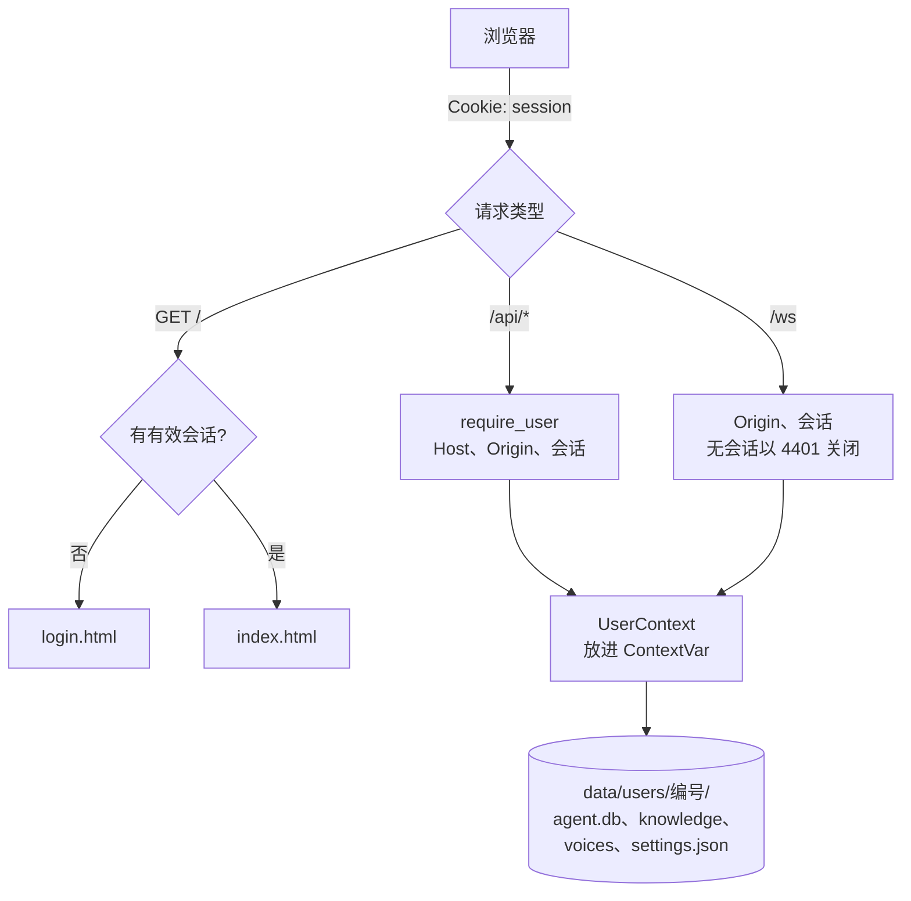
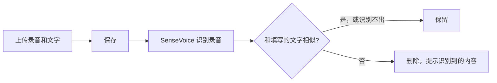

# S1 解析：账号与数据隔离

把单用户的语音助手改成多人登录使用，每个人的记忆、提醒、知识库、音色和设置互不可见。仍在本机运行，数据库仍是 SQLite，迁 PostgreSQL 放到部署阶段。

| 文件 | 变化 |
|---|---|
| `accounts.py` | 新增：账号、scrypt 密码哈希、会话、登录失败限流 |
| `user_context.py` | 新增：用户上下文、每用户独立的数据目录 |
| `app.py` | 登录接口；`require_user` 替换本机检查；音色和城市按用户 |
| `tools.py` | 工具改为从当前用户取存储 |
| `manage.py` | 新增：创建管理员、导入单用户数据 |
| `static/login.html`、`app.js`、`index.html` | 登录注册页、当前账号、默认城市、退出 |
| `conftest.py` | 每个测试都是一个独立的测试用户 |
| `test_accounts.py`、`test_isolation.py` | 新增：账号测试、跨用户隔离测试 |

## 全局流程



## 步骤 1：账号和会话（`accounts.py`）

| 项目 | 做法 | 原因 |
|---|---|---|
| 密码 | scrypt 加 16 字节随机盐 | Python 自带，不用新依赖；计算慢，能拖住暴力猜测 |
| 会话令牌 | 32 字节随机数，库里**只存 SHA-256** | 数据库泄露也拿不到能用的令牌 |
| 有效期 | 30 天 | 退出登录时立即删除 |
| 不存在的邮箱 | 照样计算一次哈希 | 响应时间不会暴露哪些邮箱注册过 |
| 错误提示 | 统一显示“邮箱或密码不正确” | 同上 |
| 限流 | 同一邮箱 15 分钟内错 10 次就暂停 | 防止针对单个账号猜密码 |

```python
def hash_password(password):
    salt = secrets.token_bytes(16)
    digest = hashlib.scrypt(password.encode(), salt=salt, n=SCRYPT_N, r=SCRYPT_R, p=SCRYPT_P, dklen=32)
    return f"scrypt${SCRYPT_N}${SCRYPT_R}${SCRYPT_P}${encode(salt)}${encode(digest)}"
```

参数写进哈希字符串，以后调高强度时，旧密码仍能校验。

Cookie 设置为 `HttpOnly`（页面脚本读不到）和 `SameSite=Lax`（跨站请求不带上）。部署到 HTTPS 后，设置 `VOICE_SECURE_COOKIE=1` 让它只走加密连接。

## 步骤 2：用户上下文（`user_context.py`）

### 为什么每用户一个目录

方案原本是每张表加 `user_id`。在 SQLite 阶段改成了更稳的做法：每个用户一个目录。

```
data/users/1/agent.db        记忆、提醒、操作日志
data/users/1/knowledge/      知识库文件
data/users/1/knowledge.db    知识库索引
data/users/1/voices/         参考音色
data/users/1/settings.json   音色选择、默认城市
```

隔离靠文件本身分开，不靠每条查询都记得写 `WHERE user_id = ?`。漏写一处也不会串号。迁 PostgreSQL 时再改回加字段，并开行级安全兜底。

### 为什么用 ContextVar

```python
CURRENT = ContextVar("current_user")

def current():
    return CURRENT.get()
```

登录校验后把用户放进 `CURRENT`。工具、语音合成、提醒都从这里取，不用把用户参数一层层往下传：

```python
def memories():
    return user_context.current().memories
```

关键性质：`asyncio` 的任务和 `asyncio.to_thread` 都会复制当前的上下文变量。所以 WebSocket 里派生出的回复任务、确认、后台提醒扫描、线程里跑的知识库检索，自动都是同一个用户，不会串。

**取不到就报错**：`current()` 在没有登录用户时抛出 `LookupError`，而不是退回某个默认用户。

## 步骤 3：替换本机检查（`app.py`）

```python
def require_user(request, write=False):
    if request.headers.get("host") not in ALLOWED_HOSTS:
        raise HTTPException(403, ...)
    if write and request.headers.get("origin") not in ALLOWED_ORIGINS:
        raise HTTPException(403, ...)
    context = session_user(request)
    if context is None:
        raise HTTPException(401, "请先登录")
    user_context.CURRENT.set(context)
    return context
```

| 检查 | 作用 |
|---|---|
| Host | 防 DNS 重绑定，原有逻辑保留 |
| Origin（写操作） | 配合 SameSite Cookie，防跨站请求伪造 |
| 会话 | 确定是谁 |

允许的来源从环境变量 `VOICE_ALLOWED_ORIGINS` 读，默认仍是本机 8765 端口。部署时改成正式域名即可，不用改代码。

WebSocket 没有会话时，先接受连接再以 **4401** 关闭。页面收到 4401 就跳转登录页，不会无限重连。

## 步骤 4：个人设置

**修掉的问题**：原来 `select_voice` 修改全局变量，一个人换音色，所有人跟着变。现在写进各自的 `settings.json`。

```python
def current_voice():
    context = user_context.CURRENT.get(None)
    saved = context.settings() if context else {}
    provider = saved.get("provider") or TTS_PROVIDER
    ...
    return VoiceChoice(provider, voice, saved.get("profile_id", "") if context else CLONE_ID, context.voices if context else voice_store)
```

- 没设置的项沿用服务器默认值。
- **服务器默认音色只来自环境变量**，默认 edge-tts。原来的默认值读自 `voices/settings.json`，那是你本人的克隆音色；如果沿用，新用户默认就会用你的声音。
- 克隆音色只能选自己上传的样本：别人的样本编号在自己的音色目录里根本找不到。
- 每次回复开始时读一次音色，回复中途换音色只影响下一次回复。

## 步骤 5：页面

- 未登录访问首页，返回登录页；登录后返回原来的页面。两者都禁止缓存。
- 顶部显示当前账号、默认城市和退出按钮。
- 普通用户看不到 Key 指纹、服务器进程号这些服务器信息。

## 步骤 6：迁移现有数据

```bash
.venv/Scripts/python.exe manage.py create-admin 你的邮箱
.venv/Scripts/python.exe manage.py import-legacy 你的邮箱
```

- **复制，不移动**：`data/agent.db`、`knowledge/`、`voices/` 原样保留。CosyVoice 启动预热仍读 `voices/settings.json`。
- **不覆盖**：账号里已有的部分会跳过。
- **音色选择变成个人设置**：你的克隆音色只属于你的账号。

## 步骤 7：隔离测试

`test_isolation.py` 注册两个真实账号，用真实 Cookie：

| 测试 | 结果 |
|---|---|
| 每人一个数据目录 | 通过 |
| B 列出、删除、恢复 A 的记忆 | 看不到，删除和恢复都返回 404 |
| B 列出、取消 A 的提醒 | 看不到，返回 404 |
| B 列出、删除、检索 A 的知识库，包括用 `../` 路径 | 都失败 |
| B 选用 A 的音色样本 | 400 |
| A 改音色和城市，B 不受影响 | 通过 |
| A 的记忆和提醒进入 B 的模型提示 | 没有 |
| A 的到期提醒推给 B 的页面 | 没有 |
| 伪造的会话令牌 | 401 |

## 实测发现的两个问题

### 克隆语音念错：参考音频和文字对不上

上线后，克隆语音念的内容和屏幕上的文字完全不同。把同一句回复用该音色合成，再用 SenseVoice 听回来，结果全是不相干的字。

原因是新上传的参考音色有 16.6 秒录音，“录音对应文字”却只填了 4 个字。CosyVoice 要用这段文字对齐参考录音，对不上就会胡乱发音。正常说话每秒 3 到 5 个字。

修复：上传音色时，用 SenseVoice 听一遍参考录音，和填写的文字比较相似度，低于 0.5 就拒绝，并在提示里给出识别到的内容。识别不出内容时不拦截，避免误伤。



用这个检查回看已有的音色：出问题的那个被正确判定为对不上；三个“蜡笔小新”和“ceshi000”通过；旧的“ceshi”也有同样的问题。

### 导入被登录时自动建的空库挡住

登录后系统会自动建一个空的 `agent.db`，原来的导入逻辑把它当成“已有数据”跳过了。账号里已经上传过音色时，整个音色目录也会被跳过。

修复：

- 数据库只有在已有记忆或提醒时才保留；空库先备份为 `agent.db.before-import`，再导入。
- 音色和知识库目录改为合并：缺的复制进来，已有的不动，同名文档以账号里的为准。

## 和方案不同的地方

| 方案 | 实际 | 原因 |
|---|---|---|
| S1 迁 PostgreSQL | 仍用 SQLite | 不用装服务，迁移推迟到部署阶段 |
| 每张表加 `user_id` | 每用户一个目录 | SQLite 阶段更不容易出错 |
| CSRF 令牌 | SameSite Cookie 加 Origin 校验 | 同等防护，前端不用改每个请求 |

## 验证结果

| 检查 | 结果 |
|---|---|
| 后端测试 | 459 项通过，1 项跳过（新增账号、隔离、音色文字核对等测试） |
| 前端测试 | 39 项通过 |
| 真实服务冒烟 | 未登录看到登录页、接口 401、WebSocket 4401；注册、各自的城市、退出都正常 |
| 浏览器 | 登录页和登录后的页面显示正常 |

冒烟和浏览器检查都用临时目录，没有动 `data/`。

## 还没做的

- **邮箱验证、找回密码**：需要发邮件的服务。
- **管理员界面**：S3 再做。
- **行级安全、PostgreSQL**：部署阶段。
- **你自己的账号**：要你在终端运行上面两条命令创建，密码由你输入。
