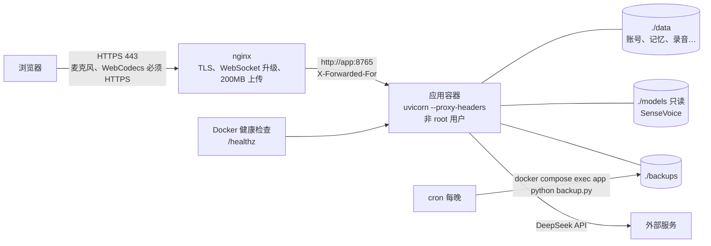

# S2 部署准备解析（不需要等决定的部分）

S2 是“部署到外网、小范围试用”。这一步先做不需要等决定的工程部分：打包部署、识别并发、限流和运行指标、备份、压测。要等你决定的部分（国内语音合成服务、合规公示、实名认证）放在后面做。部署步骤见 [deploy/README.md](../deploy/README.md)。

| 文件 | 内容 |
|---|---|
| `ops.py` | 新增：限流（滑动窗口）、运行指标（计数和最近 500 次耗时）、识别并发闸门 |
| `app.py` | `/healthz` 健康检查；`/api/admin/metrics`；各接口和 WebSocket 加限流；识别改走闸门；排队时提示 |
| `Dockerfile`、`.dockerignore`、`docker-compose.yml`、`deploy/nginx.conf`、`.env.example` | 容器部署：应用 + nginx（HTTPS、WebSocket、200 MB 上传） |
| `backup.py` | 新增：全部用户数据打成一个带日期的压缩包，保留最新几份 |
| `work/load_test.py` | 新增：多人同时说话的压测 |
| `static/ui/pages.js` | “设置”页给管理员加“运行情况”卡片 |
| `deploy/README.md` | 部署、备份、更新、回退步骤 |
| `test_ops.py`、`test_backup.py`、`test_frontend.cjs` | 新增测试 |

## 部署结构



- **配置全部走环境变量**，模板是 `.env.example`。真实的 `.env` 在服务器上由你自己填，已加进 `.gitignore`，镜像里也不会打包。
- **模型和数据不打进镜像**：数据是卷，更新和回退都不会动它；国内服务器访问不了 Hugging Face，模型从开发机拷过去。
- 容器里用 uid 10001 的普通用户运行；应用不直接对外开放端口，只有 nginx 能访问它。
- nginx：80 跳转到 443；`/ws` 升级为 WebSocket，空闲最长 1 小时；上传上限 210 MB（会议录音最大 200 MB）；静态文件缓存 7 天；加了 HSTS 等安全响应头。
- uvicorn 开了 `--proxy-headers`，限流看到的是访问者的真实地址，不是 nginx 的地址。

## 健康检查 `/healthz`

不需要登录，只回答 `{"ok": true}`，不透露任何其他信息。它会在 `data/` 里写一个小文件，写不了就返回 503，例如磁盘满或权限不对。Docker 每 30 秒检查一次，nginx 等应用检查通过后才启动。

## 识别并发

原来所有识别共用一把锁，一次只能识别一句：5 个人同时说话，第 5 个人要等前 4 句都识别完。

```python
with recognition_gate as gate:          # 最多 N 句同时识别，其余排队
    metrics.observe("asr_wait", gate.waited)
    text = transcribe_sensevoice(...)
```

- 同时识别几句由 `VOICE_ASR_CONCURRENCY` 决定，默认 2。每句占 2 个 CPU 线程，大约设成服务器核数的一半。
- SenseVoice 的识别器每种语言只加载一个，所有请求共用。实测在同一个识别器上并行解码，结果和串行完全一致；加载时上锁，避免两个请求同时加载两份。
- Whisper（备用）仍然一次只识别一句。
- 正在排队时，页面状态显示“识别排队中，前面还有 N 句…”，不会没有反应。
- 会议记录的后台转写也走同一个闸门，每次只占一个位置，实时对话可以插进来。

本机实测（12 核）：8 句 4.7 秒的录音，同时 1 句要 2.0 秒，同时 2 句 1.5 秒，同时 4 句 1.0 秒。

## 限流

按“谁”和“做什么”分别计数，滑动窗口：

| 类别 | 默认 | 按谁算 | 用在哪 |
|---|---|---|---|
| auth | 20 次/分钟 | IP 地址 | 登录、注册（账号本身还有“同一邮箱 15 分钟错 10 次”的保护） |
| turn | 30 次/分钟 | 账号 | 对话：打字、按住说话、开始或接着英语对话 |
| upload | 30 次/小时 | 账号 | 知识库、会议录音、自定义声音 |
| lookup | 60 次/分钟 | 账号 | 翻译、查词、标准读法、跟读、试听 |
| task | 20 次/小时 | 账号 | 后台任务、有声内容、测验、补生成总结 |

- 超出时 HTTP 接口返回 429，带“请 N 秒后再试”和 `Retry-After` 头；WebSocket 回一条错误消息，正在录的那句丢掉。
- 每个类别都能用环境变量调，如 `VOICE_RATE_TURN=60/60`。
- 只在一个进程的内存里计数。将来多实例部署（S4）时要换成 Redis。
- 压测时就碰到了：一分钟内注册超过 20 个测试账号，第 21 个被挡了下来。

## 运行指标

- 计数：各类 HTTP 状态（2xx、4xx、5xx）、各类限流触发次数。
- 耗时（最近 500 次的中位数、最慢 5%、最慢）：识别、识别排队、接口请求，以及每次回复的各个环节（识别完成、第一个字、第一段语音、文字完成、语音发完）。
- 管理员在“设置”页的“运行情况”卡片里看：运行了多久、正在识别几句 / 上限、排队几句、请求和出错次数、限流触发情况、各环节耗时表。
- 只记时间和次数，不记任何说话内容。

## 备份

```python
with closing(sqlite3.connect(path)) as source, closing(sqlite3.connect(copy)) as destination:
    source.backup(destination)          # SQLite 自己的在线备份，用户在用也能得到一致的副本
```

- `data/` 下所有文件打进 `backups/data-日期时间.tar.gz`；数据库用 SQLite 的在线备份复制；WAL 之类的临时文件和健康检查文件跳过。
- `--keep 14` 只保留最新 14 份。
- 写代码时发现一个 Windows 上的问题：Python 的 `with sqlite3.connect()` 只提交、不关闭连接，临时文件删不掉。改成显式关闭。

## 压测（本机，假模型，真识别，真 edge-tts）

`python work/load_test.py --pcm 一句话.pcm --users 1 5 --rounds 3`：注册测试账号，所有人在同一时刻用“按住说话”发同一句 4.7 秒的英语，每人 3 轮。

| 同时说话 | 识别完成（中位 / 最慢 5%） | 第一个字 | 第一段语音 |
|---|---|---|---|
| 1 人（模型已加载） | 0.26 / 0.26 秒 | 0.66 秒 | 1.81 秒 |
| 5 人 | 0.36 / 0.96 秒 | 0.77 秒 | 1.94 秒 |
| 10 人（第一次运行） | 0.40 / 1.78 秒 | 0.80 秒 | 1.98 秒 |

- 5 人同时说话，一般情况只慢了约 0.1 秒；最慢的那 5% 多等约 0.7 秒，是同时识别上限为 2 时排在后面的人。
- 第一次运行时单人最慢 4.1 秒，是识别模型首次加载。服务启动后第一句话会慢几秒。
- “第一个字”包含假模型固定的 0.4 秒；换成真实的 DeepSeek，要再加上它的响应时间。“第一段语音”包含 edge-tts 的网络往返，约 1 秒。
- 服务器上的数字要在云服务器上重新测，核数和网络都不同。建议 S0 时定下验收线，比如“5 人同时说话时，识别完成的最慢 5% 不超过 1.5 秒”。

## 还没验证的

- **Docker 镜像没有在本机构建**：Docker 已安装，但 Docker Desktop 没有运行；构建还要下载 Python 基础镜像和依赖包。Compose 文件已用 `docker compose config` 检查过，语法和挂载都对。
- nginx 配置没有实际跑过，要在服务器上用真实证书验证。

## 测试

- 后端新增 20 个：
  - 限流的计数、等待时间、按键分开、窗口滑动；
  - 环境变量设置限流（非法值回到默认）；
  - 指标只保留最近 N 次、分位数正确；
  - 并发闸门最多同时 N 个、等待人数计数正确；
  - 并发数的环境变量；
  - 健康检查不用登录、只回答 ok；
  - 只有管理员能看指标；
  - 同一地址登录太频繁返回 429 和 `Retry-After`；
  - 每个账号有自己的查询额度；
  - WebSocket 问得太快会提示等多久；
  - 识别排队时提示前面还有几句；
  - 备份包含所有文件、数据库副本可读、跳过临时文件、只保留最新几份。
- 前端新增 1 个：运行指标表格的文字。
