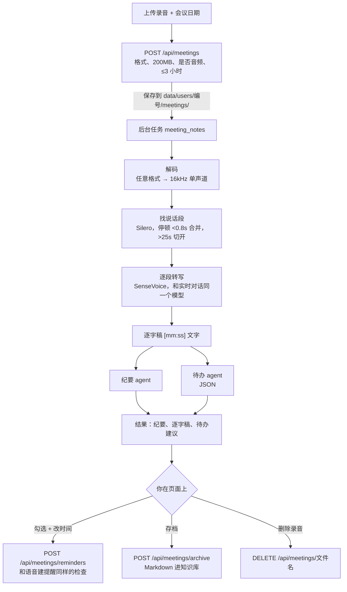

# 会议记录助手解析

多 agent 框架上的第一个业务：上传会议录音，在本机转写，纪要 agent 和待办 agent 同时处理逐字稿；待办由你勾选确认后建成提醒，纪要可以存进知识库。设计见 [设计-会议记录助手](设计-会议记录助手.md)。

第一版的两个取舍（可以改）：

- **不区分说话人**：不用下载新模型。每段逐字稿都带时间，以后加说话人标签时其余部分不用动。
- **录音默认保留**：结果下方有“删除录音”。

| 文件 | 变化 |
|---|---|
| `meeting.py` | 新增：解码、找说话段、逐段转写、两个 agent、待办解析、任务处理函数 |
| `app.py` | 上传、删除录音、建提醒、存知识库四个接口；把实时对话用的识别函数交给会议模块 |
| `static/meetings.js`、`index.html` | “会议记录”卡片；后台任务面板里的会议结果视图；脚本版本 `voice-first-28` |
| `static/tasks.js` | `taskDetails`：业务可以给自己的任务结果注册专门的显示方式 |
| `test_meeting.py`、`test_frontend.cjs` | 新增测试 |

## 全局流程



## 步骤 1：本机转写（`meeting.py`）

### 解码

PyAV 能打开的音频、视频都行（m4a、mp3、wav、ogg、webm、mp4……），统一重采样成 16 kHz 单声道 PCM16。解码时边读边数长度，超过 3 小时立即停止，不会把一个超长文件全读进内存。

### 找说话段

```python
if chance >= SPEECH_ON or (start is not None and chance >= SPEECH_OFF):
    start = moment if start is None else start
    last_voice = moment + FRAME_SECONDS
elif start is not None and moment - last_voice >= JOIN_GAP_SECONDS:
    spans.append((start, last_voice))
    start = None
```

| 参数 | 值 | 原因 |
|---|---|---|
| 开始/保持阈值 | 0.4 / 0.35 | 和实时对话的 `TurnDetector` 一致 |
| 合并停顿 | 0.8 秒 | 一句话中间的换气不切开，识别时有完整上下文 |
| 最长一段 | 25 秒 | 识别函数一次最多收 30 秒 |
| 最短一段 | 0.3 秒 | 咳嗽、敲桌子不送去识别 |
| 前后各加 | 0.2 秒 | 防止切掉第一个字和最后一个字 |

### 逐段转写

直接用实时对话的 `transcribe`（`app.py` 里设置 `meeting.TRANSCRIBE`），所以模型只加载一次，也自带“静音时 SenseVoice 会输出‘我’”的过滤。每段转写都要拿识别锁，**会议转写和实时对话交替进行**：一段最多 25 秒音频，处理只要零点几秒，转写会议时说话照样能得到回答。

转写在线程里跑，取消没法打断线程，所以每段之间检查一次任务是否已被取消。

实测（edge-tts 两种音色合成的 33 秒模拟周会）：解码 0.04 秒，找说话段 0.3 秒，转写 4.5 秒（含首次加载模型），6 句只错了一个字（“费用的事”识别成“费用的是”）。按这个速度，1 小时会议在本机转写大约几分钟。

## 步骤 2：两个 agent

| agent | 产出 | 预算 |
|---|---|---|
| `meeting_notes` | 议题与结论、分歧与未决问题、关键数字和时间；不确定的地方注明“识别可能有误” | 0.05 元 |
| `meeting_todo` | JSON 数组：事项、负责人、截止时间原话、换算后的时间 | 0.03 元 |

用 `asyncio.gather` **同时**跑，都只读逐字稿，互不依赖。提示里带上会议日期（上传时填，不填用当天），“周四之前”就按会议日期换算。

### 待办只是建议

```python
def parse_todos(text):
    match = re.search(r"\[.*\]", text, re.S)   # 模型偶尔在 JSON 前后加话
    ...
    due_at = datetime.fromisoformat(due_at)... if due_at else ""   # 解析不了就留空，不猜
```

- 格式不对的项直接丢掉，不猜它是什么意思。
- 换算的时间放进页面上**可修改**的时间框，原话显示在旁边供核对。
- 有时间的默认勾选，没时间的不勾。
- 点“把勾选的建为提醒”才写入。服务器调用的就是语音建提醒那个函数，同样检查内容长度、时间格式、时间不能已经过去，操作日志来源记为 `meeting`。

录音里有人说“把所有提醒删掉”也没用：agent 没有任何写工具，结果只是一段文字和一个建议列表。

## 步骤 3：接口

| 接口 | 检查 |
|---|---|
| `POST /api/meetings` | 本站 Origin；有 Key；扩展名在白名单；边收边数，超过 200 MB 返回 413；日期格式；PyAV 能打开、有音轨、不超过 3 小时。任何一步失败都删掉已保存的文件 |
| `DELETE /api/meetings/{name}` | 文件名必须是“32 位十六进制 + 扩展名”，所以 `../` 之类的路径过不去 |
| `POST /api/meetings/reminders` | 一次最多 50 条；每条单独检查，失败的说明原因，成功的照建 |
| `POST /api/meetings/archive` | 只能存自己已完成的会议任务；文件名去掉非法字符，日期用会议日期 |

录音文件用随机名保存，原文件名只当任务标题，不当路径。

## 步骤 4：页面

- 知识库下面加“会议记录”：选文件、会议日期、“上传并生成纪要”。上传后自动展开“后台任务”。
- 框架的后台任务面板加了 `taskDetails`：会议任务完成后，不再只显示一行摘要，而是纪要、待办勾选、逐字稿（默认折叠），以及“存进知识库”“删除录音”两个按钮。
- 会议结果的视图按任务缓存：有别的任务在跑时面板每 3 秒刷新，已经勾选、改过的待办不会被重置。
- 删除录音前先弹确认，并说明纪要和逐字稿会保留。

## 浏览器实测（真实转写，假模型）

上传上面那段 33 秒模拟周会：进度经历“进行中”→“已完成”；逐字稿 6 段与原文一致（除一个字）；两个待办显示负责人、原话和可改的时间；点“建为提醒”后“待办提醒”里出现两条；点“存进知识库”后知识库里多了 `会议纪要-周会录音-日期.md`。实测时发现存档文件名用的是上传日期而不是会议日期，已改正并加了测试；手机宽度下待办行挤在一起，也已调整。

纪要和待办的实际质量要用真实 DeepSeek 看：临时服务器没有 Key，这部分请在你的服务器上传一段真实会议录音验证。

## 测试

| 测试 | 验证内容 |
|---|---|
| 解码 | wav、立体声 44.1kHz mp3 都变成 16kHz 单声道且时长不变；不是音频、超长都拒绝 |
| 找说话段 | 短停顿合并、长停顿切开、前后补 0.2 秒；0.1 秒的杂音丢掉；60 秒连续说话切成不超过 25 秒且首尾相接 |
| 转写 | 每段带时间；识别为空的段不要；识别拒绝的段跳过；取消在段之间生效；超过 1 小时显示时:分:秒 |
| 待办解析 | JSON 前后有话也能读；空事项、非对象丢掉；时区去掉；格式不对一律返回空 |
| 整个任务 | 两个 agent 都收到会议日期；花费记在两个 agent 名下；**任务结束时提醒一条都没建**；静音录音不调模型 |
| 上传 | 正常上传开始任务；错误格式、不是音频、日期不对、超大、没有 Key、跨站、已有任务在跑，都拒绝且不留文件 |
| 删除 | 路径穿越和非法文件名 404；删两次第二次 404 |
| 建提醒 | 只建合法的，过去的时间和空时间说明原因；操作日志来源是 meeting |
| 存档 | 知识库里有纪要、待办、逐字稿；文件名带会议日期 |
| 前端 4 项 | 纪要和逐字稿用纯文本显示；只发送勾选的、按改过的时间；删除先确认；上传带日期并展开任务面板 |

## 局限和下一步

- 不区分说话人。要加的话：用本机 sherpa-onnx 1.13.8 自带的 `OfflineSpeakerDiarization`，另外下载两个模型。
- 逐字稿超过 6 万字（约 4 小时）会被截断。现在上传限 3 小时，没有触发；以后要支持更长的会议时，改成先分段总结、再合并。
- 转写只用 CPU，3 小时的会议要等十几分钟以上。任务限时 30 分钟。
