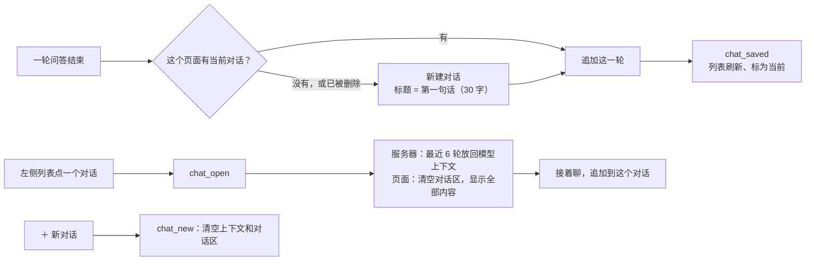

# 功能补充解析

按优先级补了 8 项功能：普通对话历史、账号功能、记忆和提醒的手动编辑（含重复提醒）、会议页面录音，以及英语对话的 4 处细节。实测时还发现并修了一个会让整个语音引擎失效的问题，见最后一节。

| 文件 | 变化 |
|---|---|
| `memory_store.py` | 新增 `ChatStore`；记忆可修改；提醒可修改、可重复（`repeat` 列，旧数据库自动加列）；复习记录支持“基本对” |
| `accounts.py` | 新增 `change_password` |
| `tools.py` | 设置提醒的语音工具支持 `repeat` |
| `quiz.py` | 拼写差一个字母算“基本对”（`one_edit_apart`） |
| `app.py` | 对话保存、打开、新建；对话列表接口；改密码；记忆和提醒的新增、修改；测验记录接口 |
| `static/ui/pages.js`、`meetings.js`、`english.js` | 对话列表；改密码表单；记忆、提醒编辑；页面录音；测验记录；生词本“我的声音”；手机选词 |
| `static/login.html` | 重新设计的登录、注册页 |
| `static/app.js` | `chat_*` 消息交给对话列表 |
| `test_chats.py`、`test_password.py`、`test_memory_editing.py`、`test_quiz.py`、`test_frontend.cjs` | 新增测试 |

## 1. 普通对话的历史记录



- 存在每个用户自己的 `agent.db` 里：`chats`（标题、更新时间、轮数）和 `chat_messages`（谁说的、内容、时间）。
- 只保存问和最终的回答，不保存工具调用的中间过程。打开旧对话时，最近 6 轮作为上下文还给模型，所以能接着聊。
- **英语对话的内容不会进这个列表**（它有自己的对话记录），演示确认的测试句也不保存。
- 列表：按最近更新排序；搜索标题或任意一句话（输入 `%`、`_` 按普通字符找，不当通配符）；改标题；删除（先确认）。
- 对话页左侧是列表，右侧是对话区；手机上列表在上面，最多占 260 像素高。

## 2. 账号功能

**修改密码**（设置页 → 账号 → 修改密码）：

- 要输入现在的密码；新密码 8–128 位，不能和现在的一样，要输两次。
- 改成功后，**其他设备上的登录全部退出**，当前这台保持登录：万一会话被别人拿到，改密码就能踢掉。
- 和登录一样计入同一地址的频率限制；输错现在的密码会记进操作日志。

**登录页**重新设计：

- 左边是产品介绍，右边是登录和注册切换；
- 密码可以点“显示”；
- 注册要输两次密码，提交前先检查邮箱格式、长度、两次是否一致；
- 手机上上下排列。

找回密码要邮件或短信服务，还没做，页面提示“忘记密码请联系管理员重置”。

## 3. 记忆、提醒手动编辑和重复提醒

- **长期记忆**：顶部输入框直接添加；每条可以“编辑”（回车保存、Esc 取消）。
- **待办提醒**：顶部表单写事项、选时间（默认下一个整点）、选重复方式（不重复、每天、工作日、每周）；每条可以编辑。
- 页面上的新增和修改，检查和语音工具一样：内容 1–200 字、时间要在将来、重复方式合法；操作都记进操作日志。

重复提醒：

```python
def next_occurrence(due, repeat, moment):
    step = timedelta(days=7 if repeat == "weekly" else 1)
    due = due + step
    while due <= moment or (repeat == "weekdays" and due.weekday() >= 5):
        due += step
    return due
```

- 播报后不标成“已完成”，而是排到下一次，时间点不变；工作日的跳过周六周日。
- 错过很多次（比如几天没打开页面），只补报一次，下一次排到将来的第一个时间点，不会一口气补报好几条。
- 语音也能设：设置提醒的工具多了 `repeat` 参数，说“每天早上八点提醒我吃药”，模型会填 `daily`，回答里带上“（每天重复）”。
- 旧数据库没有 `repeat` 列，第一次打开时自动加上，原来的提醒都当作不重复。

## 4. 会议直接在页面录音

- 会议记录页新增“在页面录音”：开始、暂停 / 继续、结束并生成纪要、丢弃（先确认）；显示时长和音量条。
- 用浏览器的 MediaRecorder 录成 WebM/Opus（32 kbps，1 小时约 15 MB），用当前选的麦克风。结束后直接上传给原来的会议接口，服务器的转写流程不用改（已确认能解码 WebM/Opus）。
- 录音器放在页面组件外面，**录音时可以切到别的页面**；关闭或刷新标签页时浏览器会先询问。
- 最长 3 小时，到时自动结束并上传。上传失败时，录音自动下载到本机，可以稍后再传。

## 5–8. 英语对话的细节

| # | 改动 |
|---|---|
| 5 | 填空和拼写题：4 个字母以上的词差一个字母（多、少或错一个）算“≈ 基本对”，显示正确拼法；这个条目**不升级也不降级**，明天再考 |
| 6 | 英语对话页右侧多了“测验”标签：每次测验的时间和得分，点开看每道题、你的答案、对错和正确答案 |
| 7 | 生词本每条都有“标准读法”和“我的声音”两个按钮 |
| 8 | 手机、平板等触屏设备上，长按选中文字后约 0.7 秒自动弹出解释（触屏没有“松开鼠标”这个事件，改为跟踪选区变化） |

## 实测中发现的问题：全局变量重名让语音引擎失效

在浏览器里检查时，对话区完全没有反应。控制台显示：

> Uncaught SyntaxError: Identifier 'recording' has already been declared

原因：页面的脚本都是普通脚本，共用一个全局作用域。会议录音模块新声明了一个全局的 `recording`，而 `app.js` 早就有一个同名变量（按住说话的录音状态），所以后加载的 `app.js` 整个没有执行，语音引擎完全失效。

- 修复：会议录音的状态改名为 `meetingRecording`。
- 防止再犯：前端测试加了一项，按 `index.html` 的加载顺序检查所有脚本声明的顶层名字，有重名就失败。修复前它正好能查出这一处。
- 同时修了一个日期显示问题：对话列表判断“是不是今天”时用了 UTC 日期，晚上就已经算到明天了，改成本地日期。

## 浏览器实测

- 登录页新样式；注册时两次密码不一致会提示，一致后注册并进入应用。
- 对话：问两句，列表出现“今天天气怎么样 · 2 轮”；点“新对话”，对话区清空；再问一句，列表有两个对话；点回第一个，对话区显示原来的 4 条消息并标为当前。
- 记忆：添加“我不吃香菜”，编辑成“我不吃香菜和葱”。
- 提醒：时间默认是下一个整点；选“工作日”添加后，列表显示时间、内容和“工作日”标签。
- 会议录音卡片、改密码表单、测验标签都能正常显示。没有实测真正录音，浏览器面板里没有麦克风。

## 测试

后端 669 个通过、1 个跳过（这次新增 33 个），前端 61 个通过（新增 4 个）：

- 对话：存储、搜索（含 `%` `_`）、改名、删除；逐轮保存到同一个对话；新对话没有旧上下文；打开旧对话后模型拿到原来的内容；被删除的对话不会再被写入；英语对话不进列表；接口的增删改查和跨站保护。
- 密码：要现在的密码；其他设备退出、当前保持；新密码的规则；接口的错误提示和操作日志；计入登录频率限制。
- 记忆和提醒：重复的下一次时间（含周末、错过多天）；播报后重复的排到下次、一次性的完成；旧数据库自动加列；只能改未播报的；语音工具设重复提醒；页面新增和修改的各种校验。
- 测验：差一个字母的判定、只对 4 个字母以上的词生效；“基本对”不升不降、明天再考；测验记录的列表和详情。
- 前端：改密码校验、默认提醒时间（含跨年）、录音文件名、对话时间显示（晚上不按 UTC 算）、结果标签、答案显示、全局变量重名检查。
