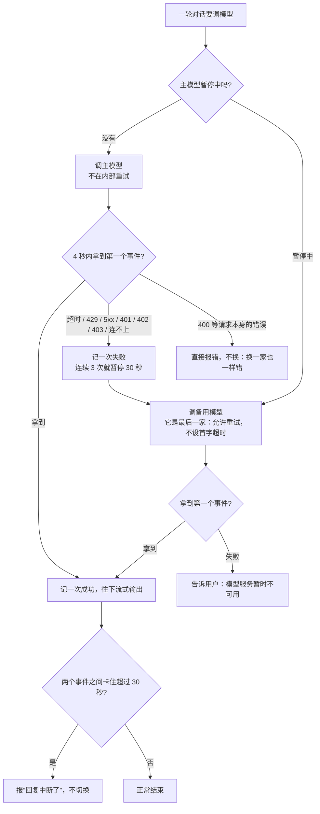

# 备用模型切换解析

DeepSeek 出问题时（超时、限流、服务端错误、余额不足、密钥失效、连不上），自动改用一个备用的模型服务，用户最多觉得那一句慢了一点。备用服务可以是任何兼容 OpenAI 聊天接口的服务，不配置就和以前完全一样。

| 文件 | 内容 |
|---|---|
| `llm_client.py` | 新增 `ProviderUnavailable`，表示“这家用不了，换一家可能可以”；连接失败也包装成它；可以关掉内部重试；DeepSeek 独有的 `thinking` 参数改由各服务自己配置 |
| `llm_router.py` | 新增：服务列表、切换规则、熔断器、两种等待策略 |
| `app.py` | 读取备用服务配置；语音对话和后台 agent 都改走路由；管理员运行情况接口返回模型状态 |
| `agents.py` | 账本记录实际回答的那个模型 |
| `usage.py` | 新增不打折的固定价格（备用服务没有 DeepSeek 的夜间半价） |
| `manage.py` | `import-legacy` 按账号库所在的位置决定导入到哪里（迁移 PostgreSQL 时留下的问题，这次跑测试发现后修好） |
| `static/ui/pages.js` | 管理员“运行情况”卡片加一项“模型” |
| `.env.example` | 备用服务的 5 个配置项 |
| `test_llm_router.py`、`test_usage.py`、`test_postgres.py`、`test_frontend.cjs` | 新增测试 |

## 1. 核心规则：只能在还没输出的时候换

回复是边生成边念的。第一个字念出来以后再换模型，用户会听到前半句是一个模型说的、后面又换了一种说法。所以：



“第一个事件”可以是第一段文字，也可以是“模型要调用工具”的通知。工具通知一出来，页面就开始播放“我查一下”这类等待语音，所以同样算作已经开始回复。

## 2. 底层：区分“值得换一家”的错误

```python
FAILOVER_STATUSES = RETRY_STATUSES | {401, 402, 403}   # 400 不算

if response.status_code != 200:
    error = ProviderUnavailable if response.status_code in FAILOVER_STATUSES else RuntimeError
    raise error(auth_error(response.status_code))
```

- `ProviderUnavailable` 继承 `RuntimeError`，所以原来处理错误的地方都不用改，给用户看的文字也和以前一样。
- 连不上（`httpx.TransportError`）以前会把 httpx 的原始异常抛出去，页面只能显示“处理失败”。现在要看出错的时机：还没开始收数据，说明这家连不上，抛 `ProviderUnavailable("连不上模型服务")`；已经收到一部分，说明回复中途断了，抛 `RuntimeError("模型回复中断了")`。
- 新参数 `retry_delays`：传 `()` 表示失败了不在同一家重试，马上返回，让路由去换下一家。语音对话等不起原来的 1 秒加 2 秒。

## 3. 路由 `llm_router.py`

### 两种等待策略

```python
VOICE = Policy(first_event=4, stall=30)          # DeepSeek 平时 0.6–0.9 秒出第一个字（data/latency.jsonl）
BACKGROUND = Policy(first_event=30, stall=120)   # 后台 agent 没人在听，给主模型更多时间
```

- `first_event` 只用在“后面还有一家可以换”的时候。最后一家没有退路，就按客户端原来的超时（连接 5 秒、读取 180 秒）等，内部重试也照旧。所以**没配置备用服务时，行为和以前完全一样**，原有的 671 个测试一个没改就全部通过了。
- `stall` 管的是已经开始回复以后，两个事件之间最多隔多久。超过就报“回复中断”，不会换另一个模型再回答一遍。

### 超时用 `asyncio.timeout`，不用 `wait_for`

```python
async def next_event(stream, seconds=None):
    if seconds is None:
        return await anext(stream)
    async with asyncio.timeout(seconds):
        return await anext(stream)
```

`wait_for` 会把每次取下一个事件都放进一个新的任务里执行，而 httpx 的流式连接要求始终在同一个任务里被推进。`asyncio.timeout` 在当前任务里计时，超时就取消当前这一步，连接会在原来的任务里正常关闭。

### 熔断器

```python
class Breaker:
    # closed（正常）→ 连续失败 3 次 → open（暂停 30 秒，直接跳过）
    #   → 30 秒后 half-open（放一个请求过去试）→ 成功回到 closed，失败重新暂停 30 秒
```

没有熔断器的话，DeepSeek 一旦整体故障，每一句话都要先白等 4 秒，才能轮到备用模型。有了熔断器，只有最开始的 3 句会慢，之后直接走备用模型；每 30 秒试一次主模型，恢复了就自动切回去。

所有服务都在暂停中时，仍然会试最后一家，而不是直接拒绝用户。

### 账本记实际回答的那一家

```python
on_usage=lambda provider, used: usage.LEDGER.record_chat(context.user_id, provider.model, used)
```

- 主模型虽然超时，但可能已经接受了请求并开始计费。`stream_chat` 原有的逻辑会把它记成“不完整”的一条，正好符合实际。被直接拒绝（429、503 等）的请求不计费，也不记账。
- 后台 agent 可以指定更强的模型（`spec.model`），这个指定只替换主服务的模型。备用服务的模型名在另一个平台上，保持它自己的配置。
- 备用模型的价格用 `VOICE_LLM_BACKUP_PRICE` 配置，按固定价格计算，不打夜间折扣。没配置价格时，它的调用在花费页显示为“未定价”，不会被悄悄算成 0 元。

## 4. 业务代码怎么调用

```python
# app.py
def llm_providers():   # 每次调用时读取，改配置（以及测试替换配置）马上生效
    return [llm_router.Provider("deepseek", DEEPSEEK_URL, API_KEY, LLM_MODEL, llm_client.DEEPSEEK_OPTIONS),
            llm_router.Provider("backup", BACKUP_URL, BACKUP_KEY, BACKUP_MODEL, BACKUP_EXTRA_BODY)]

llm = llm_router.Router(llm_providers, lambda: metrics)

# 实时语音对话
return llm.chat(messages, llm_router.VOICE, **options, on_usage=...)

# 后台 agent
return llm.chat(messages, llm_router.BACKGROUND, primary_model=model, on_usage=...)
```

`run_turn` 和工具循环一行都不用改，因为 `llm.chat` 产出的事件和原来的 `stream_chat` 完全一样。工具循环每一轮都会把完整历史重新发一遍，所以第一轮用 DeepSeek、第二轮用备用模型也没问题。

## 5. 运维能看到什么

管理员“运行情况”卡片新增“模型”一项：

- 当前由谁回答：主模型 / 备用模型 / 无备用。
- 每个服务的熔断状态：正常 / 暂停中 / 试探恢复。
- 累计切换次数（`llm_failover_deepseek`），以及备用模型实际回答的次数（`llm_answered_by_backup`）。

普通用户看不到这些，只会觉得那一句慢了一点。

## 6. 配置（服务器的 `.env`，密钥由你自己填）

```
VOICE_LLM_BACKUP_BASE_URL=https://备用平台的接口地址
VOICE_LLM_BACKUP_API_KEY=
VOICE_LLM_BACKUP_MODEL=备用平台上的模型名
VOICE_LLM_BACKUP_EXTRA_BODY={"thinking": {"type": "disabled"}}    # 只有备用平台也是 DeepSeek 模型、并且支持这个参数时才写
VOICE_LLM_BACKUP_PRICE={"hit": 0.2, "miss": 2.0, "output": 8.0}   # 按备用平台的价格页填，单位元/百万 tokens
```

**备用服务怎么选**：最好选别的平台托管的同一个 DeepSeek 模型。火山方舟、阿里云百炼等国内平台都提供 DeepSeek 模型，具体型号以平台为准。这样提示词、工具调用和中文语气都一致。换成别家的模型也可以，但上线前要先用 stage 0 的工具调用探测脚本（`work/` 下）跑一遍，确认它能正确调用工具，并且不会在工具还没执行时就说“记下了”。

## 7. 验证

| 检查 | 结果 |
|---|---|
| 原有全部测试（没有备用服务，行为不变） | 通过 |
| `test_llm_router.py`：主模型没反应 → 换备用；429/500/503/401/402 → 立刻换、不重试；400 → 不换；已开始输出后卡住 → 报中断、不换；工具通知算作已开始；最后一家不受首字超时限制；只有一家时保留它自己的错误提示；两家都失败；熔断 → 暂停 → 试探 → 恢复或重新暂停；全部暂停时仍试最后一家；按实际回答的模型记账；agent 指定的模型只替换主服务；各家的参数分开传；未配置的备用服务被忽略；用户打断时会关闭底层连接 | 25 个通过 |
| 经过真实 httpx 客户端：503 → 每家各只发 1 次请求，备用请求不带 `thinking`；连不上 → 换备用；后台 agent 按备用模型记账；一整轮 WebSocket 语音对话由备用模型回答 | 通过（包含在上面 25 个里） |
| 备用模型固定价格、夜间不打折；DeepSeek 夜间仍半价 | 通过 |
| 管理员卡片的模型摘要 | 前端测试通过 |

## 没做的和要注意的

- **没有用真实的备用平台测过**：还没选定平台，也没有它的密钥。上线前要用真实密钥跑一次，再用工具调用探测脚本确认它的行为。
- **前缀缓存会失效**：DeepSeek 的缓存命中价远低于未命中价，切到备用模型后缓存全部失效，这段时间成本会上升。熔断恢复后会自动切回主模型。
- **402（余额不足）现在只是切换，还没有报警**：管理员只能在卡片上看到切换次数在涨。以后可以接一个通知。
- **多实例部署时**：熔断状态在每个进程里各记各的，最多每台机器各白等几次超时，可以接受，不需要为此引入 Redis。
- 超时数字（4 秒、30 秒、连续 3 次、暂停 30 秒）是按现在的延迟记录定的。上线后看运行情况卡片里的数据再调整。
