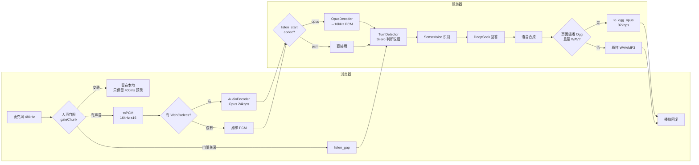
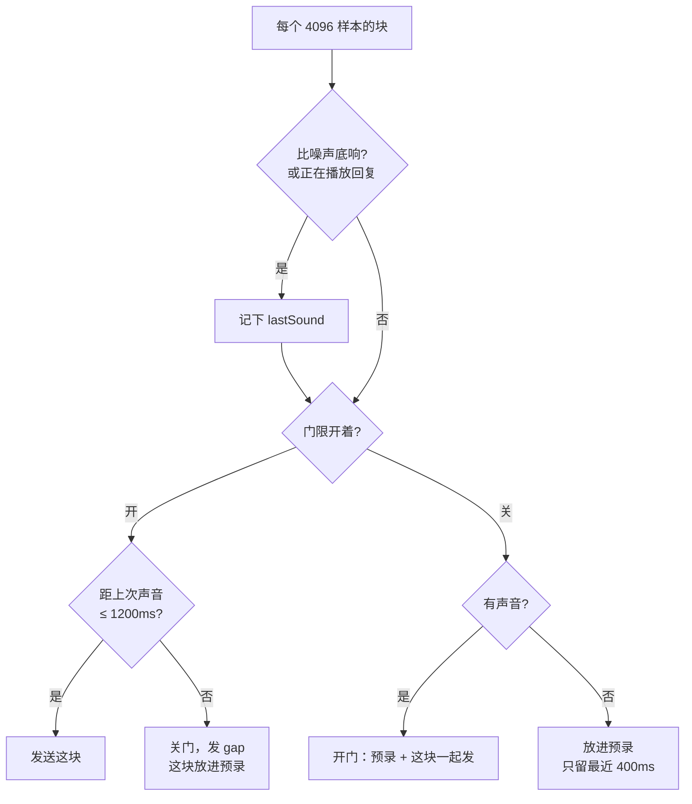
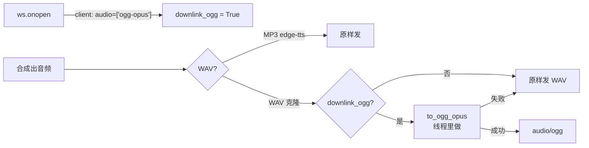

# 带宽优化解析：浏览器人声门限 + Opus 编码

部署到服务器之前，先把语音流量压下来。原来持续监听时浏览器一直上传 16 kHz PCM（每秒 32 KB，安静时也在传），克隆音色的回复以 24 kHz WAV 下发（每秒 48 KB）。按带宽计费的云服务器上，这是最大的一项流量。

| 文件 | 变化 |
|---|---|
| `audio_codec.py` | 新增：`OpusDecoder` 解码麦克风包，`to_ogg_opus` 压缩回复 |
| `static/speech.js` | 新增人声门限 `newSpeechGate`、`gateChunk` |
| `static/app.js` | 监听时先过门限；`createUplink` 用 WebCodecs 编码 Opus；连接时告诉服务器能否播放 Ogg |
| `app.py` | 按页面声明解码 Opus、转码回复；处理 `listen_gap`；协议版本升到 5 |
| `static/index.html` | 脚本版本号改为 `voice-first-25`，避免浏览器用旧缓存 |
| `test_audio_codec.py`、`test_frontend.cjs` | 新增测试 |

不需要新依赖：浏览器用自带的 WebCodecs，服务器用 PyAV 自带的 libopus。

## 实测结果（浏览器面板，真实页面代码）

测试音频：1 秒静音 +“测试确认” + 3 秒静音，共 6.37 秒，按 48 kHz 麦克风送入页面的门限和编码器，服务器正常识别出“测试确认。”。

| 方向 | 原来 | 现在 | 缩小 |
|---|---|---|---|
| 上行（这段 6.37 秒） | 203,776 字节 PCM | 门限后剩 106,470 字节，Opus 编码后 **7,022 字节**（166 个包） | 约 29 倍 |
| 上行（说话时每秒） | 32 KB | 约 2.1 KB | 约 15 倍 |
| 上行（没人说话） | 32 KB/秒 | **0** | — |
| 下行（克隆音色回复） | 48 KB/秒 WAV | 3.8 KB/秒 Ogg/Opus | 约 12 倍 |

浏览器解码服务器生成的 Ogg 正常，时长一致（2.37 秒）；音量不变（输入峰值 0.244，输出 0.249）。

## 全局流程



## 步骤 1：浏览器人声门限（`static/speech.js`）

门限只决定**传不传**，不决定**是不是人话**：真正判断说话开始和结束的仍是服务器的 Silero。所以门限可以简单：沿用页面已有的自适应噪声底（`detectSpeech`），比噪声底明显高就算有声音。



三个数字的来由：

| 参数 | 值 | 原因 |
|---|---|---|
| 预录 | 400 ms | 第一个字的开头还不够响，门限晚开一点；预录把它补上，否则“测试”会被识别成“试” |
| 拖尾 | 1200 ms | 必须长于服务器判断一句话结束的 0.6 秒静音，否则服务器永远等不到句尾 |
| 播放时 | 一直开 | 用户插话时要让服务器做打断判断，不能被门限挡掉 |

```javascript
function gateChunk(gate, chunk, rms, now, chunkMs, keepOpen = false) {
  const sound = detectSpeech(gate.detector, rms) || keepOpen;
  if (sound) gate.lastSound = now;
  if (gate.open) {
    if (now - gate.lastSound <= gate.hangoverMs) return {send: [chunk], gap: false};
    gate.open = false;
    gate.buffer = [{chunk, chunkMs}]; gate.bufferMs = chunkMs;
    return {send: [], gap: true};
  }
  ...
}
```

关门那一刻返回 `gap: true`，页面发一条 `{type:'listen_gap'}`。

## 步骤 2：Opus 上行（`static/app.js` 的 `createUplink`）

```javascript
const config = {codec:'opus', sampleRate:16000, numberOfChannels:1, bitrate:24000};
const supported = typeof AudioEncoder !== 'undefined' && (await AudioEncoder.isConfigSupported(config)...).supported;
if (!supported) return {codec:'pcm', send: pcm => ws.send(pcm), close() {}};
```

- 支持就返回一个 `{codec:'opus', send, close}`，`send` 把 16 kHz PCM 包成 `AudioData` 交给编码器，编码器每 20 ms 吐出一个 Opus 包，直接作为二进制帧发出去。
- 不支持（旧浏览器、非 HTTPS 的远程地址）就退回 PCM，功能不变，只是流量大。
- 时间戳按已送出的样本数算，门限关掉的那段静音不占时间，编码器不会补静音。
- `startListening` 把选中的编码写进 `listen_start`：`{type:'listen_start', codec:'opus'}`。
- 按住说话（录音模式）仍走 PCM，没改。

## 步骤 3：服务器解码（`audio_codec.py`、`app.py`）

```python
class OpusDecoder:
    def __init__(self):
        self.codec = av.CodecContext.create("opus", "r")
        self.resampler = av.AudioResampler(format="s16", layout="mono", rate=16000)

    def decode(self, packet):
        try:
            frames = [out for frame in self.codec.decode(av.Packet(packet)) for out in self.resampler.resample(frame)]
        except Exception:
            return b""          # 坏包丢掉，连接不断
        return b"".join(frame.to_ndarray().astype("<i2").tobytes() for frame in frames)
```

- libopus 不管要什么采样率都输出 48 kHz 浮点，所以接一个重采样器转回 16 kHz s16，后面的 Silero 和 SenseVoice 完全不用改。
- Opus 包之间有状态，所以**每个监听连接一个解码器**，`listen_start` 时创建，`listen_stop` 时丢掉。

```python
audio_in = decoder.decode(message["bytes"]) if decoder else message["bytes"]
for event, audio in detector.feed(audio_in):
```

### `listen_gap` 怎么处理

门限关闭后，服务器那边可能还留着一点没凑成一句话的残余音频。下一句话开头不能接上几秒前的残余，所以收到 `listen_gap` 时清掉它；但如果服务器正在一句话中间（`detector.audio` 不是空的），绝不能清，否则会截断这句话。

```python
if kind == "listen_gap":
    if detector is not None and getattr(detector, "audio", None) is None:
        detector.reset()
```

拖尾 1200 ms 长于 0.6 秒的句尾判断，正常情况下 gap 到达时句子已经结束；这个判断是保险。

## 步骤 4：Ogg/Opus 下行（`to_ogg_opus`、`send_audio`）



- 页面连接后先发 `{type:'client', audio:[...]}`，用 `canPlayType('audio/ogg; codecs="opus"')` 判断能不能播。没说能播的页面一律收 WAV，旧页面不受影响。
- edge-tts 的 MP3 本来就小（每秒约 6 KB），不转。
- 转码放进 `asyncio.to_thread`，不卡住 WebSocket；出错就记日志发 WAV，不会没声音。
- Opus 只支持 8/12/16/24/48 kHz，其他采样率（如 22050）先重采样到 48 kHz。

## 步骤 5：协议版本 5

页面和服务器必须同时更新：新页面发 Opus 给旧服务器，旧服务器会把 Opus 包当 PCM 喂给 Silero，什么也识别不出，而且不报错。所以 `/api/status` 的 `voice_protocol` 升到 5，页面只在版本为 5 时才打开持续监听，版本不对会提示刷新或重启服务。`index.html` 里的脚本版本号同步改成 `voice-first-25`，否则浏览器可能用缓存的旧 `speech.js`（这次实测就遇到了）。

## 测试

| 测试 | 验证内容 |
|---|---|
| `test_opus_packets_come_back_as_16khz_pcm...` | Opus 解码后长度和频率都对 |
| `test_opus_is_about_an_eighth_of_pcm` | 体积小于 PCM 的六分之一 |
| `test_a_damaged_packet_is_dropped_not_fatal` | 坏包不让连接出错 |
| `test_wav_replies_become_much_smaller_ogg_opus...` | 24k、16k、22050 Hz 都能转，体积小于五分之一，时长不变 |
| `test_a_listening_page_can_send_opus` | WebSocket 收 Opus，送给 Silero 的是 1 秒 PCM |
| `test_without_a_codec_the_page_still_sends_pcm` | 不声明编码时照旧 |
| `test_a_gap_clears_stale_audio_only_between_sentences` | gap 只在句子之间清空 |
| `test_a_page_that_plays_ogg_gets_wav_replies_as_ogg_opus` 等 | Ogg、WAV、MP3 的选择 |
| 前端：门限单元测试、安静房间什么都不发、页面声明 Ogg | `test_frontend.cjs` |

## 局限

- 门限是能量判断，空调、风扇这类持续噪声会被噪声底吸收，但电视声会打开门限，照样上传（服务器再用 Silero 过滤）。
- WebCodecs 要求安全上下文：本机 `127.0.0.1` 可以；部署到服务器后必须上 HTTPS，否则退回 PCM。
- 外放播放时门限保持打开，这段时间的流量和以前一样（压缩后）。
