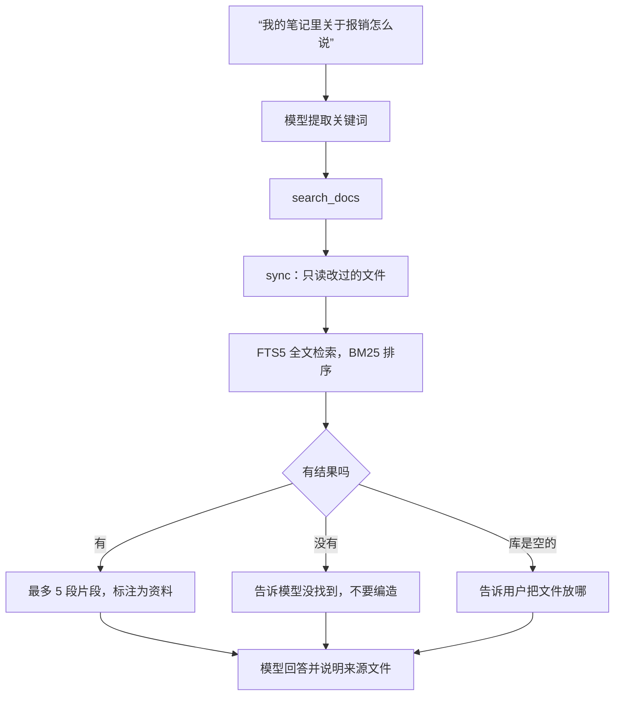
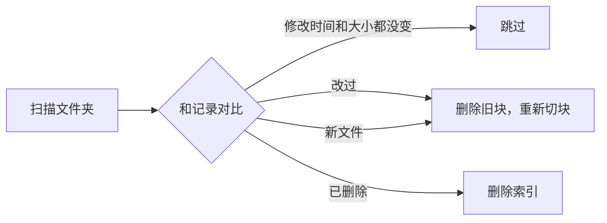
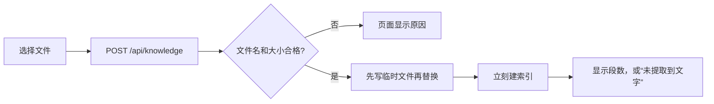
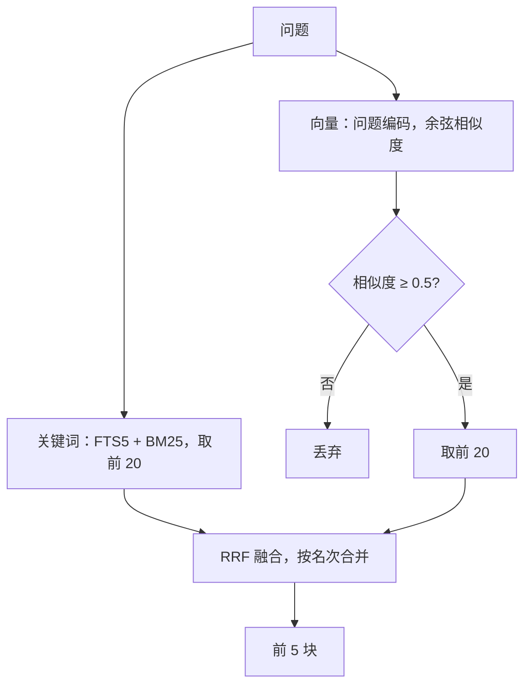

# 本地知识库解析

让助手能回答“我的笔记里怎么说”。在页面上传文件，或者复制到 `knowledge` 文件夹就能查，不用重启，也不用手动建索引。

| 文件 | 变化 |
|---|---|
| `knowledge.py` | 新增：切词、切块、增量索引、检索 |
| `tools.py` | 新增 `search_docs` 工具 |
| `agent_loop.py` | 规则里把文档也列为“只是资料” |
| `conftest.py` | 测试使用独立的知识库 |
| `.gitignore` | 忽略 `knowledge/`，个人文档不进 git |
| `app.py`、`static/memories.js` | 上传、列表、删除 |
| `requirements.txt` | 新增 `pypdf`、`python-docx` |

## 全局流程



## 为什么不用向量检索

原方案写的是向量检索。第一版改用全文检索：

| | 全文检索（现在） | 向量检索 |
|---|---|---|
| 下载 | 不用 | 要下载嵌入模型 |
| 新依赖 | 不用，SQLite 自带 | 要 |
| 理解同义词 | 不能 | 能 |
| 精确词（人名、编号） | 很好 | 一般 |

先用简单方案，把真实使用中的漏查记录下来，再决定是否值得加向量。这里的接口是 `search(query)`，以后换实现不用改工具。

## 步骤 1：中文切词（`tokens`）

SQLite 的默认分词把一串中文当成一个词，所以“报销流程说明”查“流程”查不到。这里自己切成重叠的两字组合：

```python
def tokens(text):
    for word in WORDS.findall(text):
        if word.isascii():
            found.append(word.lower())
        elif len(word) == 1:
            found.append(word)
        else:
            found.extend(word[i:i + 2] for i in range(len(word) - 1))
```

`报销流程` 会变成 `报销 销流 流程`。不需要词典，所以也不用 jieba，代价是会产生“销流”这种无意义的组合，但它们只是不起作用，不影响结果。

## 步骤 2：切块（`chunks`）

整篇发给模型太长，所以把文档切成约 400 字的块：

- 按空行分段，段落尽量合并到 400 字。
- 超长段落按 400 字切开，相邻两块重叠 50 字，避免一句话被切断后两边都查不到。

文件名也进入索引，所以 `年假制度.txt` 里即使没写“年假”，查“年假”也能找到。

## 步骤 3：增量索引（`sync`）

每次查询前都同步，但只读改过的文件：



所以改完文件马上就能查到，也不用后台监听。索引文件 `data/knowledge.db` 可以随时删除，下次查询时会重建。

## 步骤 4：检索

```python
expression = " OR ".join(f'"{term}"' for term in terms)
rows = connection.execute("SELECT path, body FROM chunks WHERE chunks MATCH ? ORDER BY rank LIMIT ?", (expression, limit))
```

- **`OR`**：共享任何一个词就算候选，由 BM25 排序。
- **加引号**：每个词都被引起来，所以用户输入里的 `OR`、`NEAR(` 不会被当成查询语法。
- **参数绑定**：查询文本不会拼进 SQL。

## 步骤 5：安全边界

文档是自己的，但不一定是自己写的，比如下载的文章，所以和网页同等对待：

| 风险 | 处理 |
|---|---|
| 文档里藏着指令 | `external=True`：这一轮的写操作都要确认 |
| 文档原文留在对话里 | 写入历史前换成省略说明 |
| 符号链接指向文件夹外的隐私文件 | 解析真实路径，不在文件夹内就跳过 |
| 文件内容外发 | 只发查到的片段，最多 5 段 |
| 查不到时模型编造 | 明确告诉它“没有找到，不要编造” |

## 步骤 6：上传和 PDF、Word



- **文件名只取最后一段**：`../../evil.md` 变成 `evil.md`，上传不能写到知识库以外。
- **上传时就建索引**：大 PDF 解析可能要几秒，放在上传时做，提问时就不用等，也不会撞上工具的超时。
- **读不了的文件照样记录**：加密或损坏的文件显示“未提取到文字”，不会每次提问都重试，也不影响其他文件。
- **删除要确认**：文档删除后不能恢复，和记忆、提醒不同，所以页面会先询问。删除接口也会校验路径，只能删知识库里支持的文件类型。
- **大小限制**：`md`、`txt` 2 MB，`pdf`、`docx` 20 MB。

## 步骤 7：标题跟着块走

问题：文档写着“三、住宿标准”，下面一行是“一线城市 500 元”。如果切块时标题和正文分开，正文那一块就查不到“住宿标准”，模型也不知道 500 元指什么。

做法：识别标题，给每段正文加上完整的标题路径，比如 `【差旅制度 > 二、住宿标准】`。

| 标题形式 | 层级 |
|---|---|
| Markdown `#` 到 `######` | 按 `#` 的数量 |
| 第一章、第一篇、第一部分 | 1 |
| 第一节、一、 | 2 |
| （一）、1. | 3 |
| 1.1 | 4 |
| Word 的“标题 1、标题 2”样式 | 按样式等级 |

只有不超过 30 字、不以句号这类标点结尾的行才算标题，所以“1. 发票要在七天内提交。”是正文，不是标题。

### 第一版做错了

第一版每个章节单独切块。用评测脚本一测，命中率反而从 9/10 降到 8/10。原因是“出差住酒店的上限”里的“出差”在另一个章节，切开后就不在同一块了。

现在的做法：先给每段加上标题路径，再把小章节合并到 400 字。

| 测试 | 不带标签 | 每章单独切块 | 带标签并合并（现在） |
|---|---|---|---|
| 示例库 10 题，第一名命中 | 9 | 8 | 9 |
| 长文档“住宿标准是多少” | 第 4 名 | - | 第 2 名 |
| 长文档“交通怎么规定” | 没命中 | - | 第 2 名 |

短文档本来就整篇在一块里，标签帮不上忙，所以长文档才看得出差别。示例题是我写的，难免偏向这套方案，最终要以你的真实文档为准。

切块格式变了，旧索引会自动重建：靠 SQLite 的 `user_version` 记录索引版本，版本不对就清空重来。

## 评测脚本

`work/eval_knowledge.py` 统计第一名命中、前 5 命中和 MRR：

```bash
python work/eval_knowledge.py --init    # 生成示例问题文件
python work/eval_knowledge.py           # 用你的问题评测真实知识库
python work/eval_knowledge.py --demo    # 用内置示例库评测
```

问题文件在 `data/knowledge_eval.json`，只保存在本地。每题要写明答案所在的文件，可以再写一段片段里必须出现的文字。以后每次改检索方式，都用同一份问题对比。

## 步骤 8：混合召回



### 模型

`Xenova/bge-small-zh-v1.5` 的 int8 ONNX 版本，约 24 MB，输出 512 维，取首个 token（CLS）作为句子向量。官方 BAAI 仓库没有 ONNX 文件，所以用社区转换版。在 CPU 上运行，GPU 留给克隆音色。没有新依赖：`onnxruntime`、`tokenizers`、`numpy` 原本就装了。

### 融合

```python
def fuse(*rankings):
    scores = {}
    for ranking in rankings:
        for rank, chunk in enumerate(ranking):
            scores[chunk] = scores.get(chunk, 0) + 1 / (RRF_K + rank + 1)
    return sorted(scores, key=scores.get, reverse=True)
```

BM25 分数和余弦相似度的量纲不同，RRF 只看名次，所以不用调权重。两路都排在前面的块得分最高。

### 相似度门槛

向量检索总会返回“最近的”几块，哪怕都不相关，这会让“查不到就说查不到”失效。实测相关的句子对是 0.53 到 0.65，无关的是 0.35 到 0.45，所以只靠向量命中的块，相似度要不低于 0.5。关键词命中的块不受影响。

这个门槛只来自几组句子，换了文档可能要调整。

### 向量什么时候算

| 时机 | 做法 |
|---|---|
| 上传 | 一次算完，上传会变慢，提问不受影响 |
| 文件放进文件夹，或者模型是后来才下载的 | 每次提问最多补算 2 秒，分批提交，进度不会丢 |
| 文件改动或删除 | 旧向量一起删除 |

补算有上限，是为了不撞上工具 10 秒的超时。补算完成前，没有向量的块只能靠关键词找到。

### 降级

没有模型文件或者模型损坏时，自动退回纯关键词，日志里会记一条，提问照常进行。

### 结果

| 测试 | 只用关键词 | 混合召回 |
|---|---|---|
| 示例库 10 题，第一名命中 | 9 | 10 |
| “车费能报吗” | 没命中 | 第一名 |
| “量子计算机的原理”（无关） | 0 条 | 0 条 |

| 速度（201 个文件，401 块） | 结果 |
|---|---|
| 建向量 | 15 秒，约 38 毫秒一块 |
| 一次混合检索 | 约 0.16 秒 |
| 问题编码 | 约 2 毫秒 |

示例题仍然是我写的，还要用你的真实文档跑一遍评测才能下结论。

## 实测发现的问题：代码行被当成标题

上传了一份 Go 和 gRPC 教程后，标题路径里出现了“创建服务器 > 5. for {”“9. break”这种标签。原因有两个：

- 代码块里的 `1.`、`#` 被当成了标题。
- 这份文档的代码没有放在代码块标记里，而是带行号的普通文本。

修复：

| 规则 | 作用 |
|---|---|
| 代码块（三个反引号或波浪线）里不识别标题 | 挡住代码注释和编号 |
| 含 `{}()[];=<>` 这类代码符号的行不算标题 | 挡住大部分代码行 |
| 数字编号的标题必须含中文，且不能有连续空格 | 挡住带缩进的行号代码 |

代价：英文的数字编号标题（如“1. Introduction”）不再识别，Markdown 的 `#` 标题不受影响。

修复后这份文档的标题路径全部是真实章节。索引版本升到 5，旧索引会自动重建。

同一次测试里，问“go 的学习路线”，模型回答“没找到”。检索其实返回了 5 段，但这份文档讲的是用 Go 写 gRPC，没有学习路线，所以模型的判断不算错。不过它应该说明资料里实际讲的是什么。工具说明已经补上这条要求，需要真实模型验证。

## 已知局限

- **同义词**：混合召回已经能处理一部分，比如“车费”对“打车”，但向量模型很小，也不是每次都能找到。
- **相似度门槛是估计值**：只用几组句子测过。
- **大知识库首次补算要等**：约 38 毫秒一块，几千块要几分钟，期间只能靠关键词找到还没算完的部分。
- **扫描版 PDF 读不了**：里面是图片，没有文字，需要 OCR。
- **PDF 的版式**：多栏和表格提取后顺序可能混乱。
- **中文 PDF 只有你的文件能验证**：自动测试里的 PDF 是英文的，因为生成中文 PDF 要嵌入字体。
- **追问**：原文不留在历史里，所以追问时模型会重新查询，或者只根据之前的回答。

## 验证结果

| 检查 | 结果 |
|---|---|
| 后端测试 | 417 项通过，1 项跳过 |
| 前端测试 | 39 项通过 |
| 1001 个文件的库 | 首次索引 2.4 秒，索引约 9.5 MB |
| 文件没变时的查询 | 约 0.3 秒，其中大部分是扫描文件夹 |
| 精确词查询 | “差旅报销住宿标准”第一条命中 |
| 部分词命中 | “出差住宿”命中 |
| 同义词查询 | “车费能报吗”没有命中 |

**还没验证**：真实 DeepSeek 是否会在该查的时候调用它，以及你自己文档上的效果。
