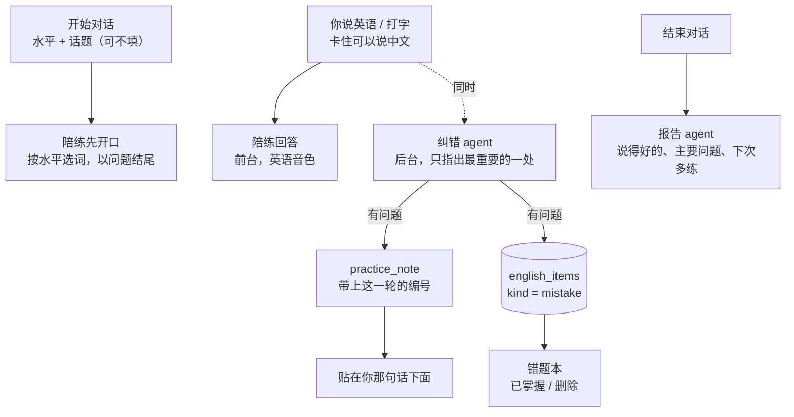
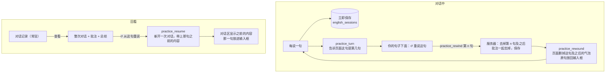

# 自由英语对话解析（第一阶段）

把场景版口语陪练改成自由英语对话的第一阶段：聊什么都行，陪练按你的水平说话；你说的话有问题，改法直接出现在你那句话下面，并自动记进**错题本**。设计和后两个阶段（看不懂的词句标注、生词本、间隔复习测验）见 [设计-自由英语对话](设计-自由英语对话.md)。

| 文件 | 变化 |
|---|---|
| `practice.py` | 去掉场景、角色、规划 agent、固定热身句；新增水平和话题、聊天伙伴提示；评估 agent 改名为纠错 agent；总结改为简短三段 |
| `memory_store.py`、`user_context.py` | `PracticeStore` 换成 `EnglishStore`：对话记录表 `english_sessions` 和学习库 `english_items`（第三阶段复习用的字段已建好） |
| `app.py` | 开始对话收水平和话题；纠错结果入错题本，并带上所属那一轮的编号；错题本的列出、标为已掌握、删除接口 |
| `static/app.js` | 记下每一轮“你”的气泡，后到的批注能贴到对应那句下面 |
| `static/practice.js`、`index.html` | “英语对话”卡片（水平、话题、开始/结束、错题本、对话记录）；脚本版本 `voice-first-31` |
| `test_practice.py`、`test_frontend.cjs` | 测试按新行为重写 |

## 全局流程



## 步骤 1：从场景改成自由对话（`practice.py`）

```python
LEVELS = {
    "beginner": ("初级", "a beginner (about CEFR A2): use very common words and short simple sentences, ..."),
    "intermediate": ("中级", "an intermediate learner (about CEFR B1-B2): ..."),
    "advanced": ("高级", "an advanced learner (about CEFR C1): ..."),
}
```

`partner_prompt(level, topic)` 写给陪练的要求：

- 只说英语，每次最多三句，通常以问题结尾，让对话接下去；
- 按水平选词；有话题就从话题开始，没有就让你选，想不出时它建议一个日常话题；
- 你说中文或卡住时，先用一句中文帮你，再回到英语；
- 你问某个词、某句话什么意思时，简单解释并举一个例子；
- **不当场纠错**：纠错由另一个 agent 安静地做，陪练只管把话聊下去。

话题是你自己写的，所以直接放进陪练提示（最多 100 字，多余的空白合并）。水平记在个人设置里，下次打开默认选上次的。

## 步骤 2：批注贴在你那句话下面

难点在于批注是**后到的**：陪练可能已经回答完、你甚至已经说了下一句，批注才回来。所以要知道它属于哪一句。

- **服务器**：纠错 agent 启动时带上这一轮的编号 `rid`，发 `practice_note` 时作为 `request_id` 一起发回。
- **页面**：`bubble()` 创建“你”的气泡时，用当前轮次编号记下这个气泡：

```javascript
if (role === 'user') {
  userBubbles.set(requestId, box);
  for (const old of userBubbles.keys()) { if (userBubbles.size <= 50) break; userBubbles.delete(old); }
}
```

  打字、按住说话、持续监听三种方式创建气泡时，`requestId` 都已经是这一轮的编号，所以三种方式都能对上。

- `practice.js` 收到批注后用 `userBubbleFor(request_id)` 找到气泡，把黄色批注卡加在下面；找不到（比如页面刷新过）就显示在卡片的状态行里。
- 批注里的每一段都用 `textContent` 写入，你说的话不会被当成 HTML。
- 只保留最近 50 轮的对应关系，长时间对话不会越攒越多。

纠错 agent 的提示多了两条：你说中文、或者在问某个词的意思时，不算错误。不然“budget 是什么意思”会被当成病句。

## 步骤 3：错题入库（`EnglishStore`）

```
english_items：id, kind(word/phrase/sentence/mistake), text, key, meaning, phonetic, note, context,
               session_id, created_at, seen_count, box, due_at, tested, correct, mastered
               UNIQUE (kind, key)
```

错题入库时各字段的用法：

| 字段 | 错题里存的 |
|---|---|
| `text` | 你说的原句 |
| `meaning` | 改法（没有就用更地道的说法） |
| `note` | 中文说明 |
| `context` | 原句里有问题的那部分 |

- `key` 是去掉大小写、多余空格和句末标点后的文本：同一个错误再犯，不会多一条，而是 `seen_count` 加一、改法更新为最新的，并且重新变成“未掌握”、马上到期。
- `box`、`due_at`、`tested`、`correct` 这一阶段先建好不用，第三阶段的间隔复习直接接上。
- 生词、短语、句子（第二阶段）也放这张表，用 `kind` 区分。
- 新建了表 `english_sessions`，不沿用场景版的 `practice_sessions`。你在服务器上试过场景版，那张旧表还在，但不再使用，不影响。

## 步骤 4：页面

- “口语陪练”改名为“**英语对话**”：水平、话题、开始对话、结束对话。
- “**错题本**”（显示条数）：原句（灰）、改法（粗体）、说明、日期，出现过多次的写出次数；可以“已掌握”或“删除”。对话中有新批注时，如果错题本是展开的，会自动刷新。
- “对话记录”：时间、水平、话题、说了几句、几条批注。
- 去掉了固定场景和固定跟读句。跟读的识别接口 `/api/practice/read` 保留，第二阶段改成“任意一句都能跟读”。

## 浏览器实测（真实英语合成，假模型）

选“初级”、话题“my weekend”开始：

1. 陪练用英语开场，问周末做了什么；
2. 输入“I go to cinema yesterday”，这句下面出现批注：“语法：I go → I went，更地道：I went to the cinema yesterday. 说过去的事要用过去式 went”；
3. 再输入正确的“I watched a funny movie”，下面**没有**批注；
4. 结束后错题本显示 1 条，对话记录多了一条，后台任务生成总结。

实测时还发现一个测试脚本的问题：页面还没连上服务器就点了开始，前两句发给了平时的助手。这不是功能问题，“开始对话”在没连上时会提示“还没连上服务器”。

## 测试

| 测试 | 验证内容 |
|---|---|
| 陪练提示 | 初级含 A2、没话题时建议日常话题；高级含 C1、包含你写的话题和“卡住可说中文” |
| 学习库 | 同一错误两次只算一条、次数加一、改法更新、重新未掌握；计数、已掌握、删除；类型不对或内容为空拒绝 |
| 对话记录 | 只列出已结束的；话题和总结保存 |
| 全程（WebSocket） | 水平、话题（合并空白）进陪练提示；英语音色按句播报；**批注带着这一轮的编号**；错题入库各字段；结束后总结；回到平时助手时没有对话内容；水平记进个人设置；四个 agent 记账 |
| 边界 | 水平不对、话题超 100 字拒绝且不建记录；没说话不生成总结；中途关页面也保存；说话按英语识别 |
| 接口 | 总览（水平列表、上次的水平、对话记录、各类条数）；错题本列出、按类型过滤、已掌握和撤销、删除、跨站被拒；跟读接口；补生成总结 |
| 前端 4 项 | 默认选上次的水平、对话记录和错题数；开始发送水平和话题、**批注贴到对应气泡下**、找不到气泡时显示在状态行；错题本纯文本显示、已掌握和删除；总结显示 |

## 下一步

- **第二阶段**：标注 agent 给陪练的话标出超出水平的词；点词或句子看解释；查过的、问过的进生词本；任意一句都能跟读。
- **第三阶段**：间隔复习测验；到期的词融进下次对话。

---

# 补充：对话实时保存、重说某一句、回看记录

你的反馈：“对话记录”看不到（之前折叠在卡片最下面，而且只有一行摘要，看不到内容）；希望每句实时保存，并且能从某一句重新来。

## 页面怎么安排

| 位置 | 放什么 | 原因 |
|---|---|---|
| 上方对话区（输入框、麦克风旁边） | 正在进行的对话；批注贴在你的句子下面；你的每一句下面有“↺ 重说这句” | 说话、打字都在这里，不需要在卡片里再放一套输入框，也不会两处重复显示 |
| “英语对话”卡片 | 开始/结束、错题本，以及**常驻显示的“对话记录”**列表 | 记录不再折叠；每行一次对话：时间、水平、话题、说了几句、批注数，进行中的标“未结束” |
| 卡片里的记录查看器 | 点“查看”展开整次对话：陪练/你的每一句、批注、总结；你的每一句都有“↺ 从这句重说” | 回看和重来放在一起，不离开卡片 |



## 服务器

- **每句都存**：你的句子一进来、陪练每说完一句、每条批注回来，都立刻写进 `english_sessions`（`save_progress`）。关掉页面或服务重启，对话都还在，记录里标“未结束”。
- **陪练的历史从句子列表重建**（`practice.history_for(turns)`），不再单独存一份。去掉几句，只需要把列表截短，陪练就“忘了”那几句。
- **重说这句**（`practice_rewind`）：只能选你自己说的句子（`is_learner_turn`：必须是整数、在范围内、是你的句子；陪练的开场不行）。会先停掉正在播报的回复，再去掉这句和之后所有的句子与批注，保存，然后把原句发回页面。
- **晚到的批注**：重说之前那句的批注可能还在路上。批注回来时会检查那个位置上还是不是原来那句话，不是就丢掉，不会贴错地方，也不会存进这次对话。（已经记进错题本的错误仍然保留：错误确实犯过。）
- **从以前的对话重说**（`practice_resume`）：新开一次对话，复制那句**之前**的内容和批注，水平、话题沿用。旧的那次对话保持原样，不会被改。
- 批注多了 `turn` 字段，回看时知道它属于哪一句。
- 新接口 `GET /api/practice/sessions/{id}`：一次对话的全部句子、批注、总结。记录列表现在包括未结束的对话。

## 页面

- `practiceBubbles`：句子编号 → 对话区里的气泡。你的句子由服务器的 `practice_turn` 带编号告诉页面，陪练的句子取当前回复的气泡。
- 点“重说这句”后，页面删掉这句及之后的所有气泡，把原句放进输入框，可以改了再发，也可以直接重新说。
- 结束对话后，对话区里的“重说这句”按钮自动去掉，避免对已结束的对话操作。
- 从记录重说时，对话区先显示那句之前的内容（包括当时的批注），再把那句放进输入框。
- 所有内容都用 `textContent` 写入。脚本版本 `voice-first-32`。

## 浏览器实测（真实英语合成，假模型）

1. 开始对话，说了两句。对话**还没结束**时，记录里已经有这次对话：说了 2 句、批注 1 条、未结束。
2. 在第一句下面点“重说这句”：这句和后面的内容都从对话区消失，原句回到输入框；发送后对话从这里继续。
3. 结束对话后，“对话记录”常驻显示这一条；点“查看”，卡片里展开陪练和你的每一句、批注和总结。
4. 在查看器里点“从这句重说”：新开一次对话，对话区显示陪练的开场，原句放进输入框。

## 新增测试

| 测试 | 验证内容 |
|---|---|
| 历史重建、句子编号检查 | 从句子列表重建陪练历史；只有你的句子能重说（陪练的句子、越界、布尔值、字符串都不行） |
| 实时保存 | 说话过程中就能读到完整对话、标未结束；页面收到每句的编号；批注带句子编号 |
| 重说这句 | 这句和之后的句子、批注都去掉；陪练之后的请求里没有被去掉的内容；无效编号报错 |
| 晚到的批注 | 批注在重说之后才回来，不会存进对话 |
| 从以前的对话重说 | 新对话带上那句之前的内容和批注、沿用水平话题；陪练历史正确；旧对话不变；无效请求报错 |
| 前端 | 记录常驻、未结束标注；重说按钮、批注位置、删除之后的气泡、原句放回输入框；查看器内容、只有你的句子能重说、从记录重说后对话区和输入框正确 |
