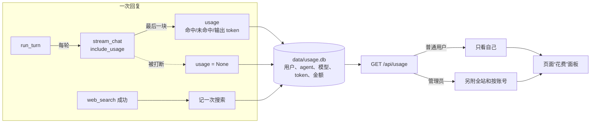
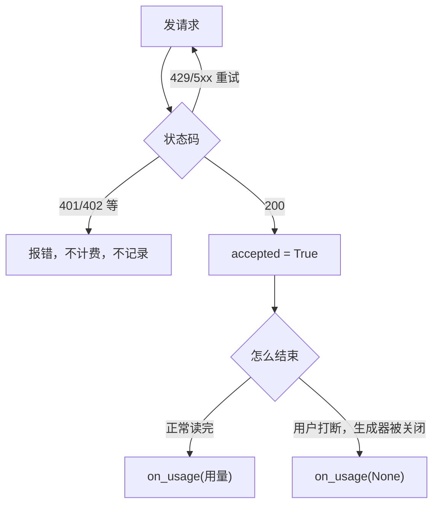

# 花费统计解析：本地记录 DeepSeek 用量和金额

接入多 agent 之前先把账算清楚：每次调用模型、每次联网搜索花了多少钱，是谁、哪个 agent 花的，都记在本机，在页面上能看到。以后加后台调研等 agent 时，只要给它一个名字，花费就自动单独统计。

| 文件 | 变化 |
|---|---|
| `usage.py` | 新增：价格表、高峰判断、账本 `UsageLedger`、汇总 |
| `llm_client.py` | 请求带 `stream_options.include_usage`，从最后一块取用量，通过 `on_usage` 交出去 |
| `app.py` | 回复时把用量记到当前用户名下；新增 `GET /api/usage` |
| `tools.py` | 联网搜索成功一次记一次 |
| `accounts.py` | `emails()`：管理员表格里显示邮箱 |
| `static/usage.js`、`index.html` | “花费”面板；脚本版本 `voice-first-26` |
| `test_usage.py`、`test_frontend.cjs` | 新增测试 |

## 全局流程



## 步骤 1：价格（`usage.py`）

价格来自 DeepSeek 官方价格页（2026-11），单位是元/百万 token，表里存的是**高峰价**：

| 模型 | 输入（缓存命中） | 输入（未命中） | 输出 |
|---|---|---|---|
| deepseek-flash（当前在用） | 0.04 | 2 | 8 |
| deepseek-v4-pro | 0.30 | 9 | 27 |

- 高峰时段：北京时间工作日 9–12 点、14–18 点；其余时间半价。
- 联网搜索：每 1000 次成功 5 元，即每次 0.005 元。

```python
def is_peak(moment):
    moment = moment.astimezone(BEIJING)
    return moment.weekday() < 5 and any(start <= moment.hour < end for start, end in PEAK_HOURS)
```

- 中国没有夏令时，固定 UTC+8 就是准确的，不用装时区数据库（Windows 上 `zoneinfo` 还要额外装 tzdata）。
- 节假日也是半价，但这里没有节假日日历，节假日的工作日按高峰价算：**只会多估，不会少估**。
- 不认识的模型返回 `None`，页面显示“没有价格，未计入”，不会当成免费。DeepSeek 调价时改 `PRICES` 即可。

## 步骤 2：从流里拿到用量（`llm_client.py`）

请求里加上 `"stream_options": {"include_usage": true}`，DeepSeek 会在 `[DONE]` 之前的最后一块里带上整个请求的 `usage`，有时和最后一个字在同一块，所以要在处理 `choices` 之前先取：

```python
state["usage"] = chunk.get("usage") or state["usage"]
choices = chunk.get("choices", [])
```

`stream_chat` 外面包一层 `try/finally`，保证**每个被服务器接受的请求恰好报告一次**：



| 情况 | 记录 | 原因 |
|---|---|---|
| 正常完成 | 一行，带 token 和金额 | |
| 重试后成功 | 一行 | 被拒绝的那次不计费 |
| 401、402 | 不记 | 不计费 |
| 播报中被打断 | 一行“不完整” | DeepSeek 照样收了这次的钱，但用量没传回来；页面写明“N 次被打断的对话没有拿到用量，实际花费会略高”，而不是悄悄少报 |

## 步骤 3：账本（`UsageLedger`）

一张表，放在 `data/usage.db`，**不放在每个用户的目录里**：管理员要看全站汇总，集中一张表才查得动。普通用户的查询条件 `user_id` 只来自登录会话，请求参数里没有，改不了别人的。

| 列 | 用途 |
|---|---|
| `user_id` | 谁花的 |
| `agent` | 哪个 agent 花的，现在都是 `main`；以后后台调研写 `research` |
| `kind` | `chat` 或 `search` |
| `model`、`hit_tokens`、`miss_tokens`、`output_tokens` | 原始用量，价格变了也能重算 |
| `peak`、`cost_yuan` | 记录当时的价格 |
| `complete` | 0 表示被打断、没拿到用量 |
| `day` | 北京时间的日期，按天汇总用 |

写入失败（磁盘满、文件坏了）只记日志，不影响回复，和操作日志 `ActionLog` 一样。

## 步骤 4：接口和页面

`GET /api/usage` 返回今天、本月、最近 14 天每天、本月按 agent 的汇总，每项都有金额、对话数、搜索数、token 和缓存命中率。管理员多一个 `all`：全站本月合计和按账号的表。

页面在“长期记忆 / 待办提醒 / 知识库”下面加了“花费”，打开时才加载，可手动刷新。邮箱等内容一律用 `textContent` 写入，不当 HTML 解析。

缓存命中率值得看：命中的输入价格是未命中的 1/50。系统提示把时钟放在最后（`build_system_prompt`），就是为了让前面的部分保持不变、多命中缓存。

## 给多 agent 留的接口

新 agent 调模型时，在 `on_usage` 里换个名字就行：

```python
stream_chat(..., on_usage=lambda used: usage.LEDGER.record_chat(context.user_id, LLM_MODEL, used, agent="research"))
```

面板的“本月按 agent”表会自动多出一行。下一步做每用户、每 agent 的预算上限时，也从这张表查。

## 测试

| 测试 | 验证内容 |
|---|---|
| `test_peak_is_weekday_office_hours_in_beijing` | 9:00、11:59、14:00 是高峰，12:00、13:59、18:00、周末不是 |
| `test_the_same_moment_in_another_timezone...` | 换了时区也按北京时间判断 |
| `test_cost_follows_the_price_table...` | 金额与价格表一致，非高峰半价 |
| `test_summary_adds_up...` | 今天、本月、按天、按 agent 的合计 |
| `test_a_user_sees_only_their_own_spend...` | 用户之间互相看不到 |
| `test_a_cut_off_call_is_counted_as_missing...` | 被打断、没价格的调用单独计数 |
| `test_usage_from_the_last_chunk...` 等 | 用量来自最后一块；打断报 None；重试只记一次；401/402 不记 |
| `test_a_reply_is_recorded_for_the_user_who_asked` | 一次真实的 WebSocket 回复记到当前用户名下 |
| `test_a_successful_web_search_is_recorded...` | 搜索成功才记 |
| `test_the_page_gets_its_own_spend...` | 只有管理员能看到全站 |
| 前端两项 | 面板显示金额、命中率、缺失提示；账号表用纯文本 |

## 局限

- 金额是按价格表估算的，以 DeepSeek 后台账单为准；赠送余额、节假日半价都没算进去。
- 播报中被打断的对话用量拿不到，只能计次数。
- 语音合成（edge-tts 免费、CosyVoice 在本机）和语音识别（本机）不花钱，所以没有记录。
