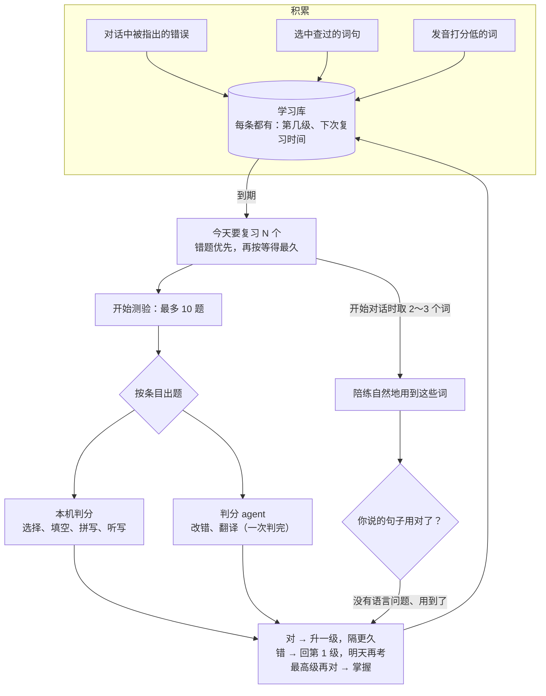

# 英语复习测验解析（自由英语对话第三阶段）

对话里积累的错题和生词，按遗忘规律安排复习：到期了就出测试题，答对隔得更久，答错明天再考。到期的词还会交给陪练，在下次对话里自然地用到，你自己用对了也算一次复习。设计见 [设计-自由英语对话](设计-自由英语对话.md)。

| 文件 | 变化 |
|---|---|
| `memory_store.py` | 复习间隔、`next_review`；学习库新增到期查询、记录答题、测验表 `english_quizzes`；新条目的到期时间改用本地时间格式 |
| `quiz.py` | 新增：按条目出题、本机判分规则、干扰项和判分两个 agent 的输入输出 |
| `practice.py` | 陪练提示可带复习词；`used_words` 判断一句话里用到了哪些词 |
| `app.py` | 复习状态、开始测验、交卷三个接口；开始对话时取到期的词交给陪练；用对复习词记一次答对 |
| `static/ui/english.js`、`index.html` | 复习状态条和“开始测验”；测验卡片和结果；生词本、错题本显示复习进度；“复习词”评判标签 |
| `test_quiz.py`、`test_frontend.cjs` | 新增测试 |

## 全局流程



## 步骤 1：复习间隔

| 级别 | 0 | 1 | 2 | 3 | 4 | 5 |
|---|---|---|---|---|---|---|
| 隔几天再考 | 当天 | 1 | 2 | 4 | 7 | 15 |

```python
def next_review(box, correct, moment):
    if not correct:
        return 1, local(moment + timedelta(days=1)), False          # 错：回第 1 级，明天
    if box >= len(REVIEW_DAYS) - 1:
        return box, local(moment), True                             # 最高级又对：掌握
    box += 1
    return box, local(moment + timedelta(days=REVIEW_DAYS[box])), False
```

- 新条目在第 0 级，记下当天就能考到。
- 掌握了的不再出题。同一个错误再犯、同一个词再查，会重新变成“未掌握、马上到期”（第一阶段已经这样做）。
- 到期查询把错题排前面，其余按等得最久排，一次最多 10 个。
- 修了一个时间格式的隐患：新条目原来用带时区的格式记录到期时间，复习查询用不带时区的本地时间比较，两种格式按文字比较会出错，现在统一成本地时间。

## 步骤 2：出题

| 条目 | 题型 | 判分 |
|---|---|---|
| 错题 | **改错**：给出你当时说的原句和提示，写出正确的说法 | 判分 agent：改掉了原来的问题、语法对、意思不变就算对，不必和参考答案一字不差 |
| 句子 | **听写**（标准音色读一遍）或**翻译成中文**，两种轮换 | 听写在本机判：逐词对齐，读对 90% 以上算对；翻译交给判分 agent |
| 单词、短语，原句里有它 | **填空**：用当时那句话，把这个词挖空，下面给中文提示 | 本机：忽略大小写和标点后完全一致 |
| 单词、短语，有中文意思 | **选意思**（4 选 1）或**看中文写英文**，两种轮换 | 本机 |
| 只有发音分、没有意思的词 | **听写** | 本机 |

- 选择题的 3 个干扰项由出题 agent 一次生成。拿不到时（没有 Key、超出预算、网络出错），从你学习库里其他条目的意思中随机取；凑不够 3 个就改成“看中文写英文”。
- **答案只留在服务器**，页面拿到的题目里没有答案。
- 判分 agent 拿不到结果时，改错和翻译按和参考答案的相似度判（80% 以上算对），保证交卷总有结果。
- 一次测验只能交一次，重复交卷返回 409。

花费：一次 10 题大约调用两次模型（出干扰项一次、判开放题一次），约 0.002 元，计入每天的花费上限。其余题型本机判分，不花钱。

## 步骤 3：复习词进对话

- 开始对话时，取最多 3 个到期的单词或短语，写进陪练提示：“学习者正在复习这些词，在合适的时候自然地用一用，也引导他用，但不要把聊天变成上课。”
- 状态栏提示：“这次会用到复习词：……，试着自己也用一用。”
- 你说的句子里用到了某个复习词（按整词匹配，不分大小写），并且纠错 agent 没有指出语言问题，就记一次答对，这个词升一级；评判标签显示“复习词：用上了 ……，算一次复习”。每个词一次对话只算一次。

## 步骤 4：页面

- 英语对话页的控制卡片下多了一条**复习状态**：“今天有 N 个错题和生词要复习”和“开始测验”；复习做完时显示下一个的时间和上次测验得分。对话进行中不能开始测验。
- **测验卡片**出现在对话区上方：每题标明题型（改错、听写、翻译、填空、看中文写英文、选意思），听写题有“▶ 播放”，选择题是 4 个可点的选项。下方显示已答几题，没答的算错。
- **交卷后**：每题变绿或变红，错的给出答案，开放题有点评，并写明下次什么时候考（明天、几天后、已掌握）；标题显示得分。
- **生词本、错题本**的每条都显示复习进度：“复习第 2 级 · 答对 2/3 · 下次 2026-11-12 10:00”，或“还没复习过”“已掌握”。

## 浏览器实测（假模型）

1. 开始对话，说一句“I go to cinema yesterday”（得到一条错题），查一下“weekend”（得到一个生词），结束对话；
2. 复习状态条显示“今天有 2 个错题和生词要复习”；
3. 开始测验：第 1 题是改错（原句加提示），第 2 题是填空“What did you do this _____?”（提示“周末”）；
4. 改错写“I went to the cinema yesterday.”，填空故意写“weekday”，交卷：得分 1/2，第 1 题“✓ 对了”，第 2 题“✗ 不对 答案：weekend”，两题都“明天再考”；
5. 状态条变为“今天的复习做完了，下一个在 ……”和“上次测验 1/2”。

## 测试

| 测试 | 验证内容 |
|---|---|
| 复习间隔 | 各级答对、答错后的级别和时间；最高级答对算掌握 |
| 到期查询 | 错题优先、再按到期早晚；已掌握和未到期的不出；按类型筛选；答题次数和答对次数累加 |
| 出题 | 每类条目对应的题型；挖空只匹配整词；没有干扰项的选择题改成拼写；选择题答案位置正确；页面看不到答案；最多 10 题 |
| 判分规则 | 选择、拼写（大小写、标点、空格）、听写 90%；改错和翻译交给判分 agent；空答案算错；干扰项和批改结果的解析 |
| 测验接口 | 没有到期的内容时说明原因；出题、交卷、得分、点评、每个条目升降级；不能交两次；没有 Key 时干扰项来自其他条目、开放题按相似度判 |
| 复习词进对话 | 开始对话时发出复习词；用对后记一次答对、升级；评判里有“用上了”；整词匹配 |
| 前端 | 下次复习时间、复习进度的文字；“复习词”标签 |

后端 616 个通过、1 个跳过（新增 14 个）；前端 57 个通过。

## 局限

- 口头作答（用说的回答测验）还没做，按之前的约定等新麦克风到了再做。
- 填空和拼写要求完全一致，拼错一个字母也算错（会给出正确答案）。
- 复习词只看你有没有在没有语言问题的句子里用到，不判断用法是否地道。
