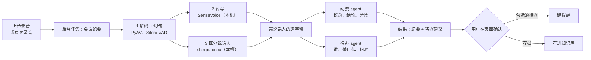

# 设计：会议记录助手（待确认，未实现）

上传或在页面录一段会议录音，后台转写并区分说话人，几个 agent 分工写纪要、拆待办，待办经用户确认后变成提醒，纪要可存进知识库。

## 用户流程

纪要和待办两个 agent **并行**跑（都只读逐字稿），比串行快一半。

## agent 分工

| agent | 输入 | 输出 | 工具 | 预算 |
|---|---|---|---|---|
| `meeting_notes` | 逐字稿 | 议题、每个议题的结论和分歧、未决问题 | 无 | 0.05 元 |
| `meeting_todo` | 逐字稿 | JSON：负责人、事项、截止时间（原话） | 无 | 0.03 元 |

截止时间让模型照抄原话（“周五前”），由现有的 `parse_due` 换算成具体时间，不让模型自己算日期。

两个 agent 都不能写。建提醒、存知识库都在用户确认后由页面调用现有接口完成，经过阶段 3 的确认和操作日志。

## 本机处理（不调模型，不花钱）

| 步骤 | 用什么 | 已有/新增 |
|---|---|---|
| 解码 | PyAV，支持 m4a、mp3、wav、ogg、webm | 已有（带宽那步引入） |
| 切句 | Silero VAD | 已有 |
| 转写 | SenseVoice | 已有 |
| 区分说话人 | sherpa-onnx 1.13.8 的 `OfflineSpeakerDiarization`（已确认本机安装的版本有这个类） | **新增两个模型**：分段模型（pyannote segmentation 的 ONNX 版）和声纹模型，约几十 MB，需下载 |

说话人只标“说话人 1、2、3”，用户可以在页面改成真名，改名后再生成纪要。

## 数据与接口

- 录音存到 `data/users/<id>/meetings/`，转写完成后用户可选择删除录音、只留逐字稿。
- 任务类型 `meeting_notes`，输入是录音文件编号；结果 `{"text": 纪要, "transcript": [...], "proposals": [{"content", "due_text", "due_at"}]}`。
- 新接口：`POST /api/meetings`（上传，上限 200 MB），`POST /api/meetings/{id}/speakers`（改名）。
- 页面：知识库下面加“会议记录”，上传后跳到后台任务面板；完成后展开纪要、逐字稿和待办勾选框。

## 时间和花费估算

- 1 小时会议约 1 万到 1.5 万字。SenseVoice 在 CPU 上转写约几分钟，区分说话人也是分钟级。任务限时定 30 分钟。
- 两个 agent 各读一遍逐字稿：约 2 × 1.5 万 token 输入 + 3 千 token 输出，按 deepseek-flash 高峰价约 **0.08 元/小时会议**，非高峰减半。

## 风险

| 风险 | 对策 |
|---|---|
| 录音里有人说“把所有提醒删掉” | agent 没有写工具；待办只是建议 |
| 逐字稿超过 6 万字（约 4 小时） | 先分段总结再合并，第一版先限制 3 小时 |
| 说话人分错 | 允许改名、合并说话人；纪要标注“说话人可能有误” |
| 录别人的声音 | 上传页提示“请确认参会者知情” |

## 要你定的

1. 第一版要不要区分说话人？不要的话省掉新模型下载，工期少一半，纪要里不写“谁说的”。
2. 录音转写后默认保留还是删除？

## 测试计划

- 用合成的两人对话录音（两种不同音色的 edge-tts 拼起来），验证转写和说话人数量。
- 假模型按脚本回复，验证并行、待办解析、截止时间换算、建议需要确认才落库。
- 浏览器端到端：上传 → 进度 → 勾选待办 → 提醒出现在“待办提醒”。
