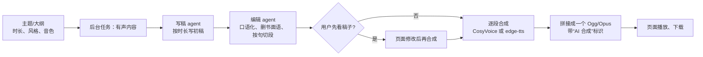

# 设计：有声内容生成（待确认，未实现）

用户给一个主题或一段大纲，写稿 agent 写初稿，编辑 agent 改成适合朗读的稿子，再用选定的音色（自己的克隆音色或 edge-tts）合成整段音频，在页面播放和下载。用于播客、睡前故事、学习材料。

## 用户流程

## agent 分工

| agent | 输入 | 输出 | 工具 | 预算 |
|---|---|---|---|---|
| `script_writer` | 主题、时长、风格 | 初稿（约每分钟 250 字） | 可选 `web_search`（用户勾选“需要查资料”时） | 0.05 元 |
| `script_editor` | 初稿 | 朗读稿：每段一句到三句，去掉括号、网址、表格；数字写成读法 | 无 | 0.03 元 |

为什么要两个：写稿要内容充实，编辑要读起来顺。合在一个提示里，模型常顾此失彼，长稿尤其明显。编辑 agent 还能检查长度，超出时长就删减。

## 合成

- 逐段合成，每段完成就更新进度（“已合成 12/40 段”）。失败的段重试一次，仍失败就整体失败并说明是哪一段。
- **克隆音色**走本机 CosyVoice。这台机器是 GTX 1060 6GB，合成比实时慢；10 分钟内容估计要十几分钟以上，并且合成期间语音对话的克隆回复要排队。第一版建议**限制 10 分钟**，CosyVoice 忙时优先让给实时对话。
- **edge-tts** 快得多，但要把文字发给微软在线服务（页脚已说明）。
- 拼接后转成 Ogg/Opus（复用带宽那步的 `to_ogg_opus`），10 分钟约 2.4 MB。

## 合规（上 SaaS 前必须做）

- 国内对 AI 生成的音频有标识要求（《人工智能生成合成内容标识办法》）：音频开头加一句提示音或口播“本内容由 AI 合成”，文件元数据里写入标识。具体做法上线前要再核对一次条文。
- 克隆音色只能用用户自己上传、并声明已获授权的声音（上传时已有这条提示）。不提供名人音色。

## 数据与接口

- 音频存 `data/users/<id>/audio/`，按用户配额（如 500 MB）。
- 任务类型 `audio_content`；结果 `{"text": 朗读稿, "audio_id", "seconds"}`。
- 新接口：`GET /api/audio/{id}`（播放/下载，只能取自己的）、`DELETE /api/audio/{id}`。
- 页面：新增“有声内容”卡片：主题、时长（1/3/5/10 分钟）、音色下拉、“先看稿子再合成”勾选框。

## 花费估算

两个 agent 加起来约 5 千 token 输入、5 千 token 输出（10 分钟稿），按 deepseek-flash 高峰价约 **0.05 元/篇**。合成在本机或 edge-tts，不花钱。

## 要你定的

1. 第一版默认“先看稿子再合成”，还是一次生成到底？
2. 时长上限定 10 分钟可以吗？

## 测试计划

- 假模型：写稿 → 编辑串联；编辑稿切段规则（无括号、网址，每段长度）；超长被删减。
- 合成用假的 `synthesize`，验证逐段进度、单段重试、失败说明、拼接时长、AI 标识存在。
- 浏览器：提交 → 进度 → 播放。
