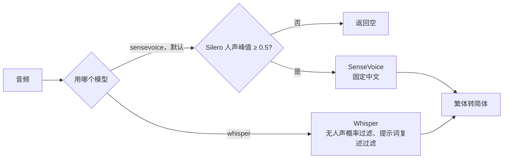

# 语音识别换成 SenseVoice

默认的语音识别从 Whisper base 换成了 SenseVoice Small。起因是摄像头麦克风缺少 3.4 kHz 以上的声音，Whisper 认不出短口令，比如“测试确认”认成了“特殊错误”。

| 文件 | 变化 |
|---|---|
| `app.py` | `transcribe` 按开关分派到 `transcribe_sensevoice` 或 `transcribe_whisper` |
| `prepare_asr.py` | 新增 `--sensevoice`，下载 SenseVoice 模型 |
| `requirements.txt` | 新增 `sherpa-onnx` |
| `static/app.js` | 状态卡片显示当前识别模型 |
| `work/compare_asr.py` | 新增：两个模型离线对比 |

## 为什么换

`work/compare_asr.py` 用同样的音频跑两个模型：

| 测试 | Whisper base | SenseVoice |
|---|---|---|
| 合成语音 24 句，完整音质 | 17 句全对 | 24 句全对 |
| 合成语音 24 句，切到 3.4 kHz 模拟摄像头麦克风 | 14 句全对 | 24 句全对 |
| 单独说“确认”（3.4 kHz） | “谢谢”“去吧”“去人” | 3 次都对 |
| 浏览器录下的 24 段真实说话 | “测试确认”一段也没认对 | 17 段认成“测试确认” |
| 每句耗时（中位数） | 727 毫秒 | 175 毫秒 |
| 进程内存 | 约 193 MB | 约 335 MB |
| 模型文件 | 142 MB | 239 MB（int8 ONNX） |

真实录音当时没有逐条记下实际说了什么，所以只能看出大方向，算不出准确率。

## 流程



## 关键：SenseVoice 不会返回“没听到”

替换前专门测了非人声：

| 输入 | SenseVoice 固定中文 | SenseVoice 自动检测语言 | Silero 人声峰值 |
|---|---|---|---|
| 静音 | “我。” | “그.”（韩语） | 0.02 |
| 白噪声 | “我。” | “그.” | 0.07 到 0.11 |
| 50 Hz 嗡嗡声 | “我。” | “我.” | 0.03 |
| 单个咔哒声 | “我。” | “I.” | 0.03 |
| 你的真实说话 | 正确 | 两段短话误判成日语 | 0.96 到 0.99 |

Whisper 有“无人声概率”，我们靠它过滤噪声。SenseVoice 没有这个值，它返回的事件标签也只认出了一部分噪声。如果直接替换，持续监听时房间里的噪声都会变成一个“我”发给模型。

所以识别前先用项目里已有的 Silero 检测：峰值低于 0.5 就当作没有人声，不调用 SenseVoice。

```python
if measure_speech(pcm)[0] < SPEECH_PEAK_MIN:
    return ""
```

噪声最高 0.11，真实说话最低 0.96，差距很大。这一步每次约多花 15 毫秒。

语言固定为中文，因为自动检测会把短的中文误判成日语。

## 切换和降级

| 情况 | 用哪个 |
|---|---|
| `models/sensevoice-small/model.int8.onnx` 存在 | SenseVoice |
| 模型不存在 | Whisper |
| 设置 `VOICE_ASR_PROVIDER=whisper` | Whisper |

Whisper 的代码和过滤逻辑原样保留。重新下载模型：

```bash
python prepare_asr.py --sensevoice
```

## 验证结果

| 检查 | 结果 |
|---|---|
| 后端测试 | 428 项通过，1 项跳过 |
| 前端测试 | 39 项通过 |
| 真实服务，你的三段录音 | 都识别为“测试确认” |
| 真实服务，白噪声 | 返回空 |
| 识别耗时 | 首次约 4.2 秒（加载模型），之后每句约 0.16 到 0.19 秒 |

| 真实麦克风的持续监听（2026-11-07） | 用户试用正常，包括识别、安静时不误触发、外放回声和打断 |

## 还没验证

- **确认流程的语音统计**：“确定执行”和“取消”各 20 次，原计划等新麦克风再测，现在换了模型，可以先用当前麦克风试。
- **服务重启后第一句会慢**：首次加载约 4 秒，没有做启动预热。
