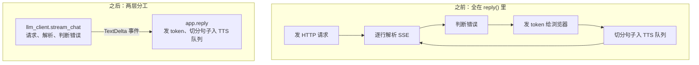
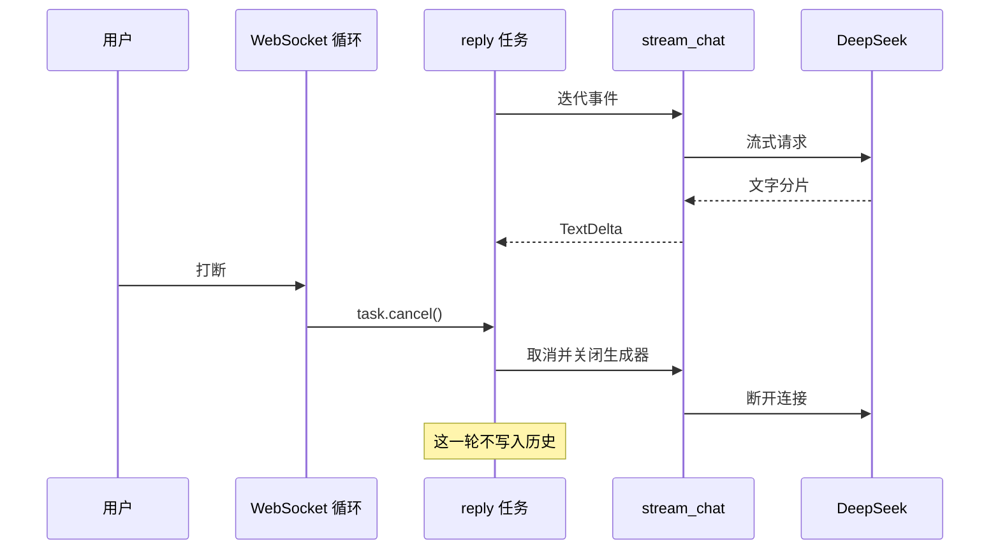
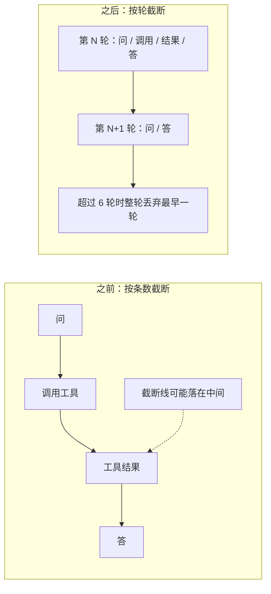

# 阶段 1 解析：无行为变化的重构

这一阶段没有新增功能，目的是给阶段 2 的工具循环腾出位置。总共做了两件事：把 LLM 调用从 `reply()` 里拆出来，把历史改成按轮保存。

| 文件 | 变化 |
|---|---|
| `llm_client.py` | 新增：请求 DeepSeek，把 SSE 流转成事件 |
| `conversation.py` | 新增：按轮保存对话历史 |
| `app.py` | `reply()` 改用上面两个模块，净减 15 行 |
| `test_llm_client.py`、`test_conversation.py` | 新增 13 项测试 |
| `test_app.py` | 未修改 |

## 步骤 1：抽出 `llm_client.py`

### 为什么要拆

原来一个 `reply()` 函数同时管三件事：网络请求、解析 SSE、把文字切段送去合成。阶段 2 要让 LLM 在一轮里被调用多次，这些逻辑必须能单独调用和测试。

### 流程图



### 代码解析

`stream_chat` 是一个**异步生成器**：每解析出一段文字就 `yield` 一次，调用方拿到后马上处理，所以流式效果和之前完全一样。

```python
@dataclass(frozen=True)
class TextDelta:
    text: str

async def stream_chat(base_url, api_key, model, messages):
    async with httpx.AsyncClient(...) as client:
        async with client.stream("POST", base_url + "/chat/completions", ...) as response:
            if response.status_code != 200:
                raise RuntimeError(auth_error(response.status_code))  # 401/402/429 转成中文提示
            async for line in response.aiter_lines():
                if not line.startswith("data:"):
                    continue                      # 跳过 keepalive 等非数据行
                payload = line[5:].strip()
                if payload == "[DONE]":
                    return                        # 流结束
                chunk = json.loads(payload)
                if chunk.get("error"):
                    raise RuntimeError("DeepSeek 返回错误，请检查账户及请求配置")
                ...
                if token:
                    yield TextDelta(token)        # 只把非空文字交出去
```

几个设计点：

- **为什么用 `TextDelta` 而不是直接返回字符串**：阶段 2 会增加工具调用事件，调用方按事件类型分支即可，接口不用再改。
- **参数由调用方传入**：`stream_chat` 不读全局配置，所以单独测试时不用启动整个应用。
- **错误信息不含上游原文**：抛出的文字会显示给用户，测试确认上游返回的内容不会混进来。

`app.py` 这边只剩业务逻辑：

```python
messages = [{"role": "system", "content": SYSTEM}] + history.messages() + [{"role": "user", "content": text}]
async with contextlib.aclosing(stream_chat(DEEPSEEK_URL, API_KEY, LLM_MODEL, messages)) as events:
    async for event in events:
        token = event.text
        ...  # 发给浏览器，切分后入 TTS 队列
```

### 打断时发生什么

这是最容易在重构中弄坏的地方。`contextlib.aclosing` 保证任务被取消时，生成器也会关闭，HTTP 连接随之断开，不会继续消耗 token。



## 步骤 2：历史改为按轮保存

### 为什么要改

原来按消息条数截断，每轮固定两条消息时没问题。加入工具后，一轮可能有四条或更多消息。按条数截断可能把调用和结果切开，留下一条找不到对应调用的 `tool` 消息，下一次请求就会出错。

### 流程图



### 代码解析

```python
MAX_TURNS = 6

class Conversation:
    def __init__(self):
        self.turns = []                          # 每个元素是一整轮的消息列表

    def add_turn(self, messages):
        self.turns.append(list(messages))        # 复制一份，调用方后续改动不影响历史
        del self.turns[:-MAX_TURNS]              # 只按轮丢弃

    def messages(self):
        return [message for turn in self.turns for message in turn]   # 展开成 API 需要的平铺列表
```

6 轮乘以每轮 2 条等于原来的 12 条。`test_keeps_the_same_twelve_messages_the_old_trim_kept` 把新旧算法并排跑 20 轮，确认结果相同，所以现有行为没有变。

`app.py` 里只有写入点变了：

```python
history.add_turn([{"role": "user", "content": text}, {"role": "assistant", "content": content}])
```

这一行仍在回复完整结束后才执行，所以被打断的回复依然不入历史。阶段 2 再处理“已执行的工具操作要记下来”。

## 验证结果

| 检查 | 结果 |
|---|---|
| 后端测试 | 112 项通过，1 项跳过（新增 13 项） |
| 前端测试 | 无失败 |
| 现有测试断言 | 未修改 |
| 真实 uvicorn 服务加模拟 DeepSeek | 连续两轮正常，音频正常合成 |
| 打断冒烟测试 | 上游连接确实被取消，被打断的一轮没有进入历史，下一轮正常 |

冒烟测试中，四次请求的消息数依次是 2、4、6、6。第四次仍是 6，说明第三轮被打断后没有写入历史。

**还没验证**：真实麦克风的语音对话和打断，以及真实 DeepSeek 接口。

## 下一步如何用到这些改动

阶段 2 会让 `llm_client` 再产出工具调用事件，由新的 `agent_loop` 消费；`Conversation` 的一轮里可以直接放入工具消息，不用再改截断逻辑。
