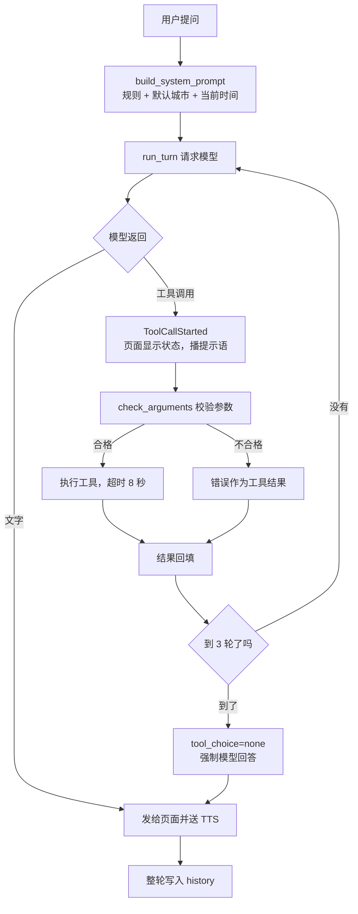
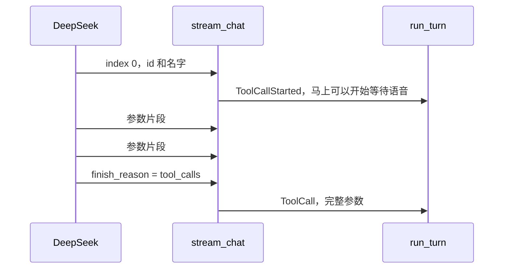
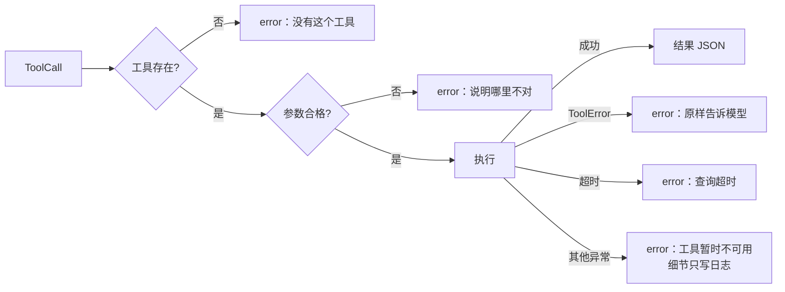
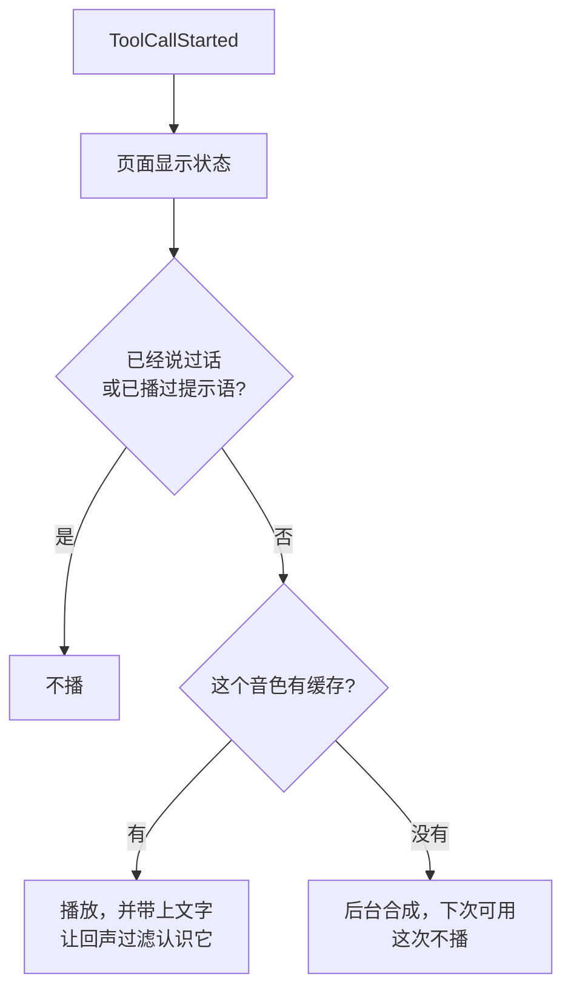

# 阶段 2 解析：工具循环和天气工具

这一阶段让助手第一次能“做事”：模型可以决定调用工具，拿到结果后再用口语回答。目前只有一个工具 `get_weather`，但循环、校验、等待语音都已经是通用的。

| 文件 | 变化 |
|---|---|
| `llm_client.py` | 除文字外，还产出 `ToolCallStarted` 和 `ToolCall` 事件 |
| `agent_loop.py` | 新增：多轮循环和系统提示 |
| `tools.py` | 新增：工具定义、参数校验、天气工具 |
| `fillers.py` | 新增：“我查一下”的音频缓存 |
| `app.py` | `reply()` 改为调用 `run_turn` |
| `work/spike_preamble.py` | 新增：测量“工具执行前先说话”的发生率 |

## 全局流程



## 步骤 1：解析流式工具调用（`llm_client.py`）

### 难点

工具调用的参数是一小段一小段流过来的，实测一次调用有 9 到 26 个分片。只有第一片带 `id` 和名字，后面只有参数片段。并行调用时要靠 `index` 区分。



### 代码解析

```python
for piece in delta.get("tool_calls") or []:
    index = piece.get("index", 0)
    call = calls.setdefault(index, {"id": "", "name": "", "arguments": ""})
    ...
    call["arguments"] += function.get("arguments") or ""     # 按 index 拼接
    if call["name"] and index not in announced:
        announced.add(index)
        yield ToolCallStarted(call["name"])                  # 一知道名字就通知
```

事件分两种，因为两者时机不同：`ToolCallStarted` 要尽早发出，让等待语音尽快开始；`ToolCall` 必须等参数完整。

```python
if finish_reason != "tool_calls":
    raise RuntimeError("工具调用不完整，请再说一次")
```

被截断的参数碰巧也可能是合法 JSON，比如少了后面的字段。现在只有只读工具，但阶段 3 之后有写操作，这里就是安全底线。

## 步骤 2：Agent 循环（`agent_loop.py`）

```python
async def run_turn(messages, registry, chat, on_event):
    added = []
    for round_number in range(MAX_TOOL_ROUNDS + 1):
        out_of_rounds = round_number == MAX_TOOL_ROUNDS
        options = {"tools": registry.schemas(), **({"tool_choice": "none"} if out_of_rounds else {})}
        content, calls = "", []
        async with contextlib.aclosing(chat(messages + added, **options)) as events:
            async for event in events:
                if isinstance(event, ToolCall):
                    calls.append(event)      # 收集起来，流结束后再执行
                    continue
                if isinstance(event, TextDelta):
                    content += event.text
                await on_event(event)        # 文字和开始事件实时转发
        if not calls or out_of_rounds:
            added.append({"role": "assistant", "content": content})
            return added
        added.append(assistant_message(content, calls))
        results = await asyncio.gather(*(registry.execute(call) for call in calls))
        added.extend({"role": "tool", "tool_call_id": call.id, "content": result} ...)
```

要点：

- **不依赖语音和网络**：`chat` 和 `on_event` 都由外部传入，所以测试可以写一个假模型，不用连网，也不用启动服务。
- **`added` 就是这一轮的全部新消息**：`app.py` 把它和用户消息一起写入历史，工具链保持完整。
- **并行执行**：`asyncio.gather` 让“北京和上海”两次查询同时进行，结果顺序和调用顺序一致。
- **防止死循环**：3 轮后加上 `tool_choice: "none"`，模型只能用文字回答。
- **打断**：任务取消会传到 `gather` 里正在等待的工具，测试确认工具确实被取消。

系统提示的顺序也有讲究：

```python
return base + TOOL_RULES + city + "当前时间：" + time.strftime("%Y-%m-%d %H:%M %A")
```

时间每分钟都变，放在最后可以让前面的内容保持稳定，有利于命中前缀缓存。

## 步骤 3：工具注册和参数校验（`tools.py`）

模型给的参数不可信，所以先校验，再执行。所有失败都变成工具结果交回模型，由模型用口语告诉用户。



`ToolError` 和其他异常要区分开：“找不到地点”是有用的信息，可以告诉模型；其他异常可能包含路径等内部细节，只写日志。

### 天气工具的一个坑

调试时发现 `上海市` 会被解析到**美国伊利诺伊州**的 Shanghai，而 `上海` 是对的。

```python
query = city.strip().removesuffix("市") or city
```

返回结果里还带上 `place`（国家、省、城市），这样模型和用户都能看到实际查的是哪里。

日期用 `past_days=1` 多取一天，因为“今天”要按那个地方的日期算，而这台机器是 UTC-5，日期可能比北京早一天。

## 步骤 4：等待语音（`fillers.py` 和 `app.py`）

克隆音色首段要约 2.4 秒，临时合成的话，提示语可能比答案还晚。所以只播已经缓存好的音频。



```python
if tool and tool.filler and first_token and not filler_played:
    filler_played = True
    audio = fillers.take((TTS_PROVIDER, VOICE, CLONE_ID), synthesize)
    if audio:
        await send_audio(rid, audio, FILLER_PHRASE)
```

- 缓存的键包含音色，换音色后不会播出旧声音。
- 每个音色在服务启动后第一次查询时不播提示语，从第二次开始才有。
- 这个功能的测试抓到过一个真 bug：回调的参数对不上，提示语一直合成失败，只留下一条警告。

## 和方案不同的地方

| 方案 | 实际 | 原因 |
|---|---|---|
| 提示语缓存到磁盘，3 到 4 句 | 内存缓存，1 句 | 重启后只需再合成一次短句，更简单 |
| 工具结果压缩成摘要 | 推迟到阶段 6 | 天气结果很短，网页搜索才需要 |
| 打断时记录已执行操作 | 推迟到阶段 4 | 目前只有只读工具，没有需要记录的操作 |

## 验证结果

| 检查 | 结果 |
|---|---|
| 后端测试 | 145 项通过，1 项跳过（阶段 1 后新增 33 项） |
| 前端测试 | 24 项通过 |
| 真实 Open-Meteo | 上海市、上海、北京、苏州都解析到中国 |
| 真实 uvicorn 服务加模拟 DeepSeek | 工具调用、真实天气结果、回填、播报都走通 |
| 提示语 | 第一次查询不播，第二次播“我查一下。” |
| 工具轮后打断 | 上游连接断开，被打断的一轮不入历史，工具轮的消息完整保留 |
| 真实 DeepSeek 加克隆音色 | 用户实际使用的 CosyVoice 日志显示，合肥明天和后天的天气回答正常，追问能接上上文 |

**还没验证**：

- 提前说话的发生率。`work/spike_preamble.py` 已写好，推迟到阶段 4 开始前运行。
