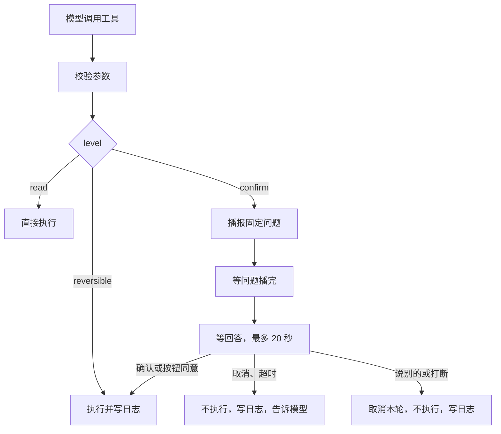
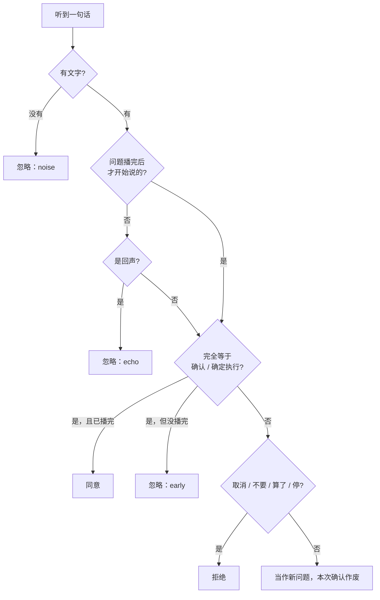
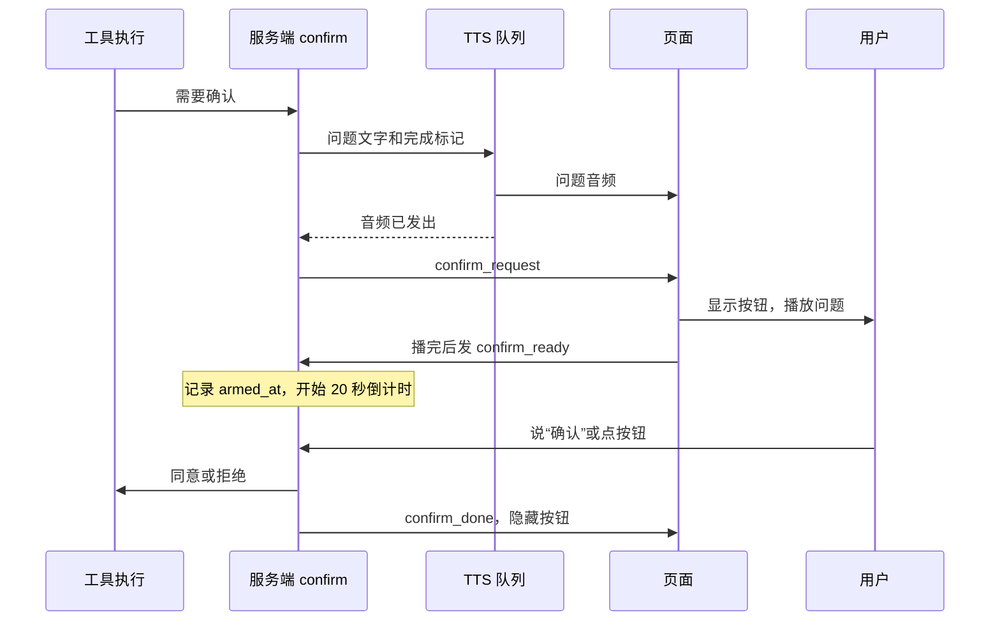
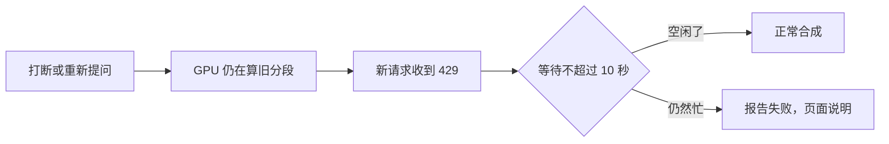

# 阶段 3 解析：权限分级和语音确认

这一阶段不增加用户能用的新功能，而是先把“安全闸门”建好：阶段 4 的记忆和提醒工具接进来时，直接使用这里的权限和确认。

| 文件 | 变化 |
|---|---|
| `tools.py` | 工具增加 `level` 和 `confirm_text`；新增写操作流程和演示工具 |
| `agent_loop.py` | 写操作逐个执行，只读工具仍然并行 |
| `memory_store.py` | 新增：SQLite 操作日志 `action_log` |
| `app.py` | 新增 `confirmation_action`、`PendingConfirmation` 和确认路由 |
| `static/app.js`、`index.html` | 确认按钮、播完通知 |
| `work/confirm_stats.py` | 新增：统计真实语音的确认结果 |

## 全局流程



## 步骤 1：权限等级（`tools.py`）

等级写在工具定义里，由代码判断，模型无法绕过：

```python
level: str = "read"       # read / reversible / confirm
confirm_text: str = ""    # 问题由代码写死，不让模型来写
```

`confirm_text` 写死有一个原因：如果问题由模型生成，它可能说“要查天气吗”，实际却在清空记忆。用户确认的问题必须和实际动作一致。

### 写操作的执行

```python
async def _write(self, tool, arguments, confirm, audit):
    detail = ""
    if tool.level == "confirm":
        try:
            approved, detail = await confirm(tool, arguments) if confirm else (False, "no_confirm")
        except asyncio.CancelledError:
            audit(tool.name, arguments, "interrupted", "")
            raise
        if not approved:
            audit(tool.name, arguments, "denied", detail)
            return {"cancelled": True, "message": "用户没有确认，操作未执行"}
    ...
    work = asyncio.ensure_future(finish())
    self.writes.add(work)
    work.add_done_callback(self.writes.discard)
    return await asyncio.shield(work)
```

- **默认拒绝**：没有提供 `confirm` 回调时，这类工具永远不会执行。
- **`shield` 保护写操作**：确认之前打断会取消操作；一旦开始执行，打断不会把它切成一半，日志也一定写入。
- **拒绝结果也交给模型**：这样模型能说“已取消”，而不是假装做完了。

### 执行顺序

```python
if all(registry.is_read(call.name) for call in calls):
    return await asyncio.gather(...)              # 只读：并行
return [await registry.execute(...) for call in calls]   # 写操作：逐个
```

用户一次只能回答一个问题，写操作的先后顺序也可能有意义。

## 步骤 2：判定回答（`confirmation_action`）

这是最关键的函数。所有规则都在一个纯函数里，不用麦克风就能完整测试。



```python
def confirmation_action(heard, playing, armed):
    words = re.sub(r"[\W_]+", "", heard)
    if not words:
        return "ignored", "noise"
    if not armed and is_own_voice(heard, playing):
        return "ignored", "echo"
    if words in CONFIRM_YES:
        return ("approve", "") if armed else ("ignored", "early")
    if words in CONFIRM_NO or STOP_COMMAND.fullmatch(heard.strip()):
        return "deny", ""
    return "question", ""
```

### 三个不明显的坑

**1. 回声检查只能在播放期间做。** 问题播完后，文字还留在 `recent_text` 里，其中包含“确认”二字。如果这时还做回声检查，用户真心说的“确认”也会被判成回声，永远确认不了。

**2. 要看这句话什么时候开始，不是什么时候识别完。** 提示音的尾巴可能在播放期间被录下，等 Whisper 识别完时，确认窗口已经打开了。所以用音频长度倒推开始时间：

```python
hear_queue.put_nowait((audio, False, time.monotonic() - len(audio) / PCM_BYTES_PER_SECOND))

def accepts(self, started):
    return self.armed_at is not None and started >= self.armed_at
```

音频里含 0.3 秒预录和句尾静音，所以判定偏严格：问题播完马上抢答可能被忽略，页面会提示再说一次。这个方向的误差是安全的。

**3. 短词规则要绕开。** 普通监听中，播报时短于 2 字的话会被忽略。确认分支在 `hearing_action` 之前处理，所以不受影响。

## 步骤 3：确认的时序（`app.py` 和页面）



`speak_worker` 按顺序处理队列，所以把一个 `asyncio.Event` 放在问题后面，它被取到时就说明问题音频已经发出：

```python
if isinstance(sentence, asyncio.Event):
    sentence.set()
    continue
```

`PendingConfirmation.answer` 同时会结束“等播完”，所以用户在播放中点按钮或说“取消”，不用等问题播完。

确认期间的其他处理：

- 监听到持续说话时**不暂停**播放，因为问题必须听完。
- 确认绑定在 `request_id` 上，旧回合的回答会被丢弃。
- 只有 `approved` 严格等于 `true` 才算同意，其他值都按拒绝处理。
- 打断或说别的内容时，页面发起新回合，任务被取消，`CancelledError` 让工具不会执行。

### 按键说话的限制

按下“开始说话”会立即开始新回合，从而取消确认。所以按键说话模式下只能点按钮，语音回答需要开启持续监听。

## 步骤 4：操作日志（`memory_store.py`）

```sql
action_log(id, tool, args_json, source, outcome, detail, created_at)
```

| 字段 | 取值 |
|---|---|
| `source` | `listen` 持续监听，`audio` 按键说话，`text` 打字 |
| `outcome` | `executed`、`denied`、`interrupted`、`failed` |
| `detail` | `voice:确认`、`button`、`timeout` 等 |

日志写入失败不会影响回复，只记一条错误。文件在 `data/agent.db`，只保存在本机，不进 git。

## 演示工具和验收

没有真实的危险工具时，用 `demo_confirm` 测试。它什么也不做，默认关闭，用 `./start.ps1 -DemoConfirm` 启动时才可用，页面的“可用工具”会显示它。

演示模式下，“测试确认”这句话由 `demo_chat` 代替模型处理，不发给 DeepSeek，所以统计结果只反映麦克风、Whisper 和确认流程。

实测时模型一开始没有调用这个工具，原因之一是规则写成了“需要实时信息时才调用工具”。规则已改为“需要实时信息或用户要求执行操作时调用工具”，否则阶段 4 的记忆和提醒也会受影响。

只在演示模式下，确认期间听到的文字才会记录到本地日志（`confirm_heard`），用来统计识别率。

## 实测发现的问题：克隆服务忙时整段没声音

打断只会断开 HTTP 请求，GPU 上正在合成的那一段还会算完，这期间新请求会收到 429。原来的代码把它当成失败，这一轮之后的语音全部放弃，页面状态也不再更新。



现在 `synthesize_clone_when_free` 每 0.25 秒重试一次，最多等 10 秒。实测连发 4 次时，最后一次等了约 7 秒才出声，但语音完整。`stream` 播放模式没有加这个重试。

## 实测发现的问题：摄像头麦克风缺高频

真实语音总被认错。逐步排除后，结论如下：

| 怀疑 | 检查 | 结果 |
|---|---|---|
| 噪声或音量 | 测量录音 | 排除：语音 -9 到 -18 dB，信噪比超过 50 dB |
| 页面逐块降采样 | 模拟对比 | 影响很小 |
| 解码参数、提示词、VAD | 换参数重试 | 排除：换了也认不对 |
| 缺高频 | 频谱分析 | 3.4 kHz 以上能量约为 0，干净语音约 3% |

把干净语音切到 3.4 kHz 后，正确数从 13/18 掉到 9/18，切到 3 kHz 时是 6/18，错误也相似。长句基本不受影响。

绕过浏览器用 `work/record_raw_mic.py` 直录，高频同样只有 0.08% 到 0.12%，所以高频不是浏览器丢的，问题在麦克风硬件或它的驱动。

另外，单独的“确认”连干净语音都是 0/3，这是 `whisper-base` 的弱点，所以问题改为要求说“确定执行”（干净语音 3/3）。“确认”仍然算同意，只是不再提示。这个麦克风下语音回答可能失败，失败时不会执行，页面按钮是可靠的备用方式。`work/diagnose_audio.py` 现在会报告“缺高频”。

## 和方案不同的地方

| 方案 | 实际 | 原因 |
|---|---|---|
| 确认只提到语音和按钮 | 按键说话模式只能用按钮 | 按键本身会开始新回合 |
| 外部内容触发权限升级 | 放到阶段 6 | 现在没有读取网页的工具 |
| 持续监听时显示撤销按钮 | 放到阶段 4 | 现在没有可撤销的工具 |

## 验证结果

| 检查 | 结果 |
|---|---|
| 后端测试 | 203 项通过，1 项跳过 |
| 前端测试 | 29 项通过 |
| 真实 uvicorn 服务加模拟 DeepSeek | 问题先播报，按钮同意会执行，拒绝不执行，日志正确 |

**还没验证**：真实麦克风的识别率、外放回声下的表现、页面按钮的实际显示。
