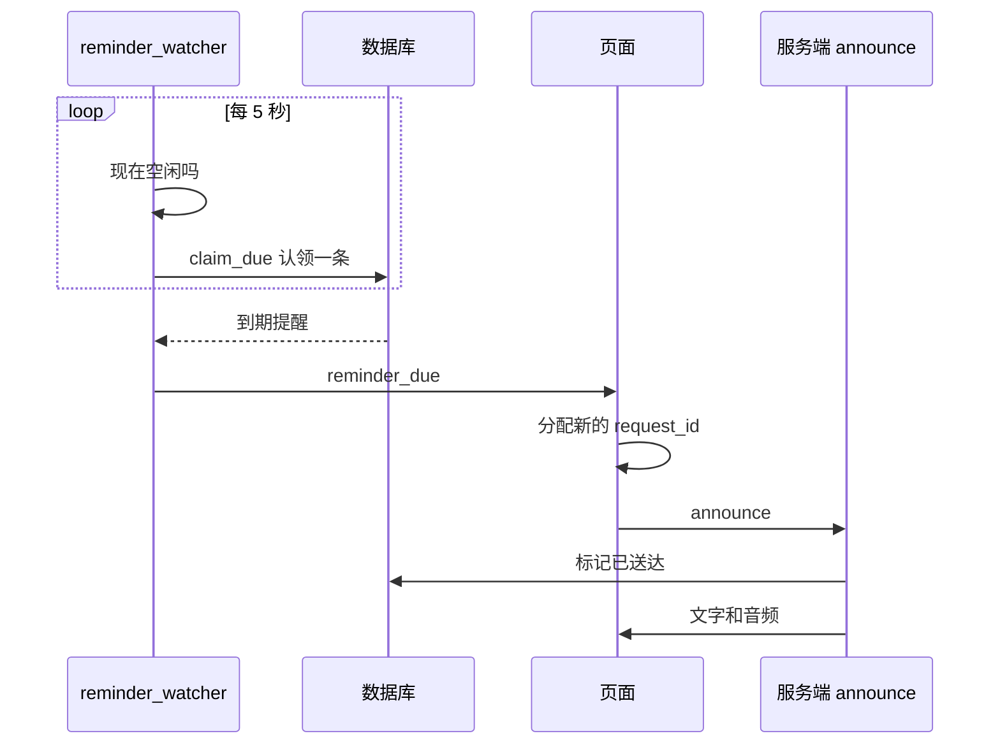
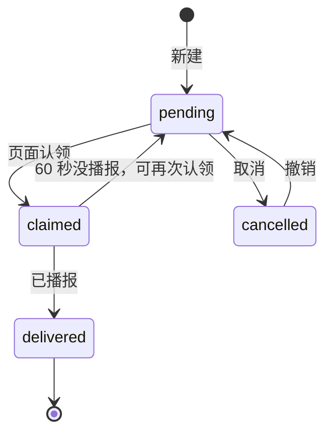
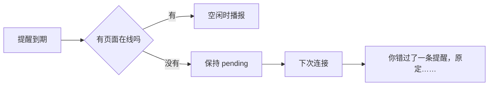

# 阶段 5 解析：提醒和主动播报

到这一阶段，助手第一次**主动开口**：不是用户问了才答，而是到点自己说话。难点不在存提醒，而在时机：不能打断用户，不能重复播报，也不能因为页面关了就丢掉提醒。

| 文件 | 变化 |
|---|---|
| `memory_store.py` | 新增 `ReminderStore`：状态流转和原子认领 |
| `tools.py` | 新增 `set_reminder`、`cancel_reminder`、时间朗读 |
| `agent_loop.py` | 待办提醒注入提示 |
| `app.py` | 后台扫描 `reminder_watcher`、播报 `announce`、提醒接口 |
| `static/app.js`、`memories.js` | 响应到期通知、提醒列表和撤销 |

## 全局流程



为什么要绕一圈让页面发起：`request_id` 由页面分配，页面会丢弃编号不符的消息。让页面开一个新回合，提醒就能走现有的显示、播放和打断逻辑，不用另写一套。

## 步骤 1：状态和原子认领（`memory_store.py`）



两个标签页同时在线时，靠一条带条件的 `UPDATE` 决出唯一赢家：

```python
won = connection.execute(f"UPDATE reminders SET status = 'claimed', claimed_at = ? WHERE id = ? AND {available}", ...).rowcount
return {...} if won else None
```

只有真正把状态改掉的那次调用 `rowcount` 为 1，另一个页面什么也拿不到。

**认领过期**：页面认领后可能马上关闭。60 秒内没有播报，提醒可以重新被认领，不会丢。

**时间格式**：统一存成定长的本地时间，这样 SQL 里比较文字就等于比较时间。

## 步骤 2：提醒工具（`tools.py`）

| 工具 | 等级 | 说明 |
|---|---|---|
| `set_reminder` | reversible | 模型把“明天下午三点”换算成具体时间 |
| `cancel_reminder` | reversible | 按编号取消 |

模型负责理解时间，代码负责校验：

```python
def parse_due(text):
    try:
        due = datetime.fromisoformat(text.strip())
    except ValueError as error:
        raise ToolError("due_at 必须是 YYYY-MM-DDTHH:MM:SS 格式") from error
    return due.astimezone().replace(tzinfo=None) if due.tzinfo else due
```

- 格式不对或时间已过，都作为错误交回模型，由它向用户确认。
- 带时区的时间会转成本地时间。

**朗读完整时间**是防错的关键。设置成功后说“提醒设好了，11月7日下午3点：开会”，而不是“好的”。模型算错日期时，用户能当场听出来。

## 步骤 3：空闲才开口（`app.py`）

```python
def can_interrupt_nobody():
    speaking = detector is not None and getattr(detector, "audio", None) is not None
    return not (reply_active() or recording or speaking or claimed)
```

| 情况 | 判断依据 | 结果 |
|---|---|---|
| 正在生成或等待确认 | 回复任务未结束 | 推迟 |
| 页面还在播放 | `playing_text` | 推迟 |
| 按键录音中 | `recording` | 推迟 |
| 用户正在说话 | 检测器有未结束的音频 | 推迟 |
| 已有一条在播 | `claimed` 非空 | 推迟，一次一条 |

先判断空闲再认领，所以推迟时提醒仍是 `pending`，不会卡在中间状态。

## 步骤 4：播报（`announce`）

```python
text = agent_tools.reminder_speech(reminder)
agent_tools.reminders.mark_delivered(reminder["id"])
await send("token", rid, text=text)
```

- **不经过模型**：提醒内容原样播报，没有费用，也不会被改写。
- **文字优先**：文字一定显示。语音失败时显示警告，提醒仍算送达。
- **准时和迟到说法不同**：超过 2 分钟就说“你错过了一条提醒，原定……”。
- **防伪造**：`announce` 只接受这个连接认领过的提醒，页面不能随便让服务端播报。

## 步骤 5：错过的提醒



扫描任务跟着 WebSocket 连接运行，所以没有页面时什么也不发生，提醒就留在数据库里。服务重启也不影响，因为状态都在磁盘上。

## 页面和浏览器限制

到期通知到来时，页面调用 `unlockAudio()`。但浏览器的自动播放策略可能阻止声音：如果页面一直没有被点击过，也没有开麦克风，**提醒文字会显示，但可能没有声音**。开着“持续监听”，或者在页面上操作过，就没有这个问题。

## 和方案不同的地方

| 方案 | 实际 | 原因 |
|---|---|---|
| 有 `list_reminders` 工具 | 没有，待办直接注入提示 | 省一轮工具调用，取消时也能直接拿到编号 |
| 独立的 `scheduler.py` | 放在 WebSocket 连接里 | 只有在线页面能播报，空闲判断也都在这里 |

## 验证结果

| 检查 | 结果 |
|---|---|
| 后端测试 | 286 项通过，1 项跳过 |
| 前端测试 | 35 项通过 |
| 到期通知延迟（真实服务，3 次） | 2.0、2.1、2.8 秒，理论上限约 5 秒 |
| 两个页面同时在线（3 次） | 每次只通知 1 个 |
| 服务关闭期间到期 | 重启后说“你错过了一条提醒” |
| 播报后 | 待办列表清空 |

延迟只算到页面收到通知。克隆音色还要再加约 3 秒合成，文字会先显示。冒烟使用临时数据库和模拟 DeepSeek。

**还没验证**：真实 DeepSeek 对口语时间的换算、浏览器里的实际播放。
